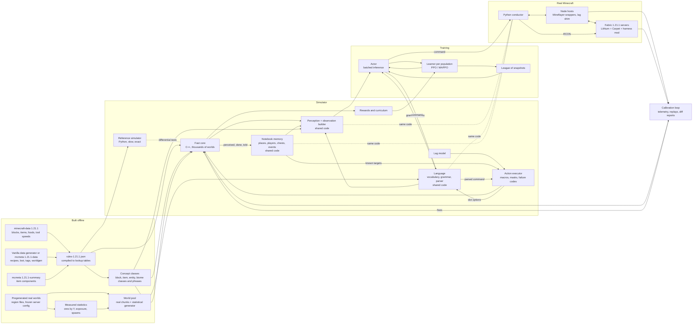

# Minecraft Hivemind

Design document for two teams of 10–20 learning Minecraft agents.

Draft 0.5, 2026-10-16. Status: M0 done (rules build, class tables, vocabulary, bridge config), and checked against the real game on the owner's PC on 2026-10-19 (4.1, 11.2); M1 under way (language layer, world, perception, navigation, inventory, crafting, loot); see the repository. Nothing is trained yet. Written to be picked up after the current project (WAI). Draft 0.2 applied an engineering review and an ML review of draft 0.1. Draft 0.3 adds section 9.1, the owner's emergent-language arm. Draft 0.4 applies the owner's requests of 2026-10-16: natural language for all actions and observations (sections 5, 6.2, 9), explicit memory (6.3), inert ports for a later LLM (6.5), container verbs (5, 10), and a goal section shared by the agent and a later LLM, with the plan for wiring the two into one AI (6.6, M11). Draft 0.5 applies the owner's second round of requests of 2026-10-16: surface-only vision (6.1), a semantic panorama and a bigger network preset (6.2, 6.4, 13), and the debug screen's facts as inputs, with biomes (6.2). It also records the M1 review's findings (4.2, 4.3, 5). The interfaces between modules are fixed in `docs/contracts.md` (cited below as "contracts").

**Labels.** [n] points to the References. **[mem]** means written from memory and not checked against a source; verify it against the pinned game version before relying on it. **[est]** means an estimate that must be measured. Everything else is a design choice or comes from a cited source.

## 1. Vision and research questions

> "My next project will be a hivemind of 10-20 AI Minecraft agents. I'll pit them in the same world as another team of 10-20 agents to see how they learn and interact. Do they learn to fight for resources or work together? The first big hurdle would be training a single agent to play Minecraft." (the owner, condensed)

The owner's design ideas:
- Simulate Minecraft the way WAI simulates Worms Armageddon (WA), then speed it up.
- Copy mechanics exactly; make randomness statistically right.
- Add variable lag so the agents can cope with online play.
- Use the owner's own high-level actions (craft pickaxe, mine block, chat).
- No LLM.
- Teach item meanings by chatting, and see whether the agent learns to ask for items.
- Write every action as an English command (`mine 4 iron ore.`), in the same words that name what the agent sees, so it can learn what the words mean.
- Keep a couple of spare layers so an LLM can be hooked up later ("neural surgery"). Until then, no LLM is in the loop (6.5).
- Give each agent an explicit memory: where things were, who is an enemy, how much is in a chest (6.3).
- Later, wire an LLM to the trained agent so the two work as one AI: the LLM a slow "prefrontal cortex" for long-term strategy, the hivemind the fast "lizard brain" that acts and understands the world. They share a goal section that both can read and write (6.6). This is the last milestone (M11), so that training starts as soon as possible.
- See only what the agent's eyes could see from where it stands: surface blocks, no X-ray (6.1).
- A bigger network for the new PC (two RTX 3090s, 32 cores, 64 GB), with a low-resolution image of the landscape in which each block is a slightly different color, and a wider block window (6.2, 6.4, 13).
- The debug screen (F3) as inputs: coordinates, facing, the block looked at, time of day and time passed (6.2).

In the owner's words:

> "I want natural language to be used in all actions so that the model can hopefully learn the words associated with actions/items/blocks/entities/ect." (the owner, 2026-10-16)

> "I want a couple extra layers of neurons available to hook up to a LLM eventually. Like neural surgery so that the LLM can use this to learn how to control Minecraft directly." (the owner, 2026-10-16)

> "How do you plan on handling the memory? How will it remember where things were? Who is an enemy? How much stuff it put in a chest?" (the owner, 2026-10-16)

> "Basically Im thinking the LLM can act as a slow prefrontal cortex capable of longerterm statigic thinking. The hivemine AI will be more like the lizzard brain capable of fast acting and understanding the world." (the owner, 2026-10-16)

> "Im thinking about having a goal section be useable by both the hivemine and the LLM. But also literally wiring a LLM to the hivemine AI neuron to neuron, creating a single AI" (the owner, 2026-10-16)

> "I only wanted to be able to see surface level blocks, so that way it's not cheating or seeing underneath things like x-ray." (the owner, 2026-10-16)

> "Is 5.6 million a little bit small ... my Worm AI is like 15 million ... this build is going to be for my upgraded PC, which is going to have two RTX 3090s, a 32-core CPU, and 64 gigabytes of RAM ... So if we can up the scale up to maybe even 30 million, that would be feasible ... letting it see a low resolution image of the landscape in front of it, where each block is just simply a slightly different color ... maybe we can make [the voxel encoder] a little bit bigger so it could have a bit more range around it." (the owner, 2026-10-16, condensed)

> "Does it have access to a lot of the debug menu that's found in Minecraft, such as your coordinates, the angle that you're facing, the block you're looking at, the time of day, the amount of time that's passed in the world? I wanted to be able to have access to those as inputs." (the owner, 2026-10-16)

### 1.1 Research questions

| # | Question | Answered by |
|---|---|---|
| RQ1 | Can a small non-LLM network, trained almost entirely in a simulator, survive and progress (wood, stone, iron, nights) in real Minecraft? | The same held-out seeds, run in the simulator and in the real game |
| RQ2 | When two teams share a world, do they fight, avoid each other or cooperate? How does that depend on scarcity and on reward sharing within a team? When they fight, is it a social dilemma or simply the best strategy? | The experiment plan, cross-play and payoff analysis (section 10) |
| RQ3 | Can a fixed-vocabulary chat carry stable, human-readable meaning? Do agents start asking for items without being taught to? Can they pick up a new word from a partner during play? | Request success, a no-imitation arm, nonce-word episodes, drift checks, sessions with the owner (section 9) |
| RQ4 | Does training with lag noise make the agents robust on laggy servers? | Real-game evaluation under three lag profiles |
| RQ5 | Does naming every action, item, block and entity with shared English words help? Does it speed up learning, carry over between related words (`iron ore`, `deepslate iron ore`, `raw iron`), and let the agent understand new combinations of known words in requests and, once trained to obey, in typed commands? | An ablation with opaque ids instead of words (6.4); held-out word combinations in requests (9); the instruction-following arm, which trains and scores obeying typed commands (9) |

RQ2 has no yes/no answer. The expected result is a map of which settings lead to conflict, avoidance or cooperation, with error bars over seeds.
- "Scarcity changes nothing" is a valid result, but only if the agents are competent. That is why RQ1 comes first.
- "They fight" is not a finding on its own. If attacking pays more whatever the other team does, there is no dilemma, only a dominant strategy. Section 10.4 measures the payoffs to tell the two cases apart.

### 1.2 What success means at each stage

| Stage | Success |
|---|---|
| Rules | All recipes and smelts match the real game. Break times logged on the server match within ±1 tick |
| One agent, simulator | On 1,000 held-out seeds, with honest, visible-only perception (6.1): iron pickaxe in ≥80% of episodes; first night survived in ≥80% |
| One agent, real game | Real/sim success ratio ≥0.8 per milestone in each of three evaluation profiles, at the fixed sample size in 11.5 |
| Language | The word model matches or beats the opaque-id ablation on the single-agent exit test. Held-out word combinations (requests whose pairing of words never occurred in training) are answered correctly above chance. Typed commands are scored separately, in the instruction-following arm (9), because only that arm trains the agent to obey them |
| Chat | With scripted helpers, ≥70% of `i need … x` requests succeed. Nulling the messages lowers team return. Agents use a nonce word correctly within an episode. The owner gets ≥15 of 20 requests answered |
| Teams | Two independently trained populations of 10–20 agents train stably. Metrics have 95% intervals over ≥8 seeds and differ from scripted baselines. There is a payoff matrix per scarcity level |

The thresholds are proposals [est], so that each stage has a finish line.

## 2. Design principles

1. **Mechanics exact, randomness statistically right.** Deterministic rules are generated from game data and copied exactly. Random processes are sampled from the game's own tables, or from statistics measured on real worlds under one frozen server config. Emergent behavior (mob AI, ore exposed in caves) is measured, not derived.
2. **High-level actions, written in English.** The policy writes a command such as `mine 4 iron ore.` or `give 3 bread to red 7.`, word by word, from one shared vocabulary (section 5). The same words name what the agent sees (6.2) and what it says (9). Movement is scripted.
   - VPT reports that RL from scratch on raw controls never learned to collect logs reliably [35].
   - DreamerV3 needed a faster block-breaking setting from prior work, and 9 days on an A100 [36].
3. **No LLM in the loop.** LLM agents such as Voyager [45] and Mindcraft [46] are slow (about 9.2 s per GPT-4o response in PillagerBench [48]) and learn no weights. Their social behavior comes from human text; Project Sid states that its institutions do not emerge from scratch [47]. They may serve as baselines, never as the learner. The network reserves inert ports so an LLM can be coupled in later (6.5); until then they change nothing.
4. **Simulator plus bridge, as in WAI.** Train in a fast simulator. Play the real game through Mineflayer, which takes the WormKit module's place. Keep checking one against the other, as WAI's dream-vs-WA checks do.
5. **Lag is noise.** Stale observations, round trips, stretched durations and failed actions are randomized, so the policy must check results.
6. **One featurizer, one perception function, one action contract, one language.** The simulator and the bridge share observation code, perception, memory, masks, failure codes, and the vocabulary and parser. Two copies would drift apart.
7. **Memory is explicit and honest.** Each agent keeps a notebook of places, players, chests and events (6.3). It holds only what the agent itself perceived, did or was told, never hidden state.
8. **The server is the ground truth.** Mineflayer's local view can be wrong; for example, it marks a block as broken before the server agrees [74]. Rule checks are therefore logged on the server.
9. **Everything measurable.** Every stage has a numeric exit test with a fixed sample size. Statistical checks are equivalence tests, not "failed to reject". Social claims rest on metrics, controls and baselines, not on stories from logs.
10. **Throughput first.** One process steps thousands of worlds, with no Python per world. Invalid actions are masked, not penalized.

## 3. Architecture overview



| Component | Location and format |
|---|---|
| Interfaces between modules | `docs/contracts.md` |
| Rules build: fetch pinned sources, merge, cross-check, compile | `hivemind/rules/` → `data/rules-1.21.1.json` (pins in `data/sources.json`) → `rules-1.21.1.bin` for the core (planned) |
| Concept classes: block, item, entity and biome classes with their phrases, shared by the featurizer, perception, the nav grid and the language | `hivemind/rules/` → `data/concepts-1.21.1.json`, `data/block_classes-1.21.1.csv` (one row per block state) |
| Language: vocabulary, command grammar, parser, masked word-by-word decoding | `hivemind/lang/` → `data/vocab-1.21.1.json` |
| World pool: pristine worlds, copied on reset | `worlds/seed-<n>.npz` (uint8 voxels plus metadata) |
| Reference simulator: readable Python, the oracle (includes the reference perception and the 20 verbs) | `hivemind/sim/ref/` |
| Fast core: batched, multithreaded C++ | `sim/core/` (planned), C ABI called through ctypes or nanobind |
| Observation builder and notebook memory, shared by the simulator and the bridge | `hivemind/features/` |
| Rewards, curriculum, trainer, league | `train/` (planned) |
| Bridge: conductor, Node hosts, server config, harness mod | `bridge/` |
| Calibration: telemetry, replays, diff reports | `calib/` (planned) |
| Run records: git hash, rules hash, concepts and vocabulary hashes, world-pool hash, config | `runs/<id>/run.json` |

The `hivemind/`, `data/` and `bridge/` directories exist in the repository; `sim/core/`, `train/` and `calib/` are planned; `worlds/` and `runs/` hold generated outputs and are git-ignored.

## 4. Simulator specification

### 4.1 Version pin and data sources

**Pin one Java Edition version and never mix versions.** Recommendation: **1.21.1** (D1).
- Mineflayer ("1.8 to 26.1" [5]), minecraft-data [2] and mcmeta tags [3] cover both 1.21.1 and 26.1. The current release is 26.3 [26].
- 1.21.1 wins because it is the long-lived Fabric/NeoForge modding version [mem], prismarine-provider-anvil documents it [10], it predates the 1.21.2 recipe and food-component format changes [mem], and Mineflayer only added 26.1 in 4.38.0 [5]. 26.1 is closer to what public servers run.
- Rules are generated by script, so re-pinning later costs a rebuild and a recalibration, not a rewrite.
- Names change between versions. The 1.21.1 gamerules `playersSleepingPercentage` and `commandModificationBlockLimit` were later renamed (`players_sleeping_percentage`; `max_block_modifications` since 25w44a) [73]. Every script and config is keyed to the pinned version.

| Source | Used for | Known problems |
|---|---|---|
| minecraft-data `pc/1.21.1` [1] | Hardness, `material` (tool tag), `harvestTools`, light, block states; stack sizes, durability; tool speeds (wood 2, stone 4, iron 6, diamond 8, netherite 9, gold 12); recipes; foods | **`blockLoot` and `entityLoot` point to the 1.20 files for every newer version [2] and contain errors.** Coal ore shows 1–2 coal at 0.5; gravel gives flint at 1/3, not 10%. It has no tags, smelting, fuel, mob stats or spawn lists. Entities and block collision shapes point to the 1.20.5 files [2] |
| Vanilla data generator [4] (`java -DbundlerMainClass="net.minecraft.data.Main" -jar server.jar --server`), or mcmeta `1.21.1-data` [3] | Recipes, including smelting `cookingtime` and `experience`; loot tables; tags (`mineable/*`, `needs_*_tool`); placed ore features; biome spawners | Hardness, fuel, and mob stats and AI live in Java code |
| mcmeta `1.21.1-summary` [3], `item_components/data.json` | Per item: stack size, durability, food, tool rules and mining speeds, attack damage and attack speed (attribute modifiers) | No armor values and no fuel times (both hard-coded with labels). Attack values are modifiers on the player's base of 1 damage and 4 attacks/s [mem] |
| minecraft.wiki [13–22][72][73] | Formulas, fuel values, mob stats, gamerules | Written by players; must be verified |
| Real game, via the bridge and the harness mod | Final authority | Slow |

The build script (`hivemind/rules/`) takes loot, recipes, tags and worldgen from the generator's output (mcmeta `1.21.1-data`), item properties from the item components and minecraft-data, and everything else from minecraft-data. Where sources overlap it cross-checks them and fails on any disagreement: recipes in both; stack sizes, durability and food; harvest tools against tool rules plus the `needs_*_tool` tags; tool speeds. Known differences in representation are listed in the build script, each with a reason. The exact upstream commits are pinned in `data/sources.json` (contracts section 1). The built `data/rules-1.21.1.json` is committed, so the project builds offline.

**Checked against the real game** (owner's PC, 2026-10-19; `bridge/server/servertool.py check-generator` on the vanilla 1.21.1 data generator run with `--reports`). The generator's output agrees with the rules on every loot table (1,082), recipe (1,290: ids, results, cooking time, experience), block and item tag (331, resolved), block state range (1,060 blocks), item stack size, durability and food (1,333 items), and protocol id (2,523 blocks, items and entity types). The last check confirms that the entity ids, taken from minecraft-data's 1.20.5 files, are right for 1.21.1. Its 3,894 data files equal mcmeta's except four flat-world presets, which list `structure_overrides` (a set of structure sets) in another order; the check now compares that list as a set and reports the four as tolerated.

### 4.2 Exact, approximate, skipped

| Area | v1 | Notes |
|---|---|---|
| Breaking, harvest rules | **Exact** | Formula in 4.3 |
| Drops | **Sampled** from the vanilla loot tables | No Fortune or Silk Touch |
| Crafting 2×2, and 3×3 at a table | **Exact** | |
| Smelting, fuel | **Exact**; each furnace is a scheduled event | 200 ticks per item. Fuel: coal 1600 ticks, coal block 16000, lava 20000, log 300 [20]; planks 300 and stick 100 [mem] |
| Hunger, regeneration, starvation | **Exact** | [14] |
| Clock, beds, night skip | **Exact** | 24,000 ticks per day [15]. The night is skipped only when `playersSleepingPercentage` of the players sleep; the default is 100 [73] |
| Chunk ticking | **Exact rule** | Mobs and dropped items advance only in chunks inside the simulation-distance square of some agent [72]; furnaces probably stop too [mem], which the harness checks in M2 |
| Combat, armor, durability, stack sizes | **Exact** | [17][18] |
| Stacks by class | **Approximate** | Inventories hold item classes, so members of a class share stacks in the simulator but not in the game: 20 oak and 20 birch logs fill one slot here and two in the game. Slot use and the moment the inventory is full (`INV_FULL`) can differ, never the count held per class (`hivemind/sim/ref/inventory.py`; concepts `exceptions`). Checked in M7 |
| Crafting from mixed members | **Exact at class level; the bridge must match it** | One craft may mix members of a class (oak and birch planks) and the alternatives of a slot (coal or charcoal in a torch), as the game's tag ingredients allow. A Mineflayer recipe names specific items, so the bridge's `craft` must build its recipe from the items actually held (M2) |
| Mob stats | **Exact** once checked | Zombie: 20 HP, 2 armor [19]; other mobs [mem] |
| Perception | **Exact by definition** | One function in the core and the bridge (6.1) |
| Movement | **Approximate** | Nav grid with pathfinder's movement rules; durations fitted to telemetry (4.5) |
| Light | **Approximate** | Block light by BFS; sky light from the heightmap |
| Hostile spawns | **Measured** | Rate per dark cell under the frozen server config, with the vanilla caps and distances |
| Mob AI | **Measured** | Chase on the nav grid; hits with a measured hit chance; creeper fuse exact |
| Knockback | **Approximate** | Fixed displacement plus a short stun |
| Ores, trees | **Real chunks plus statistics** | No reimplementation of noise worldgen |
| **Skipped** | | Redstone, enchanting, brewing, villagers, Nether and End, fluid flow (water and lava are static), fire, crop growth, exact collisions, vehicles, rain and storms |

### 4.3 Exact formulas (v1 core)

**Breaking** [13]:
```
speed = toolSpeed if the tool's tag matches the block, else 1
if speed > 1 and Efficiency: speed += eff^2 + 1
speed *= (1 + 0.2*haste) * fatigue_factor   # fatigue_factor: 0.3, 0.09, 0.0027, 0.00081 for levels 1-4 [mem]
underwater without Aqua Affinity: *0.2 ; not on the ground: /5
dmg = speed / hardness / (canHarvest ? 30 : 100)
dmg >= 1: instant ; else ticks = ceil(1/dmg), then 6 ticks before the next block
```
Check values (this formula): stone with a wooden pickaxe 23 ticks; stone by hand 150 (no drop); log by hand 60, with a wooden axe 30; obsidian with a diamond pickaxe 188. Hardness −1 is unbreakable. Draft 0.3 wrote the fatigue factor as `0.3^min(fatigue, 4)`; the game's table differs at levels 3 and 4 [mem]. It does not matter in v1.

Who is breaking matters by a tick (M0 finding; `hivemind/sim/ref/mechanics.py`):
- The **vanilla client** adds `dmg` each tick in 32-bit floats until the sum reaches 1, so it needs 151 ticks for stone by hand and 61 for a log by hand, one more than `ceil(1/dmg)`.
- **Mineflayer** waits `ceil(1/dmg)` (with one double-rounding case: coal ore with a wooden pickaxe is 46). The simulator uses this count with the game's tool speeds (`BreakTime.design_ticks` in `mechanics.py`), because the bridge plays through Mineflayer and patches its tool speeds to match (section 5, wrapper rules). `BreakTime.mineflayer_ticks` is unpatched Mineflayer's count, kept for the patch's tests.
- The vanilla **server** accepts a client's "finished" packet once progress reaches 70% [mem], so a server-side test checks both the 100% time and the earliest accepted time.

**Hunger** [14]
- Exhaustion costs: sprinting 0.1/m, swimming 0.01/m, jump 0.05, sprint-jump 0.2, breaking a block 0.005, attacking 0.1, taking damage 0.1.
- Above 4 exhaustion (strictly): subtract 4, then remove 1 saturation (or 1 hunger if saturation is 0). Exhaustion is capped at 40 [mem].
- Hunger 20 and saturation > 0: every 10 ticks, heal `min(sat,6)/6` HP for `min(sat,6)` exhaustion.
- Otherwise, if hunger ≥ 18: heal 1 HP every 80 ticks for 6 exhaustion.
- Hunger 0: lose 1 HP every 80 ticks. Damage stops at 10 HP on Easy and 1 HP on Normal; on Hard it does not stop.
- Sprinting needs hunger > 6. A player spawns with hunger 20 and saturation 5.
- Eating adds `n × ratio × 2` saturation, capped at the hunger level, and takes 32 ticks [mem].

**Clock** [15]: day 0–12000, night 13000–23000. Surface hostiles can spawn 13188–22812 in clear weather. Beds work 12542–23460.

**Combat** [18]
- Cooldown `T = 20/attackSpeed` ticks.
- Damage multiplier `0.2 + ((t+0.5)/T)^2 × 0.8`, clamped to [0.2, 1].
- Critical hit: ×1.5 when falling and the attack charge is above 0.9 [mem]. The wiki states this threshold as 84.8%, which is the damage multiplier at 0.9 charge (0.2 + 0.81 × 0.8), not the charge itself.
- Swords: wood 4, stone 5, iron 6, diamond 7, at attack speed 1.6. Fist: 1.
- 10 ticks of invulnerability after a hit. Fall damage = blocks fallen − 3 [mem].

**Armor** [17]: `dmg *= 1 − min(20, max(A/5, A − 4·dmg/(T+8)))/25`, with A armor points and T toughness. Iron gives 2/6/5/2 points. Diamond gives 3/8/6/3, plus toughness 2 per piece.

**Spawning** [16]
- Caps: 70 monsters and 10 creatures, each × loaded chunks/289.
- Hostiles need block light 0 and sky light ≤ a random 0–7.
- No spawns within 24 blocks of a player.
- Despawn: instantly beyond 128 blocks; beyond 32 blocks, a mob idle for 600 ticks despawns with probability 1/800 per tick.
- These rules describe normal play. The wiki reports that at a view distance of 9 or below, spawning is severely reduced [16]. The simulator uses rates measured under the frozen config (11.2), not rates derived from these rules.

### 4.4 World model

- **Voxels:** one byte per cell holding a block class: about 100–140 curated classes [est] plus fallback classes, with id 0 for air. Id 255, `unseen`, is reserved for perception (a window cell the agent cannot see, 6.1) and never stored in a world; draft 0.4 called it `buried`. Y is trimmed to −64..191, i.e. 256 levels (D3). A 128×128 single-agent world is 4 MiB. A two-team world's side is `sqrt(agents × area per agent)`, e.g. 384² (36 MiB) for 40 agents at about 60² each.
- **Classes** (contracts section 3). The simulator works on block and item classes, not on the 1,060 blocks and 1,333 items of 1.21.1 [1]. Voxels hold block-class ids, inventories hold item-class counts, and the bridge maps real names to classes. Every block state, item and entity maps to exactly one class, and each class has a phrase (6.2).
  - **Homogeneous:** all members of a class share every property the simulator uses. For blocks: hardness, tool kinds, harvest requirement, collision, transparency, light, hazard, and drops after mapping items to classes. For items: stack size, durability, food, tool, armor, fuel and recipe roles. The build checks this and fails, except for listed and justified exceptions. So `iron ore` (hardness 3) and `deepslate iron ore` (hardness 4.5) are separate classes, while the eight log types (all hardness 2) form one class `log` [1].
  - **Fallbacks:** rare or out-of-scope blocks fall into generic classes keyed by their physical signature, so break times stay exact. Fallback classes are never resources. Items outside the v1 tech tree fall into classes keyed by stack size.
  - **Known approximations:** merging hides some real details. A bed needs three wool of one color, but the class `wool` has no color, and members of one class share stacks (4.2). The class builder lists every such case, and each is a sim-to-real check in M7.
- **Block class table:** maps every 1.21.1 block state to a class and its flags (`data/block_classes-1.21.1.csv`, one row per state). The featurizer, perception and the nav grid all read this one table. Flags:
  - solid, collision height (slab 0.5, fence 1.5);
  - transparent, liquid, climbable (pathfinder can't use climbables [8]);
  - hazard: lava, fire, magma, cactus, cobweb, powder snow, sweet berry bush.
- **Y cap:** the world pool accepts only start areas whose terrain stays at or below Y 191. The real-game evaluation uses the same areas, so nothing is cut off on either side.
- **Side arrays:** block light (4 bits), a heightmap for sky light, a nav grid that is updated when blocks change, and a biome per column (draft 0.5; biome classes in contracts 3).
  - **Test worlds** assign one biome per column, and it must be true of the column [design]: it agrees with what the generator built there (sea, forest, open plain) and with the ore-table rows it placed there (`ore_table.OreFeature.in_biome`: extra gold only in badlands, emerald only in the mountain biomes). A generator that places one biome's ore rows across the whole world may name a column only with a biome that lists exactly those rows; one biome for the whole test world is the simple case. The underground biomes (`lush caves`, `dripstone caves`, `deep dark`) are never assigned to a column: a column biome would name a cave the agent has not seen, or never name one at all.
  - **Real chunks** store a biome per 4×4×4 cell, so the M3 importer keeps a 3-D biome array at that resolution, and the underground biomes appear where the game puts them. F3 does not show the cell under the feet directly: the client picks among neighbouring cells with a fuzzy zoom keyed by the hashed world seed, which the server sends at login [mem]. The importer and the bridge apply the same zoom, checked against F3 in M3.
- **Entities:** fixed slots with in-use flags: agents ≤40, mobs ≤32, dropped items ≤64, furnaces ≤16, and chests ≤8 per agent (each with its contents; the table is sized from the agent count [design], and used from M9). Craftax caps entity counts and masks unused slots in the same way [40].
- **World sources:**
  - (a) Real chunks. Pregenerate seeds on a Fabric 1.21.1 server under the frozen config, using Chunky [mem]. Read the `r.x.z.mca` region files [21][22] (a palette plus packed longs per 16³ section) with a NumPy reader. Cross-check the reader against anvil-parser2 [11] or prismarine-provider-anvil 2.13.0 [10]. cubiomes [12] gives biomes, not blocks.
  - (b) A statistical generator that re-places ores and trees from measured per-Y histograms, so density can be scaled.
- **Resets** copy from the pristine pool and never wait for generation, like Craftax's optimistic resets [40].

### 4.5 Tick model and movement

Each world jumps to its next event: a 5-tick frame, an action completion, or a scheduled event (furnace done, dusk, dawn).
- Hunger, regeneration and timers advance every tick.
- Furnaces, mobs and dropped items advance only in ticking chunks (4.2).
- Each frame samples spawns (Poisson, measured rates), moves mobs on the nav grid, resolves attacks with the exact formula, and despawns.

A running action is interrupted by damage, a new hostile within 8 blocks, a message addressed to the agent by a teammate or a human, a vanished target, or a full inventory. The first three end it with `INTERRUPTED` and their cause; a vanished target ends it with `TARGET_LOST`, and a full inventory with `INV_FULL` (section 5). Messages from enemies only set an observation flag, so an enemy cannot stall a rival by chatting at it.

An agent whose action ends is *ready*. A step call advances every world until it has a ready agent, then returns all ready agents as one batch. Dig times stay exact while mobs update at 4 Hz, and no world waits for another (unlike WAI's barrier on the slowest worker).

**Movement:**
```
T_goto   = T_search + L/v + k_turn·turns + k_jump·jumps + Σ dig ticks + k_pillar·pillars + ε
T_search = search_ms / tickTimeout      (pathfinder thinks tickTimeout ms per physics tick)
```
- L is the nav-grid path length. v = 4.317 m/s walking, 5.612 sprinting [mem].
- k_turn, k_jump, k_pillar, ε and search_ms (as a function of L) are fitted to Mineflayer telemetry in M2, before the fast core fixes the model. With `tickTimeout` = 10 ms, a 200 ms search costs 20 ticks.
- Reach: 4.5 blocks for blocks, 3.0 for entities [mem].

**Nav grid rules.** These match the bridge's pathfinder config (11.1); the defaults are from the pathfinder README [8].

| Move | Simulator | Pathfinder setting |
|---|---|---|
| Walk, step up 1 | Yes | Default |
| Drop | ≤4 blocks, onto a solid block | `maxDropDown = 4` (default) |
| Dig through | Yes, at the exact break time | `canDig = true` (default) |
| Pillar up 1×1 | Yes, uses one block per step | `allow1by1towers = true` (default) |
| Parkour gaps | No | `allowParkour = false` (default is true) |
| Ladders, vines | No | Pathfinder cannot use climbables |
| Doors, fence gates | Closed means wall | `canOpenDoors = false` (the README calls it unreliable) |
| Breaking next to liquid | No | `dontCreateFlow = true` (default) |
| Blocks never dug | Chests, blocks the data marks not diggable, stations, beds, doors, fence gates | `blocksCantBreak`: the package's list plus the additions of `nav.bridge_block_lists` (section 5) |
| Blocks avoided | Fire, cobweb, lava and every other hazard class | `blocksToAvoid`: the package's list plus the additions of `nav.bridge_block_lists` |
| Entities in the way | Ignored | `allowEntityDetection = false` (default true) |
| Search limit | 96 blocks; over 2 s gives PATH_TIMEOUT | `searchRadius = 96` (default −1, unbounded), `thinkTimeout = 2000` (default 5000) |

### 4.6 Performance targets

Environments built on Java Minecraft run at about 72 (MineDojo, one env) to 133 (MineRL, 8 workers) steps/s [39][40], so the real game cannot be the training ground. The simulator also does not need Craftax speed (267k–406k primitive steps/s on an RTX 4090 [40]). One decision here is a macro of about 20–400 ticks [est], and the learner caps training at about 5.5–8.5k decisions/s per RTX 3090 for network M and 10–15k for S (6.4, section 13).

**Target:** ≥30k decisions/s on 24 threads, with 60k as a stretch goal. 30k is enough to feed two GPUs: network M needs about 17k at the top of its range, S up to 30k (section 13). It means ≤800 µs of CPU per decision on average, including all world ticks in between and the observation, whose vision (window and panorama, with the window's recasts during walks) takes about 0.3–0.4 ms per average decision in preset M and under 0.1 ms in S (section 13) [est].

| Option | For | Against | Verdict |
|---|---|---|---|
| Python and NumPy | Readable | About 1k decisions/s [est] | Reference only |
| **Batched C++ core** (OpenMP; one call per step for all worlds) | Runs on Windows; uses all 32 cores; worlds fit in 64 GB of RAM; branchy logic is easy | The rules are written twice | **v1** (D2) |
| PyTorch on GPU | Native on Windows | Branchy macros are awkward; 3D worlds compete with the learner for VRAM | Observation post-processing only |
| JAX, Craftax-style | Proven on 2D worlds [40] | CUDA needs Linux or WSL2 [mem]; thousands of 3D worlds won't fit in 24 GB | Later, on a Linux rig |

Core rules: one process; structure-of-arrays state; pinned observation buffers; typed `argtypes`/`restype` on every ctypes call (a WAI lesson); profile before optimizing.

### 4.7 Determinism, testing, reproducibility

A **counter-based RNG** (Philox or SplitMix style) is keyed by seed, episode, tick, purpose and entity. It lets the reference and the core draw identical numbers.

**Replays** store the seed, the actions (as command text), the lag samples and the rules, concepts and vocabulary hashes, not states. With the counter-based RNG these replay exactly, and they are small.

**Tests:**
1. **Unit tests** against the check values in 4.3.
2. **Real-game rule checks**, logged on the server (11.4).
3. **Differential tests** (the pattern of WAI's `check_fastphysics`): 1M random valid actions through both simulators. Integer state must be identical; floats within 1e-5.
4. **Invariants every step:**
   - items appear only through loot, crafting or smelting;
   - counts stay within [0, stack limit];
   - health stays within [0, 20];
   - no block changes beyond reach.
5. **Equivalence tests** against measured distributions. Fix n in advance and pass only if a bootstrap 95% upper bound on the distance is under the margin; for example, total-variation distance ≤ 0.03 for drops at n = 5,000. A "p > 0.05" test is not used, because smaller samples pass it more easily.
6. **Speed bounds:** a lower time bound per milestone, computed from break and craft times. Any faster episode exposes a bug. Hide-and-seek agents exploited physics errors [57], and these agents will too.

**Run tracking:**
- Every run writes `run.json` with the git hash, rules hash, concepts and vocabulary hashes, world-pool hash, config and seeds.
- Unit and differential tests run on every commit.
- A nightly Mineflayer smoke suite runs each verb against a local server.
- Node dependencies are pinned in `package-lock.json`, Python dependencies in a lock file.

## 5. Action set v1: English commands

Every action is an English command from one shared vocabulary (contracts section 4), such as `mine 4 iron ore.` or `give 3 bread to red 7.` The words are the same ones that name blocks, items, entities and players in the observation (6.2) and that make up chat (9). Players are named `red 0`–`red 19`, `blue 0`–`blue 19` and `human`; the single agent of M1–M5 is `red 0`.

There are twenty verb ids: the seventeen verbs of draft 0.3, plus `store` and `take` for chests and `plan` for goals (6.6). `store` and `take` stay off until the team stage (M9; feature flag `containers`), and `plan` until M11 (feature flag `goals`), but their words are in the vocabulary from the start, so turning them on does not change the network's input and output layers (D21, D22).

Three things are automatic rather than policy actions:
- picking up items within 1 block;
- choosing the best tool inside `mine`, as the `tool` plugin does;
- respawning.

In the templates, slots are in braces and every other word is literal; every command ends with `.`. In the Duration column, RT is one round trip in ticks (RTT/50 ms).

| Verb id | Command template(s) | Mask (allowed when) | Duration | Failure codes | Mineflayer counterpart |
|---|---|---|---|---|---|
| goto | `go to the nearest {block}` · `go to the {ordinal} {entity}` · `go to {player}` · `go to my furnace {furnace}` · `go to my chest {chest}` · `go to my bed` · `go home` | target known and reachable: blocks from the notebook (6.3), entities from the visible list; chest and bed only when known | T_goto (4.5) | NO_PATH, PATH_TIMEOUT, STUCK, TARGET_LOST (an entity or player target vanished), INTERRUPTED | pathfinder `goto(GoalNear)` [8] |
| explore | `explore {dir8} {explore_dist} blocks`; dir8: `north`, `northeast`, … `northwest`; explore_dist: 16, 32, 64 | not facing the world edge | T_goto to the frontier | NO_PATH, STUCK | pathfinder `GoalXZ` [8] |
| descend | `dig down to y {y_band}`; y_band: 48, 16, 0, -16, -32, -54 | band below the agent; pickaxe held | staircase: per block, break ticks + 6 + one step | NO_PATH, DIG_FAILED, HAZARD, INTERRUPTED | own loop: `dig` + move [6] |
| strip_mine | `strip mine {dir4} {strip_dist} blocks`, 2 high; dir4: `north`, `east`, `south`, `west`; strip_dist: 16, 32 | pickaxe held | per block, break ticks + 6, plus walking | DIG_FAILED, HAZARD, INV_FULL, INTERRUPTED | own loop: `dig` + move [6] |
| mine | `mine {mine_count} {block}`; mine_count: 1, 2, 4, 8, 16 | class perceived now or in the notebook (6.3) | per block: T_goto + break ticks + 6 + RT + pickup | NO_TARGET, NO_PATH, DIG_FAILED, INV_FULL, INTERRUPTED | pathfinder + `dig`, with targets from shared perception, never `findBlocks` [6] |
| craft | `craft {item_count} {item}`; item_count: 1, 2, 3, 4, 6, 8, 12, 16, 32, 64 | recipe satisfiable; 3×3 needs a table within 16 blocks | walk + per item: n_clicks·RT + 2 ticks [est]; a pickaxe is about 8–10 clicks | MISSING_INGREDIENT, NO_STATION, INV_FULL (a full inventory stops it partway), TIMEOUT | `recipesFor`, `craft`, which crafts one item per loop pass [6][75]; the recipe is built from the items held (4.2) |
| smelt_start | `smelt {item_count} {item}` (fuel chosen automatically) | furnace within 16, and exactly the inputs `RecipeBook.smeltable(inventory, furnace)` allows: held, smeltable, with held fuel and room in that furnace (`crafting.py`) | walk + about 6 clicks·RT [est]; the agent is then free | NO_STATION, MISSING_INGREDIENT, INV_FULL (the furnace's own slots block the smelt: result words `furnace full`), TIMEOUT | `openFurnace`, `putFuel`, `putInput` [6] |
| collect | `collect from my furnace {furnace}`; furnace: 1–4, the agent's own furnaces in placement order | that furnace has output ready | walk + about 3 clicks·RT [est] | NO_TARGET, NO_PATH, INV_FULL (a full inventory stops it partway), TIMEOUT | `openFurnace`, `takeOutput` [6] |
| place | `place {item} {pattern}`; pattern: `here`, `in front`, `under me` (pillar), `around me` (enclose), `for light` | enough items; target cells free | per block: RT + 2 ticks [est] | NO_TARGET, INTERRUPTED, TIMEOUT | `placeBlock` [6] |
| attack | `attack the {ordinal} {entity}` · `attack {player}` | within 16 blocks | walk, then hit every T ticks until done | TARGET_LOST, DIED, INTERRUPTED | own loop on `attack` (mineflayer-pvp gets flagged as killaura [32]) |
| flee | `flee from the {ordinal} {entity}` · `flee from {player}` | hostile or enemy within 16 | move 16–24 blocks away | STUCK | pathfinder, inverted goal [mem] |
| eat | `eat {item}` | food held, hunger < 20 | 32 ticks + RT [mem] | INTERRUPTED | `consume` [6] |
| equip | `hold {item}` · `hold {item} in off hand` · `wear {item}` (armor; the slot follows from the item) | item held | 1–2 RT | TIMEOUT | `equip` [6] |
| sleep | `sleep` | bed within 16, bed window, no hostile within 8 blocks [mem] | until the night is skipped or the agent wakes | NO_STATION, INTERRUPTED | `sleep` [6] |
| give | `give {item_count} {item} to {player}` | item held; player within 32 | walk to ≤3 blocks, toss (RT); pickup delay about 40 ticks [mem] | TARGET_LOST, NO_PATH | goto + `toss` [6] |
| chat | `tell {addressee} {sentence}`; addressee: a player, `everyone` or `team`; sentences in section 9 | ≤1 message per 40 ticks | 1 tick + RT/2 | — | `chat` [6] |
| wait | `wait {wait_seconds} seconds`; wait_seconds: 1, 5, 20 (20, 100, 400 ticks) | always | as chosen | INTERRUPTED | no-op |
| store | `store {item_count} {item} in my chest {chest}`; chest: 1–8, the agent's own chests | `containers` on; item held; chest known (6.3) | walk + about 3 clicks·RT [est] | NO_TARGET, NO_PATH, INV_FULL (the chest is full: result words `chest full`), TIMEOUT | `openContainer`, `window.deposit` [6] |
| take | `take {item_count} {item} from my chest {chest}` | `containers` on; the notebook says that chest holds the item | walk + about 3 clicks·RT [est] | NO_TARGET (item gone), NO_PATH, INV_FULL, TIMEOUT | `openContainer`, `window.withdraw` [6] |
| plan | `plan to {goal}`; goals in 6.6 (`plan to get 3 iron ingot.`) | `goals` on; ≤1 per 40 ticks | 1 tick | — | none: writes the agent's own goal slot (6.6) |

- **Entities by name and rank.** `{ordinal}` is `nearest`, `second`, `third`, … `sixteenth`: the rank by distance among visible entities with the same phrase. Entity phrases are entity-class phrases (`zombie`, `cave spider`, `cow`), or `dropped {item}` for an item on the ground. This replaces draft 0.3's entity pointer: the agent names a target the way a player would (`attack the second zombie.`).
- **Counts mean "up to".** `craft 64 stick.` crafts as many as possible, up to 64; `give 8 bread to red 3.` gives at most what is held. A count is valid if at least one unit can be done. The count's mask then does not depend on the item chosen after it, and commands read the way people talk. The result reports what was actually done (the inventory change).

`descend` and `strip_mine` exist because iron is mostly below the surface. Smelting is split in two so the agent is not blocked for 200 ticks per item (80 s for 8 ores); the furnace is a scheduled event that runs only while its chunk ticks.

**Failure codes**, the same in the simulator and the bridge: `NO_TARGET, NO_PATH, PATH_TIMEOUT, STUCK, DIG_FAILED, MISSING_INGREDIENT, NO_STATION, INV_FULL, TARGET_LOST, HAZARD, INTERRUPTED, DIED, TIMEOUT`.
- Every action has a deadline in ticks and in wall-clock time. The result, as words, appears in the next observation and in the logs.
- Voyager teleports stuck bots with `/tp` [33]. Here a stuck bot gets `STUCK`, and the policy must recover.

Each code maps one-to-one to **result words** from the shared vocabulary (contracts 4.3):

| Code | Result words |
|---|---|
| `OK` | `done` |
| `NO_TARGET` | `no target` |
| `NO_PATH` | `no path` |
| `PATH_TIMEOUT` | `path too slow` |
| `STUCK` | `stuck` |
| `DIG_FAILED` | `dig failed` |
| `MISSING_INGREDIENT` | `missing ingredient` |
| `NO_STATION` | `no {station} nearby`; station: `crafting table`, `furnace`, `bed` |
| `INV_FULL` | `{container} full`; container: `inventory` when a full inventory stops `mine`, `strip_mine`, `craft`, `collect` or `take` partway, `chest` when `store` finds the chest full, `furnace` when the furnace's own slots block `smelt_start` |
| `TARGET_LOST` | `target lost` |
| `HAZARD` | `danger ahead` |
| `INTERRUPTED` | `interrupted by {cause}`; cause: `damage`, `message`, or the phrase of the hostile that appeared (`interrupted by creeper`) |
| `DIED` | `died` |
| `TIMEOUT` | `too slow` |

**Wrapper rules** (bridge side):
- **Deadlines with cleanup.** On a deadline or a cancel, the wrapper calls `stopDigging`, stops pathfinder, and closes any window. Some Mineflayer calls can hang: for versions without transaction packets, such as 1.21.1, a window click waits for a slot update with no timeout [75].
- **Digs are verified.** Mineflayer's `dig` waits `bot.digTime` (prismarine-block's formula), sends "finish", and then sets the block to air locally [74]. The promise can therefore resolve even if the server delays or refuses the break. After a dig, the wrapper re-reads the block after RT + 2 ticks, and returns `DIG_FAILED` if the block is still there.
- **Tool speeds are patched at startup** (M0 finding, checked against the locked package versions). prismarine-block takes a tool's speed from minecraft-data's per-block `material`, and in the 1.21.1 data every tier-gated block (all metal and gem ores, their deepslate forms, obsidian: the 101 blocks of `incorrect_for_wooden_tool`) has a material that lists only wooden tools. Unpatched, Mineflayer mines iron ore with a stone pickaxe in 91 ticks instead of 23 and obsidian with a diamond pickaxe in 1,500 instead of 188, and a wooden axe on iron ore sends "finished" before the server will accept it. The Node host sets those blocks' material to `mineable/pickaxe` before creating any block object. `bot.digTime` alone is not enough, because mineflayer-tool and mineflayer-pathfinder call `block.digTime` directly. With the patch, Mineflayer's wait equals the formula of 4.3 (`BreakTime.design_ticks`, which the simulator uses) for every block, tool and condition but one. Moss carpet with a hoe: minecraft-data's material `plant` lists no hoes, so patched Mineflayer waits 3 ticks with any hoe, while the game takes 2 with a wooden hoe and breaks it instantly with a stone or better hoe. Mineflayer is only slower there, and the server never refuses the break. The patch is `bridge/node/patches.js`; its Node test (`bridge/node/test/patches.test.js`) compares `digTime` with the reference mechanics for every fixture pair of block, tool and condition.
- **Navigation parity.** The simulator's nav grid (`hivemind/sim/ref/nav.py`) is a port of mineflayer-pathfinder 2.4.5's moves, costs and A* (4.5). Its never-dig and avoid lists are exactly what the bridge loads into the package's `Movements.blocksCantBreak` and `blocksToAvoid` (`nav.bridge_block_lists`), and `allowEntityDetection` is off on both sides. `tests/test_nav.py` runs the real mineflayer-pathfinder 2.4.5 through Node on the same scenes and requires the same status, path, digs, placements and visited-node counts (skipped where Node is missing).
- **Targets come from shared perception**, never from `findBlocks`, which searches every loaded block and amounts to X-ray.

**Writing a command.** Draft 0.3 factorized the action into a verb head and argument heads, like the craft/place/equip enums of MineRL and MineDojo [37][38]. Draft 0.4 has the policy write the command one word at a time (contracts 4.5; network in 6.4).
- **Grammar mask.** At each step only words that continue some valid command are allowed. The mask comes from the grammar and the game state: after `mine 4`, only the phrases of blocks the agent knows remain. Invalid words get a logit of −1e9. This keeps the policy gradient valid and scales far better than penalties [65].
- **Where the masks come from.** At each decision the simulator exports, once per ready agent, the options of every slot: for each template of each allowed verb, a bitset over each slot's values, plus small tables for the few slots that depend on an earlier choice in the same command (the entity given the ordinal, `place`'s pattern given the item, `take`'s chest given the item). In training, the C++ core writes these for the whole batch of ready agents. The templates are compiled once into a word-level automaton, and the actor builds each word's mask on the GPU from the automaton state and the bitsets, so writing a command needs no trip back to the CPU between words (principle 10). The tables take under 1 KB per ready agent [est], about 10 MB/s at 10k decisions/s, which is small next to the observations. The Python decoder of contracts 4.5, which asks a `SlotProvider` at each word, is the reference; M4's differential test checks the exported options against it.
- **Forced words.** When only one word can follow (`to` in `give 3 bread to`, the final `.`), it is fed in without a decision. It adds nothing to the log-probability or the entropy.
- **Tied output scores.** A word's score is the decoder state's dot product with that word's embedding, the same embedding that reads the word in the observation [87]. What the network learns about `iron` from `raw iron` in its inventory carries over to writing `mine 4 iron ore.`
- **Probability and entropy.** The log-probability of a command is the sum over its non-forced words, which gives the exact probability of the command. The entropy bonus is the sum of the per-step entropies along the sampled command. By the chain rule its expected value is the joint entropy of the whole command, so it is an unbiased estimate, and it needs only the steps actually taken; draft 0.3's exact formula, `H(verb) + Σ_v p(v)·H(args | v)`, needed every verb's argument heads at every step. Its gradient makes each step's choice less certain, but it does not pull the verb choice toward verbs with more argument choices (`chat`, `give`), as the gradient of the exact formula does. That removes draft 0.3's bias toward those verbs. A forced word adds no entropy.
- **Masks are stored with the rollout**, so the PPO ratios use the same masks. What is stored is the exported option tables, from which the learner rebuilds each word's mask.

**Precedent.** Agents for text adventure games act through generated English commands. LSTM-DQN scores an action word and an object word [81]; TDQN chooses a command template and then the objects that fill it [83]; KG-A2C decodes a template and its objects in turn, with a knowledge graph restricting the objects [84]; DRRN scores whole command texts against the state text [82] (all [mem]).

**Ablations** (RQ5), each on the single-agent exit test:
- **Opaque ids:** each concept (block class, item class, entity, verb, number) gets its own id and embedding, and the output heads are untied, as in draft 0.3. Same masks, same information, no shared words.
- **Phrase-level scoring:** each slot is one choice among whole phrases, scored against the phrase vectors (6.4), in the style of DRRN [82]. Fewer decoding steps, same words.

**Commands are the interchange format.** Logs, replays, the bridge protocol (11.1), the human and the scripted helpers all use command text. One parser (`hivemind.lang`) turns text into the parsed form (verb plus slot values, contracts 4.4), and `parse(render(c)) == c` holds for every v1 command. The parsed form names classes (`mine 4 log.`), so one **resolver** turns it into something to act on: the command, the notebook and the inventory give a plan (which known positions, in which order; which frontier point; which vanilla recipe from the items held). The simulator's macros and the bridge's conductor call the same resolver (contracts 5, `resolve.py`), and the C++ core runs a port of it under the differential tests (4.7). The core executes the parsed form with that plan; the Node side executes only the plan, which the conductor sends with the command (11.1). Neither parses English or chooses targets itself.

## 6. Observation and network v1

### 6.1 Perception

Perception is defined once and runs in the C++ core; the reference version is `hivemind/sim/ref/perception.py`. The bridge calls the same function on the blocks that Mineflayer holds.

**Vision is surface-only** (draft 0.5, owner request, section 1): the agent knows a cell only if its eyes could see it from where it stands. Draft 0.4 showed every exposed cell of the window, even one behind a wall, so the agent could see a cave on the other side of it; that rule is removed.
- **Seen:** a cell counts as seen at a tick only if a straight segment from the eye (feet + 1.62 [mem]) to the cell crosses only see-through cells before reaching it. For an opaque cell the segment ends at the centre of a face that points toward the eye (one clear segment to any such face is enough; a cube has at most three); for a see-through cell it ends at the cell's centre. See-through cells are perception's table: air, glass, leaves, water, torches, short grass and the like, but not lava and not the barrier of the world edge. The face-centre test is conservative: a cell whose face centres are hidden but whose corner shows is `unseen` in the window, yet a panorama ray or the look ray (6.2) may still hit it. That is honest, because a ray that reaches a cell through see-through cells proves the eye sees it.
- **Voxel window:** preset S is 15 × 15 × 7 cells around the feet (x and z ±7, y −3..+3, as in draft 0.4), preset M is 21 × 21 × 9 (x and z ±10, y −4..+4); the size is configurable. Seen cells show their class and seen air shows `air`. Every other cell shows the reserved class 255 `unseen`, which draft 0.4 called `buried`, a word that is false for a cave the agent cannot see.
- **Semantic panorama** (preset M only; off in S; 6.2, 6.4): a low-resolution image of everything around the agent, ray-cast from the eye, 96 columns × 24 rows [est]. Columns are world-aligned: column 0 starts at north and they turn clockwise (north, east, south, west), 3.75° each. Rows run from pitch +30° (up) to −60° (down), 3.75° each [est]. Each pixel is the first thing its ray hits within 64 blocks [est]: a non-air block cell (water, lava, leaves and glass count as hits) or an entity's box, whichever is nearer. Being ray-cast, it shows only what the eye can see.
  - **Entities in the panorama:** any entity box the ray reaches before a block cell, out to 64 blocks. The ray itself proves the entity is in sight, so the panorama can show an entity beyond the entity table's 32 blocks.
  - **The eye's own cell** is never a hit. A ray that starts in water passes water cells until it first leaves the water, as a swimmer sees the pool's floor and walls [design]; otherwise a submerged head would fill all 2,304 pixels with `water` at distance 0. A head inside a cell that blinds it (a fallen block of sand, lava) is the exception: every pixel shows that cell at distance 0, with no face and that cell's light, as the game covers the whole screen, and the window shows nothing, since no segment leaves the eye's cell [design].
- **Entities** are listed in the entity table (6.2) only when visible: within 32 blocks and with a clear segment from the eye to the entity's feet, middle or top [est] (`entity_visible`).
- **Resource sightings:** a resource block enters memory when it is seen, either as a seen cell of the window or as the block of a panorama pixel, up to 64 blocks away [est]. Both are computed with every observation. During a macro, the window's seen cells are recomputed every 20 ticks [est] while the eye moves, so resources passed on a walk are noted; the panorama is cast once per decision, because its cost rules out casting it every few ticks (section 13). Nothing is recomputed while the eye stays still and no block in range changes. Sightings are written into the notebook's places table (6.3), which replaces draft 0.3's separate resource memory.
- **Preset S has no panorama**, as decided for draft 0.5 and confirmed by the owner on 2026-10-19 (S stays the lean baseline), so its sightings come from the window's seen cells only, within its ±7 blocks. The M5 comparison of S and M (D24) therefore compares how far each preset sees and remembers, as well as the network's size.
- **Events** the client is told about: chat, damage with its source, death messages, chest lids opening and closing (with a viewer count, not a name), and who picked up which item entity. The notebook turns these into event sentences by fixed rules (6.3); the simulator produces the same inputs.
- **Honesty tests** change cells the agent cannot see and check that the observation (window, panorama, F3 group) and the notebook stay the same, from the surface and from inside caves.
  - A cell the agent cannot see is one that no straight segment from the eye reaches through see-through cells: the inside of rock, the walls of a sealed cave. Cells the window shows `unseen` only because of its conservative face-centre test do not qualify (above).
  - The test changes such cells only into other opaque classes that block light and emit none (stone for dirt, iron ore for stone). Some inputs legitimately depend on hidden cells through light: a torch, glowstone or lava out of sight changes the block light of seen cells, so the window, the panorama and the F3 group would change for a valid reason.
  - Two F3 cases are tested on their own: a zombie behind a wall in the look direction, and separately a lava cell there, leave the F3 group unchanged (6.2).
- **X-ray condition** (ablation only, always labeled): the window shows every cell's class, and memory is filled from every resource block within 64 blocks, which is what `findBlocks` gives. It measures what honest vision costs. Its results are reported separately and never count toward the exit criteria, and X-ray is never used for an agent that is evaluated (in the simulator or the real game) or deployed.

### 6.2 Observation

Every symbolic field is given as words from the shared vocabulary (contracts section 4), plus numbers. A voxel is not class 37 but `deepslate iron ore`; an inventory stack is `raw iron` and a count; a nearby player is `blue 7`, `enemy`. The network reads every word through one embedding table (6.4).

| Part | Shape | Words | Numbers |
|---|---|---|---|
| Voxel window (6.1) | S: 15 × 15 (x, z) × 7 (y −3..+3); M: 21 × 21 × 9 (y −4..+4) | block-class phrase (`stone`, `iron ore`, `air`; `unseen` for cells not seen) | light/15 (0 for unseen cells) |
| Panorama (6.1; M only) | 96 × 24 pixels, world-aligned, 360° | block-class phrase of the cell hit (`stone`, `oak leaves`, `water`; `air` when nothing is hit within 64 blocks); entity phrase or player name when an entity's box is hit first; face word of the side hit (`top`, `bottom`, `north`, `south`, `east`, `west`; empty when nothing is hit) | distance/64; sky light/15 and block light/15 of the cell in front of the face |
| Inventory | up to 41 tokens (36 main slots, 4 armor, off hand) | item phrase (`raw iron`, `iron pickaxe`) | log(1+n)/log(65), durability; held, armor and off-hand flags; padding mask |
| Self | 6 | — | health, food, saturation, air, XP, rain |
| F3 debug group (both presets) | 1 | direction word (`north`, `east`, `south`, `west`); targeted block phrase and face word; targeted fluid (`water`, `lava`); targeted entity phrase or player name; time word (`day`, `dusk`, `night`, `dawn`); biome phrase (`birch forest`, `plains`) | x and z relative to home /64, y/320; sin and cos of yaw, pitch/90; distance to the targeted block /4.5 and entity /3; sin and cos of the tick within the day; day number; ticks since the episode began /24,000; sky light/15 and block light/15 at the feet; a present flag per target (empty when there is none) |
| Entities | 16 nearest visible (6.1) within 32 blocks | entity phrase (`zombie`, `dropped raw iron`) or player name (`blue 7`); relation word (`teammate`, `enemy`, `human` for players; `hostile`, `passive` for mobs; `object` for dropped items and other entities such as arrows, experience orbs and primed TNT); held item phrase | offset/32, HP, rank among visible entities with the same phrase (the `{ordinal}` of section 5); padding mask |
| Chat | last 8 messages | the sentence (`i need 3 iron ingot`); speaker's name and relation word | from-me and addressed-to-me flags, age |
| Furnaces | 4 own furnaces | `my furnace 2`; input and output item phrases | distance/64, input left, output ready |
| Notebook (6.3) | about 136 tokens | each entry's words (`iron ore`; `blue 7` `enemy`; `my chest 1` `iron ingot`; `blue 7 attacked me`) | offset, path distance/128, dy/64, counts, age |
| Last command | 1 | the command (`mine 4 iron ore.`) and its result words (`interrupted by zombie`) | elapsed ticks |
| Goals (6.6) | 3 slots: own goal, given goal, team goal | the goal (`get 3 iron ingot`) and who set it (`me`, a player name, `human`, `llm`) | progress 0–1, age; empty slots masked. Empty in M1–M10 unless an experiment turns `goals` on |
| Lag | 1 | — | ping/500 ms (Mineflayer reports ping [6]) |
| Identity | 1 | own name (`red 7`): the number is the agent slot; the team word matters only in the shared-network variant | — |

**The panorama's pixels.** A pixel whose ray hits an entity's box first holds that entity and no block; a pixel whose ray hits nothing within 64 blocks holds `air` at distance 1 and no face (the face slot is empty and masked, like an absent target in the F3 group), with the light of the cell where the ray ends. The face is the side of the block or box the ray enters: a ray travelling south hits a `north` face [mem]. The network reads the block and entity of each pixel through their word vectors (6.4), so each block is "a slightly different color", and the color is what the agent has learned the block's name means.

**The F3 group** (draft 0.5, owner request, section 1) gives what the vanilla debug screen (F3) shows [mem], in both presets, with the deviations stated below. Nothing in it is hidden information: a player reads all of it on screen, and its look ray stops where sight stops. The bridge computes the group from its world mirror with the same shared function as the simulator, not from the client's debug screen.
- **Position:** x and z relative to home (the agent's spawn point; from M9, its team's base, where `go home` leads); y absolute, because ore heights depend on it. Absolute x and z are deliberately not given: evaluation areas sit hundreds of blocks apart (11.3), so x = 1532 is noise.
- **Facing:** yaw and pitch in Minecraft's convention (yaw 0 is south, 90 west, 180 north, −90 east; pitch −90 is straight up, +90 straight down [mem]), and the 4-way direction word F3 shows ("Facing: north"). The bridge converts Mineflayer's radians and zero direction [mem]. In the simulator the facing is what the last action left: toward the last block dug, placed or used, or the entity hit; along the last step of a path, level, after walking [est]. M2 measures what the wrappers leave.
- **Targets:** all three come from one look ray from the eye along the facing, and none can name something behind a wall.
  - **Targeted block:** the first cell along the ray that is neither air nor a fluid, within 4.5 blocks: its class phrase, its distance and the face word of the side hit. Water is passed, as F3 does [mem]. The ray stops at lava, which F3 does not do: lava is not see-through (6.1), so a block behind it is not named [design].
  - **Targeted fluid:** `water` or `lava` when such a cell comes before the targeted block (or within 4.5 blocks when there is none); otherwise none. This is what F3's fluid line shows, because its fluid pick stops at the first block outline [mem].
  - **Targeted entity:** the first entity box the ray enters within 3.0 blocks [mem] and nearer than the targeted block's hit point or a lava cell: its phrase or player name and distance. This is the game's own crosshair pick, which takes an entity only in front of the block hit [mem].
  - **Ranges:** 4.5 blocks is the block reach and 3.0 the entity reach (section 4.5) [mem], so a targeted block can be dug and a targeted entity hit. The 3.0 matches F3's targeted entity [mem]; the 4.5 is a design choice, not F3's range, since F3 picks blocks and fluids out to 20 blocks [mem]. M2 checks both in the 1.21.1 client.
- **Time:** the tick within the day, plus a word: `day` for 0–11999, `dusk` 12000–12999, `night` 13000–22999, `dawn` 23000–23999 [design, from [15]]. The day number is floor(day time / 24,000) [mem: F3's Local Difficulty "Day N"], where the day time is the game's clock, which a night skip moves forward. Ticks since the episode began count game ticks.
- **Biome** at the feet (one per column in test worlds, from the 3-D biome cells with F3's zoom in imported worlds; 4.4), named by its phrase (`birch forest`); biome classes are in contracts 3.
- **Light** at the feet: sky light and block light, F3's "Client Light" parts [mem].

**Words seen only in observations.** Some words never appear in a command: the relation words (`teammate`, `enemy`, `hostile`, `passive`; `human` and `object` are also a player name and an entity phrase), the notebook's place kinds (`resource`, `station`; `danger` and `home` also occur in result words and in `go home`), the words of the event sentences (6.3), and, from draft 0.5, `unseen`, the new words of the biome phrases (50 of their 66 words; the other 16 were already in the vocabulary, and some, such as `the` in `go to the nearest {block}` and `sand` in `mine 4 sand.`, occur in commands), the time words (`day`, `dusk`, `night`, `dawn`) and the face words `top` and `bottom` (`north` … `west` are also directions). They must be in the vocabulary from the start (contracts 4.2), because adding a word later changes the network's input and output layers.

**Teammates' inventories are hidden**, as in the real game; otherwise asking would be pointless. Nearby players' held items and armor stay visible.

Precedents:
- Craftax's symbolic observations are about 10× faster than pixels [40].
- Neural MMO convolves a 15×15 tile crop and uses attention only for entities [54].

### 6.3 Memory: the notebook (added in draft 0.4)

The owner asked how the agent will remember where things were, who is an enemy, and how much it put in a chest (section 1). The GRU alone cannot do it:
- Weights do not change during play, so anything learned in an episode must live in the network's state.
- A GRU is poor at exact recall over a 24,000-tick day. It can carry "a zombie is close" for a few decisions, not "my chest 2 held 11 iron ingots this morning".

So each agent keeps an explicit **notebook**, written by code and read by the network (contracts 6.1). The GRU still carries short-term context. Learned external memories, which the network writes itself (MERLIN [91], Neural Map [92]), are a later option; the notebook is the simple baseline that can be inspected and tested.

| Table | Capacity | Entry | Answers |
|---|---|---|---|
| Places | 48 | kind (`resource`, `station`, `danger`, `home`); phrase (`iron ore`, `my furnace 2`, `my chest 1`, `my bed`, `lava`); position; count seen; first and last seen tick. When full, the entry with the lowest score of resource tier, distance and age is dropped [est] | Where were things? |
| Players | 40 | name (`blue 7`); relation from the visible team color (`teammate`, `enemy`, `human`); last seen position and tick; last message words; counters: damage dealt to me, damage I dealt, kills each way, items given each way, times seen opening my chests | Who is an enemy? |
| Containers | 8 own + 8 seen | phrase (`my chest 1`); position; contents (item class → count) as of the last time the agent looked; tick of that look | How much is in a chest? |
| Events | 16, ring buffer | an event sentence (`blue 7 attacked me`, `blue 7 opened my chest 1`, `3 iron ingot missing from my chest 1`, `i found diamond ore`) and its tick | What happened? |

Rules:
- **Honest.** Written only from what the agent itself perceived (6.1), did, or was told in chat; never from hidden state. Resource places come only from seen cells of the window and from panorama pixels, up to 64 blocks away [est]. What it was told is stored as the speaker's words (last message), not as fact. Tests change hidden parts of the world and check that the notebook stays the same.
- **Persistent.** Survives death and respawn within an episode (from M9, when respawn exists), and is cleared at episode reset. An agent that respawns still knows who killed it and where its chest is.
- **Shared code.** The same `Notebook` (`hivemind/features/memory.py`) runs in the reference simulator and the bridge. The fast core (M4) runs a C++ port, checked against it by the differential tests (4.7), so no Python runs per world.
- **Masks read the notebook, not the world.** `goto`, `mine`, `store` and `take` offer only targets the notebook holds (section 5).
- **Read as tokens.** One token per place, player and event, and one per chest and item class it holds (at most 32 [est]): about 136 tokens. Each token is words plus numbers, read by cross-attention from the trunk (6.4), so many entries stay cheap.

**Who is an enemy.** The relation word is the team color, as a real player sees it on a name tag; it is not hidden information. But color says only who is on which side. The behavior counters (damage each way, kills, gifts, times seen opening my chests) let the agent learn who is actually dangerous, and whether a particular enemy tends to leave it alone. Grudges and trust between individual agents are part of RQ2 (10.3).

**How much is in a chest.** Contents are stored as last seen. The agent's own `store` and `take` update them exactly. If someone else takes items, the notebook does not know until the agent next opens the chest; then, for each item class whose count dropped, it writes an event such as `3 iron ingot missing from my chest 1`. Theft is discovered, not seen, and no event names a thief: the game does not tell a client who took what. If the agent earlier saw someone open that chest (`blue 7 opened my chest 1`, below), it has to join the two events itself; whether it learns to is part of RQ2.

**What counts as seen.** Events that involve another player are written by fixed rules in the shared notebook code, from perceived inputs only (the bridge's inputs are listed in `bridge/PROTOCOL.md`, sections 8 and 9):
- `{player} attacked me`, `{player} killed me`: the hit names its source, or the death message names the killer.
- `{player} opened my chest {chest}`: one of the agent's own chests opens while the agent is not using it. The game tells nearby clients that a chest lid moved and how many players now have it open, but not who (Mineflayer's `chestLidMove` [6]). The opener is named only if exactly one other visible player is within 6 blocks [est] of the chest at that moment; otherwise the event is `someone opened my chest {chest}`. The range at which clients get lid events is measured in M7 [est], and the simulator uses the same range.
- `{player} gave me {n} {item}`: the agent picks up a stack (the game reports who collected which item entity: Mineflayer's `playerCollect` [6]) whose entity first appeared in the agent's observations within 2 blocks [est] of exactly one other visible player, in a frame in which no block broke and no entity died within 2 blocks of it (that would make it a drop, not a toss). Clients are not told who threw an item [mem], so this rule is the only attribution.
- `i gave {n} {item} to {player}`, `i attacked {player}` and `i killed …` come from the agent's own actions and their results.
- **Counts** in event sentences are written as the nearest number word (`0`–`20`, `32`, `48`, `64`; ties round down, and anything above 64 is `64`). The exact count is kept in the token's numbers.

The simulator knows the true thrower, opener and taker but never writes them into the notebook. It produces the same perceived inputs as the game (lid events with viewer counts, pickups, damage sources, block changes), and the shared rules do the rest. M1 unit-tests the rules on these inputs. M7 runs scripted gift, theft and fight scenes in the real game and in the simulator from the same snapshot, and requires the same event sentences on both sides.

### 6.4 Network: presets S and M

Draft 0.4's network (about 5M parameters) is preset **S**. Draft 0.5 adds preset **M**, about 25M parameters with the critic, which also reads the panorama and the wider window, for the owner's new PC (two RTX 3090s, section 13; owner request, section 1). **M is the default.** At M5 both are trained for the same wall-clock hours and the better one is kept (D24). Larger networks can learn more from the same experience when trained with care (BBF [104]), and RL performance has been found to scale predictably with model size when compute grows with it [103] [mem]; whether that pays here at equal wall-clock time is what M5 tests.

Parameters and forward cost are estimates (FLOP = 2 × multiply-adds) [est].

| Block | S (draft 0.4) | M (default) | Parameters S / M | Forward MFLOP S / M |
|---|---|---|---|---|
| Words | One word embedding table shared by every input and the output: about 560 words × 64. A phrase encoder turns a phrase into one vector: the mean of its word vectors plus its head word's vector (`ore` in `iron ore`), then a small MLP → 64. It runs once per batch over every phrase in the vocabulary, not once per observation | the same at width 128: one row per vocabulary word, about 560 × 128 (the draft 0.5 decision said 600 × 128; the vocabulary has about 560 words, contracts 4.1) | 0.04M / 0.1M | ~0 / ~0 |
| Panorama (6.1) | none (off in S) | 96 × 24 pixels of 18 channels: the block's phrase vector projected to 8-d, the entity's to 4-d and the face word's to 3-d (lookup tables built once per batch, so every symbol is still read through its words), distance, sky and block light. A small IMPALA-style ResNet [102]: three stages of 16, 32 and 32 channels, each a Conv 3×3, a max-pool 3×3 stride 2 and one residual block of two Conv 3×3; columns wrap around (circular padding), since the image is a full circle; Linear 1152 → 512 | — / 0.65M | — / 33 |
| Voxel window | 15 × 15 × 7. Class embedding = the class's phrase vector projected to 8-d; plus light, y folded into 63 channels; Conv 3×3 → 64; Conv 3×3 stride 2 → 64; Linear 4096 → 256 | 21 × 21 × 9, visible cells only (6.1). Class vector 4-d plus light, y folded into 45 channels; Conv 3×3 → 32; Conv 3×3 stride 2 → 64; Linear 7744 → 512 | 1.1M / 4.0M | 23 / 24 |
| Entities and chat | 24 tokens (16 entities, 8 messages), each its phrase and relation vectors plus numbers → 128; 2-layer masked transformer, d = 128, 4 heads, feed-forward 512; mean- and max-pooled to 256. Plus 3 goal tokens (6.6), masked out and skipped while `goals` is off, and 8 LLM input-port tokens, masked out and skipped during RL (6.5) | the same tokens → 192; 3 layers, d = 192, 4 heads, feed-forward 384 [est]; pooled to 384 | 0.4M / 1.0M | ~19 / ~47 (about 0.39 / 0.59 per token per layer, plus input projections) |
| Inventory | up to 41 tokens: item phrase vector plus numbers → 128, shared across slots; mean- and max-pooled to 256 | → 192; pooled to 384 | 0.03M / 0.06M | ~1 / ~5 |
| Notebook | about 136 tokens (6.3): words plus numbers → key and value (64 each); 4-head cross-attention with the GRU's previous state as the query → 256 | the same, with the 1024 state as the query | 0.06M / 0.1M | ~3 / ~5 |
| Other inputs | MLP over self, the F3 group (6.2), furnaces, last command and result, lag, identity → 256 | the same | 0.4M / 0.7M | <1 / ~1 |
| Trunk | 1280 → 512 → GRU 512, the GRU size of Craftax's PPO-RNN baseline [40] | 2304 → 1024 → GRU 1024 | 2.2M / 8.7M | ~4 / ~17 |
| Adapters (6.5) | two, 512 → 128 → 512, inert until an LLM is coupled | two, 1024 → 256 → 1024 | 0.26M / 1.05M | <1 / ~2 |
| Action decoder | GRU 256 [est] started from the trunk state with `<bos>`; input: the previous word's embedding; output scores tied to the word embeddings (section 5, "Writing a command") | GRU 512 | 0.4M / 1.6M | ~6 / ~23 at the most (about 0.6 / 2.2 per word, up to ~10 words; a typical command is about 6) |
| **Policy** | | | **≈ 5M / ≈ 18M** | **≈ 56 / ≈ 158** (≈ 54 / ≈ 150 with a typical command); S ≈ 75 with 48 entity and chat tokens |
| Critic (learner only) | its own GRU 512 on the trunk's input projection, and a value head | its own GRU 1024, and a value head | 1.7M / 6.8M | ~3 / ~14 |
| **With the critic** | | | **≈ 6.6M / ≈ 25M** | |

- **The critic has its own recurrent state** [design], so the value loss does not move the policy's memory, and the team stage's centralized critic (10.1) can add its global inputs without changing the policy. It shares the encoders, which hold most of the compute.
- **Training speed follows compute per decision, not parameter count.** M has nearly four times S's parameters but costs about 2.9 times as much per decision (section 13). The GRU 1024 holds about a third of M's policy parameters and costs 13 MFLOP; the panorama encoder holds 0.65M and costs 33.
- **Deviation from the draft 0.5 decision, accepted by the owner on 2026-10-19 (D24).** The decision for M asked for about 130–150 MFLOP per forward and about 6–10k decisions/s per 3090. The rows above add up to about 150 MFLOP with a typical 6-word command (157 at the 10-word maximum), the top of that range, and section 13's arithmetic gives 5.5–8.5k decisions/s (2.1 GFLOP per decision at 12–18 TFLOPS sustained), below it: 6–10k would need about 13–21 TFLOPS sustained [est]. If M5 measures less than 6k, the first trims are the transformer's feed-forward (384 → 256 saves about 7 MFLOP) and the panorama's first convolution (about 12 MFLOP at full resolution) [est].
- **Log-probability and entropy:** summed over the non-forced words of the command (section 5).
- **Shared word embeddings** (D9): every symbol (block, item and entity classes, players, verbs, numbers, results, chat) is made of words from one table. `iron` in the voxel phrase `iron ore`, in the inventory's `raw iron`, in the chat sentence `i need 3 iron ingot` and in the command `mine 4 iron ore.` is one vector. Agents in simulated 3D worlds that learned words from grounded experience generalized to new combinations of known words [85] [mem]; RQ5 tests whether the same happens here. Nonce words (9) get their own, initially uninformative, vectors.
- **Sentences keep their order.** Chat, event and command sentences are encoded slot by slot: the template's words, then each slot's phrase vector in a fixed position. `blue 7 attacked me` and `i attacked blue 7` then differ.
- **Ablation:** opaque per-concept ids with untied output heads, as in draft 0.3 (section 5).

### 6.5 LLM ports (added in draft 0.4)

The owner wants spare layers so an LLM can later learn to control Minecraft through the agent's network (section 1). The ports are reserved now, so that coupling later does not change the network's shape, and they do nothing until then.

| Port | Design | During RL |
|---|---|---|
| Input port | 8 extra tokens in the entity and chat transformer (6.4), at its width (128 in S, 192 in M), for an LLM's hidden states after a learned projection | masked out and skipped |
| Output port | the trunk state (512 in S, 1024 in M) and the action decoder's states, exposed for reading | read by nothing |
| Spare layers | two residual bottleneck adapters after the GRU, sized to the trunk (512 → 128 → 512 in S, 1024 → 256 → 1024 in M), with zero-initialized output weights, so each is the identity until trained. This is the trick of adapters [88], LoRA [89] and ControlNet's zero convolutions [90] [mem] | frozen at zero (not in the optimizer) |
| Vocabulary bridge | Our words are English, so their embeddings can be aligned with an LLM's token embeddings of the same words (a learned map fitted on the shared words) | unused |
| Text route | Works today, with no surgery: an LLM can write commands (`mine 4 iron ore.`) that the parser checks, or chat with the agents like the owner (9) | off |

The surgery itself, in stages, is in 6.6 (milestone M11).

**"No LLM in the loop" still holds** for every experiment of M1–M10 (principle 3). The ports are masked and the adapters zero-initialized and frozen, so they change nothing. A test checks that the outputs are identical with and without them. Cost: about 0.3M parameters and under 1 MFLOP per decision in S, about 1M and 2 MFLOP in M.

### 6.6 Goals and the single-AI plan (added in draft 0.4)

The owner sees the LLM as a slow prefrontal cortex for long-term strategy and the hivemind as the fast "lizard brain" that acts and understands the world, sharing a goal section, and eventually wired together neuron to neuron as a single AI (section 1). The split matches the two speeds: an LLM takes seconds per reply (about 9.2 s for GPT-4o in PillagerBench [48]), while the agent decides about once a second and reacts within ticks. So the LLM sets goals every 10–60 s [est] and the agent carries them out. Most capable LLM agents in Minecraft already split the work this way, with the LLM planning and lower-level skills acting [45]; STEVE-1 put a learned controller that follows text goals underneath [96] [mem]. Here the lower level is the trained hivemind.

**The goal section** is a small shared workspace (a "global workspace" in the sense of Baars [99] [mem]): three slots in the observation (6.2), each holding an English goal from the shared vocabulary plus who set it, its progress and its age.

| Slot | Written by | Example |
|---|---|---|
| Own goal | the agent itself, with `plan to {goal}.` | `get 3 iron ingot` (set by `me`) |
| Given goal | the owner, the LLM or the curriculum | `survive until morning` (set by `llm`) |
| Team goal | the team's commander: the owner or one LLM for the whole team | `help red 3` |

Goals use the command words, so both halves read and write them as text (contracts 4.3):
`get {item_count} {item}` · `kill {mine_count} {entity}` · `go home` · `go to {player}` · `go to the nearest {block}` · `explore {dir8}` · `survive until morning` · `help {player}` · `protect {player}`. Each has a fixed success test in the simulator and the bridge (for example, `get` is met when the inventory holds the count; `help {player}` when the agent stays within 16 blocks of that player for 1,200 ticks [est]), which gives the progress number.

Rules:
- **Self-set goals pay nothing.** If the agent were rewarded for meeting goals it sets itself, it would set trivial ones. Its own goal is working memory and a message to teammates and the LLM: what it intends, in words.
- **Given goals pay** a goal reward when met (M11 only; size [est]), on top of the game rewards (7). This is what trains the agent to listen.
- **Hindsight relabelling** [97] [mem]: after an episode, anything the agent achieved becomes a training example for the goal that names it (an agent that ended with 3 iron ingots counts as having followed `get 3 iron ingot`). Because goals are words, relabelling costs nothing.
- **Feasibility query:** the critic, conditioned on a goal, estimates the chance of meeting it, so the LLM can ask "iron 85%, diamonds 12%" before committing (the SayCan idea [94] [mem]).
- **Off until M11.** The goal words are in the vocabulary now and the three slots are reserved, but `goals` stays off in M1–M10, so nothing here slows down training of the single agent or the teams (owner's decision: M11 comes last).

**Wiring the two into one AI.** This is how multimodal LLMs are built: a separate network is connected to an LLM through trained connector layers (LLaVA [95], Flamingo [98] [mem]); PaLM-E fed a robot's internal state into an LLM as extra tokens [100], and RT-2 had the model emit robot actions directly [101] [mem]. Neurons cannot be matched one to one, because the two networks differ in size and in internal coordinates, so the connection is the learned adapters of 6.5. Once they are trained the result is one connected network, with gradients flowing through both halves, running on two clocks:
- **Fast loop:** the hivemind, every decision.
- **Slow loop:** the LLM, every 10–60 s [est]. It reads the hivemind's state through the output port, plus the notebook and the goal slots, which are already English. It writes goals as words into the goal slots and as vectors through the input port.
- **Shared words as the anchor.** The hivemind's vector for `iron` can be trained to line up with the LLM's vector for "iron" after a projection (the vocabulary bridge of 6.5), so the two halves share coordinates for every word they both use. Initializing the hivemind's words from an LLM would bring knowledge from human text into the from-scratch experiments, so it is an M11 option only, never in M1–M10.

Because the clocks differ, the system always keeps a narrow connection between the halves. That is useful: the goal slots stay readable, so it can be seen what the "prefrontal" half told the "lizard" half, and either half can be swapped or retrained.

**Surgery in stages** (M11):
1. **Text route.** The LLM reads the notebook and goal slots as text and writes given goals and team goals. No training needed; the LLM learns in its context window what the agent is good at.
2. **Goal-following.** Fine-tune the trained agent with given goals, the goal reward and hindsight relabelling; add the feasibility query.
3. **Connectors.** With both networks frozen, train the adapters and port projections (and LoRA on the LLM [89]) on supervised pairs: internal state paired with English facts (the command the agent is about to write, its notebook, what happens next), and LLM states paired with goals that led to success. The pairs come from logs: every simulator and real-game run already records commands, results and notebook entries, so the data is nearly free.
4. **Joint fine-tune.** Unfreeze the connectors and the LoRA weights, and train end to end with RL on long tasks, with the agent's critic as the judge.

**What is uncertain.** Coupling through text goals is well established. End-to-end training of an LLM with a recurrent RL controller through a learned connection is not, and no one is known to have done exactly this in Minecraft; it is an experiment. Compute is the practical limit: a 4-bit 7–8B model with LoRA fits on one RTX 3090 next to the agent on the other, at small batch sizes [est]. Linear probes on the trunk state (does it encode "zombie behind me", "night soon"?) show what the agent knows before any LLM is attached, and are cheap to run from M5 on.

## 7. Rewards and curriculum

**Achievements** pay their tier reward on the first unlock in an episode. Tiers are 1/3/5/8, as in Craftax [40].

**Only an agent's own production unlocks an achievement:** an item must be mined, crafted or smelted by that agent, and a kill must be its own. Received or scavenged items still work as crafting inputs, so a gift pays when the receiver crafts something new with it. Passing one ingot along 20 teammates pays nothing (otherwise, at τ = 1, it would pay 20 × 5), and an enemy's death drop unlocks nothing, so killing does not pay through the reward itself.

| Tier | Achievements |
|---|---|
| 1 | log, planks, crafting table, wooden pickaxe, wooden sword, cobblestone, kill an animal, eat |
| 3 | stone pickaxe, stone sword, furnace, coal, torch, raw iron |
| 5 | iron ingot, iron pickaxe, survive the night (no death between ticks 13,000 and 24,000), kill a zombie, bed, shield, bucket |
| 8 | iron armor piece, diamond, diamond pickaxe |

**Shaping (potential-based).**
- Φ(s) = 0.1·HP + 0.1·hunger [est], and the shaping term is F = γ^k·Φ(s′) − Φ(s). This matches Crafter's ±0.1 per health point [41] and Multi-Agent Craftax's 0.1 per food or water point, lost or regained [44]. Potential-based shaping leaves the optimal policy unchanged (Ng, Harada and Russell 1999 [mem]).
- **Death:** Φ(death) = 0. The shaping chain restarts at respawn, and the respawn state's potential is never paid, so respawning at 20 HP cannot refund a death. There is also an explicit death penalty of −3 [est].
- **Episodes end on death in M1–M5**, as in Crafter [41]. Respawn appears only with teams (M9).
- **Night:** +0.1 for every 1,000 night ticks survived without damage [est], on top of the tier-5 achievement. Preparing for the night then pays before dawn.
- If the tiers prove hard to tune, flatten them to +1 per milestone, as DreamerV3 did [36].

**Time-aware discounting (semi-MDP).** An action lasting k ticks, with per-tick rewards r_i (shaping, night ticks), uses:
- `R_t = Σ_{i<k} γ^i·r_{t+i}`
- `δ_t = R_t + γ^k·V(s_{t+1}) − V(s_t)`
- `A_t = δ_t + γ^k·λ·A_{t+1}`, with λ = 0.95 per decision [est]
- per-tick `γ = 0.5^(1/H)`, with a half-life H = 12,000 ticks (10 minutes), so γ = 0.999942

The reward for surviving the night (5, paid at tick 24,000, when the time word turns from `dawn` to `day`) is then worth 5 × 0.5^(11000/12000) ≈ 2.6 at the start of the night (tick 13,000) and about 1.25 the morning before (tick 0). A 2-minute half-life would make it 0.2 and 0.005, too little to plan for. Slow actions still cost through γ^k, so no time penalty is needed. A long half-life raises variance; if the critic struggles, try H = 6,000 with the dense night reward [est].

Macros are interruptible options (Sutton, Precup and Singh 1999 [mem]).

**Score:**
- Per-achievement success rates on held-out seeds.
- The Crafter score `exp(mean(ln(1 + s_i))) − 1`, with s_i in percent [41][42]. On Crafter at 1M steps: PPO 4.6, DreamerV3 14.5, human 50.5 [43].

**Anti-hacking:**
- Each unlock counts once per episode, which kills place-and-remine and ingot ↔ block loops.
- Only own production counts (above).
- Placing blocks is never rewarded. A shelter can't be measured reliably, but surviving the night can.
- Potential-based shaping cannot be farmed: a damage-then-heal loop nets zero before discounting and loses after it.
- Speed bounds (4.7) catch simulator exploits.
- Goals the agent sets for itself (`plan`, 6.6) pay nothing; only goals set by others do, and only from M11.

**Curriculum:**
- **Episodes:** one in-game day (24,000 ticks) from morning, growing to three days.
- **Start states:** 30% start mid-tree (tools, dusk, near iron). This is WAI's stuck-spot practice in another form.
- **Density:** resources start at 2× and anneal to the measured statistics.
- **Seed replay:** seeds with the fastest learning progress are replayed more (prioritized level replay [mem]).
- **Exploration:** entropy coefficient 0.01, the explore, descend and strip_mine verbs, and a decaying new-chunk bonus [mem]. Curiosity bonuses (ICM, E3B) did not help on Craftax [40].

## 8. Lag and robustness model

Mineflayer's physics runs on a fixed 50 ms wall-clock timer with at most 4 catch-up ticks [7], and `/tick` rate changes do not speed up players [23]. Network lag and server lag therefore act differently, and the simulator needs both. Most Mineflayer actions also wait for the server once per click or block, so their duration grows with the round-trip time.

| Parameter | Sampled | Range | Effect |
|---|---|---|---|
| Ping (RTT) | per episode, lognormal | median 60 ms, p95 400 ms [est] | observations are RTT/2 old; actions start late |
| Jitter | per action | ±30% of ping [est] | |
| Round trips | per action type | craft ≈ 2 clicks per ingredient + 2 per output item; place 1 per block; equip 1–2; furnace 3–6 [est] | adds n_rt·RTT to the duration |
| Spikes | Poisson, about 1 per 2–5 min [est] | 1–3 s | observations freeze; the running action continues; then a burst of updates |
| Server rate | per episode | 20, 15 or 10 TPS | the world runs slower than bot movement |
| Duration scale | per action | U(0.9, 1.3) [est] | stretches each macro |
| Action failure | per action | 1–5% [est] | returns a failure code |
| Position correction | per goto | measured | short rollback, then a re-plan |

**Where the numbers come from.** M2 measures every wrapper's duration and failure rate under the shim's lag settings, so the ranges above are replaced by fitted values before the lag milestone (M6). The owner can also note their real ping to servers they play on, to set the lognormal.

**Evaluation profiles** (three cells, to fit the budget in 11.5):

| Profile | Lag | Server rate |
|---|---|---|
| A | LAN (<5 ms) | 20 TPS |
| B | 120 ± 40 ms | 20 TPS |
| C | 300 ± 120 ms, plus 1 s spikes (2% per action) | 15 TPS |

Training still randomizes over the full ranges above.

A delayed MDP becomes Markov again if the state includes the actions sent since the last observation (Katsikopoulos and Engelbrecht 2003, summarized in [66]). The last-command field and the GRU cover this, and DCAC trained well under random delays [66].

- **Schedule:** no lag until the single-agent exit test passes. Then ramp it in over about 20% of training, and report scores per profile.
- **Scope:** macros hide most lag. It matters for combat, fleeing, crafting at high ping, and races to resources.
- Most public servers ban bots (11.6), so "online" in practice means the owner's own server with simulated lag.

## 9. Chat and grounding

**Vocabulary.** Chat uses the shared English vocabulary (contracts section 4), not draft 0.3's 118 slot tokens. A message is one of the sentence templates below (15 sentences for the 14 intents), sent with the command `tell {addressee} {sentence}.` The addressee is a player (`red 7`, `human`), `everyone` or `team`.

| Intent | Sentence |
|---|---|
| need, have, give | `i need {item_count} {item}` · `i have {item_count} {item}` · `give me {item_count} {item}` |
| where | `where is {item}` · `where is {block}` (draft 0.5) |
| come, follow, help | `come here` · `follow me` · `help me` |
| attack, flee, stop, wait | `attack` · `flee` · `stop` · `wait` |
| yes, no, thanks | `yes` · `no` · `thanks` |

- **Slots:** `{item}` is any v1 item phrase (`iron ingot`, `raw iron`, `bread`) or a nonce word; `{block}` is a resource block class, as in `mine` (`where is iron ore`); `{item_count}` is 1, 2, 3, 4, 6, 8, 12, 16, 32 or 64. Example: `tell everyone i need 3 iron ingot.` Seventeen resource blocks share their phrase with an item (`log`, `stone`, `sand`, …); `where is log` is read as the block, the place to go (contracts 4.3).
- **Nonce words** are made-up, English-like words: `dax`, `wug`, `blicket`, `fep`, `toma`, `zib`, `kiki`, `bouba`, in the spirit of Berko's wug test [93] [mem]. They are allowed only in chat item slots, and their meaning is drawn per episode.
- **Rendering:** in the game, a message is plain chat text with the addressee first (`everyone, i need 3 iron ingot.`), the same form the owner types (below). The exact format is fixed in M2.
- **Limits:** at most 1 message per 40 ticks, each costing −0.001 [est]. This keeps agents below vanilla's spam kick [mem]; 26.2 made the threshold configurable [29].
- **Interrupts:** only messages from teammates and the human interrupt an action (4.5).
- **Structure:** with large vocabularies, emergent-language agents gave each object its own symbol, without structure [59]. The fixed templates build the structure in, and their words are the same as in actions and observations.

**How meaning is learned:**
1. **Asking pays.** Inventories are hidden, and agents get different starting kits and areas. **Giving pays** through the team share τ > 0 (section 10) and through the receiver's own crafts (section 7).
2. **Scripted helpers** use the human meaning. On `i need {n} {x}` they come and give x if they have it, and they say `i have {n} {x}` truthfully. They start as 30–50% of teammates and anneal to about 10%, so a learner gets help only by using the human meaning.
3. **Shared word embeddings** (6.4). An ablation with separate, random chat embeddings tests the owner's idea of teaching meaning through chat alone.
4. **Auxiliary losses (weight about 0.1):**
   - a speaker loss toward what a scripted speaker would say;
   - a listener head predicting the speaker's need or have;
   - positive-signalling and positive-listening losses [64].
5. **Supervised first, then self-play**, with the supervised loss kept in the mix. Lowe et al. found this order works best [63]. Lewis et al. used a frozen human-like partner and 1 supervised update per 4 RL updates [58]. Lazaridou et al. also grounded emergent symbols in natural language [60].
6. **Nonce-word episodes: the owner's "teach it by chatting".** Weights do not change during play, so a word learned mid-game must live in the GRU's state or in the notebook (the speaker's last message and the `gave me` event, 6.3). In 20% of episodes [est], each nonce word stands for an item drawn for that episode, and helpers use it consistently (`i have 3 dax`, then hand over bread). The agent must learn the word from its partner. Learning a new name for an object within an episode is the "fast mapping" studied in grounded agents by Hill et al. [86] [mem]. Score: request success with nonce words, by how often the word was shown before.
7. **No-imitation arm.** No speaker loss and no supervised pretraining; helpers still answer `i need {n} {x}`. Under a uniform word-by-word policy, a given `i need … x` comes up about once in 2,500–28,000 chat actions, with a median of about 5,000 (computed from the 159 v1 item phrases and 8 nonce words of `data/concepts-1.21.1.json` as built in M0; recompute if the classes change). `i` is one of 13 first words and `need` one of 2 after it. The item is then written word by word: its first word is one of 97, so a one-word item such as `bread` has 1 chance in 97, while `iron ingot` (`iron`, then one of 11 continuations) comes up about once in 28,000 chat actions. Early in training, with `tell` about one first word in 15, a given request is written about once per 75,000 decisions, every 5–15 seconds at the learner's rate of 5.5–15k decisions/s (13) [est]. Raw exposure is therefore not the bottleneck; credit is. The payoff arrives only after a helper walks over and the item is used in a craft, and chat's share falls as the policy sharpens on other verbs (each message also costs −0.001). So asking may never be discovered. This arm tests whether it is discovered rather than imitated, and a negative result is a finding, not a failure. It answers RQ3's "do they learn to ask?"; the main arm shows how well taught asking works.
8. **Instruction-following arm** (M8, reported separately). In the main arm nothing rewards obeying a typed command, so command understanding is trained only here. In 20% of episodes [est], a scripted commander (a helper) sends a learner a command drawn from that learner's current grammar mask, so that it can be done, in the form the owner types (`red 0, mine 4 iron ore`); at most one command per 600 ticks [est]. Commands the owner types in sessions are scored the same way. Two signals:
   - a reward of +0.5 [est], paid once per command, when one of the learner's next 2 commands [est] has the same parsed form (verb and slot values, contracts 4.4) as the command it was given;
   - an auxiliary loss (weight about 0.1, like the speaker loss) raising the log-probability of the commanded words at the decision after the command arrives.

   Score: the obey rate on held-out commands, whose pairing of verb and target was never commanded in training, compared with how often the agent writes the same command unprompted in matched states (its chance level).

**Precedent.** Craftax-Coop added REQUEST_RESOURCE and GIVE actions to Craftax. Trading appeared most under MAPPO, less under IPPO, and not at all under PQN [44].

**How meaning is kept:**
- Helpers never update.
- A **drift check** pairs learners with scripted listeners only. Falling request success means drift. Pragmatic drift between co-adapted pairs is the hardest kind to see [61].
- Evaluation uses partners the agents never trained with [56].

**A human in the chat:**
- The human tokenizer (contracts 4.4) lowercases text, turns plurals into the singular (`ingots` → `ingot`), number words into digits (`three` → `3`) and synonyms into vocabulary words (`pick` → `pickaxe`, `workbench` → `crafting table`). It maps "me"/"I" to the speaker and counts to the nearest bin, and drops filler words. Unknown words become `<unk>`.
- The human appears as the player `human`, with relation word `human`. Logged human chats become supervised data.
- **Commands from the owner.** The owner can type the same commands the agent uses, addressed to an agent: `red 0, mine 4 iron ore`. Helpers obey them. Learners see them as words in the chat field. In the main arm nothing rewards obeying them; the instruction-following arm (above) trains and scores that.
- **What to expect:** the agent learns what to *do* with a message (come, give, look for X). It does not understand language.
- The owner teaches meanings by being a consistent helper: say `i have 3 bread`, then hand over bread. Nonce words let the owner name things the agent has never heard of.

| Metric | Definition |
|---|---|
| Ask rate | `i need … x` sent when x is missing for a reachable craft |
| Request success and latency | x received within 600 ticks; median delay |
| Causal influence | change in listener actions and team return when messages are replaced by a null message [62] |
| Truthfulness | `i have … x` sent while actually holding x |
| Helper agreement | learner messages a scripted speaker would also send |
| Nonce-word success | request success with nonce words, by number of prior exposures in the episode |
| Held-out requests | correct responses to requests whose pairing of words never occurred in training, against chance (RQ5) |
| Held-out commands | instruction-following arm only: obey rate on commands whose verb–target pairing was never commanded in training, against the unprompted rate (RQ5) |
| Human success | the owner's requests answered correctly, out of 20 per session |

Messages can be informative yet ignored [62], so causal influence, not message count, is the main metric.

### 9.1 The owner's emergent-language arm (added in draft 0.3)

> "What if we just let them create their own language if they wanted to? ... Imagine you have a hive of 20 of them, and you sneak up and kill one of them. Would that one communicate to the rest of them what happened?" (the owner, 2026-10-13)

This is a separate experiment from the grounded chat above. The grounded chat is for talking with humans. This arm asks whether agents invent a language of their own, and what they use it for.

**The free channel.**
- K abstract symbols with no meaning given: 32 symbols [est], messages of 1–3 symbols, rendered as `#07 #19` in logs. The symbols are abstract on purpose: they are not words of the shared English vocabulary (6.4), so any meaning they get comes from use alone.
- No helpers, no speaker loss and no supervised data on this channel. Meaning can only come from what works.
- Variants: team-only channel (main) and global channel (the other team can listen in). Both channels can coexist (grounded + free) or the free channel can run alone.
- Same rate limit and small cost as chat (one message per 40 ticks, −0.001).

**The ambush test (alarm calls).** Do agents warn each other when one is attacked? Warnings only emerge if they pay off:
1. **Hidden threat:** teammates must not see the attacker themselves (line of sight, distance), otherwise a warning carries no news.
2. **Warnings must change outcomes:** a warned teammate can flee, regroup or arm up, and losses hurt the team reward (τ > 0, section 10).
3. **A chance to speak:** while taking damage, and once on the death tick ("last words"); witnesses can also call.
4. **Practice:** scripted raiders (or the owner) ambush lone agents at random times, often enough to learn from.
5. **The owner's version:** the owner sneaks up and kills one agent out of the others' sight. That run is logged and compared against muted runs.

**Getting it started.** Emergent communication with RL often never gets going, because speaker and listener must discover each other at the same time [62][64][78]. Helps that give no meaning of their own:
- positive-signalling and positive-listening losses [64];
- a social-influence bonus: a small reward for messages that change what listeners do [78];
- a small vocabulary and message noise or dropout, which push toward robust, reusable symbols;
- a curriculum: frequent, simple threats first, then rarer and more varied ones.

**Reading their language** (the way field researchers decoded vervet monkeys' alarm calls [77]):
- Log every message with its context: attacked, enemy seen, low health, ore found, night, item needed.
- For each symbol, measure which situations come before it and what listeners do after it (mutual information). Build an automatic **dictionary page**: symbol, most likely meaning, confidence.
- **Playback test:** inject a suspected "danger" symbol when nothing is wrong and see whether teammates react. This is how the vervet alarm calls were shown to carry meaning [77].
- **Mute control:** replace messages with a null message; the drop in reaction speed and team return is the causal effect [62].
- **Dialects:** independent populations and seeds will invent different languages. Compare their dictionaries, and check whether two populations can understand each other (cross-play).
- **Eavesdropping (global channel):** do teams start using codes, keep quiet near enemies, or send fake alarms?

| Metric | Definition |
|---|---|
| Alarm rate and latency | messages sent by a victim or witness within N ticks of an attack, and the delay |
| Listener response | teammates' flee/regroup/arm actions after an alarm, against muted runs |
| Symbol meaning (MI) | mutual information between each symbol and the logged situations |
| Playback response | reaction to an injected symbol with no threat present |
| False-alarm rate | alarms with no attack within the window |
| Dialect overlap | similarity of two populations' dictionaries; cross-play request and alarm success |

Expect the first languages to be small and practical: a few symbols for "danger", "come here" and "I have X", not sentences. Whether they add structure (who, what, where) is part of the question.

## 10. Multi-agent and teams

### 10.1 Training setup

- **Two independent populations (main setting).** Each team has its own network, learner and league. Neural MMO's niches formed between separately trained populations [53]. Within a team, agents share parameters and get an agent-slot input (the number in the agent's name, 6.2).
- **Shared-network variant.** One network for both teams, with a team-id input (plain self-play). Cooperation between copies of one policy can be a convention between twins, so this variant is reported separately. A **cross-play matrix** (every trained population, shared ones included, against every other) shows whether behavior holds against strangers.
- **Critic:** MAPPO's centralized critic. In the MAPPO study, the agent-specific (AS) and feature-pruned (FP) global-state inputs both did well; FP was used in most results and beat AS on several maps [67]. Start with FP. Hide-and-seek found an omniscient critic critical [57]. IPPO is the baseline; in Craftax-Coop all three algorithms reached comparable final returns, with MAPPO lowest [44].
- **Batch:** at least 32k agent-decisions per update. Hide-and-seek used 64k; 32k cost little, and 8k and 16k never converged [57].
- **Epochs:** 4 [est]. MAPPO suggests at most 10 epochs on hard tasks and 15 on easy ones [67]; 10 would cut throughput about 2.4× (section 13).
- **Team spirit:** `r_i′ = (1 − τ)·r_i + τ·mean_team(r)` [mem], with τ as a knob. OpenAI Five annealed τ from 0.3 to 1.0, and its Rerun from 0.3 to 0.8 [68]. Teams earn their own rewards (general-sum), so cross-team cooperation is possible but never forced.
- **League, per population:**
  - a snapshot every ~10M agent-decisions;
  - opponents are 80% the other population's current policy and 20% its past snapshots, chosen by prioritized fictitious self-play [69];
  - exploiters reset above a 70% win rate [mem], where a win means a higher per-capita return.
- **Team sizes** vary (5, 10, 20) in training, because unseen agent counts do not generalize [49].
- **World rules** (D4–D6, D14, D21):
  - death drops the inventory, and the agent respawns at base after a delay;
  - cross-team damage on, friendly fire off (a scoreboard team option [mem]);
  - global chat, with team-only as a variant;
  - the night-skip gamerule set explicitly. At the default of 100%, one awake enemy blocks the skip [73], and the simulator models the same rule;
  - containers on (feature flag `containers`, D21): agents place chests and use `store` and `take` on their own chests, up to 8 each (section 5).
- **Containers and theft.** Vanilla chests have no owner, so any player can open any chest [mem]. Theft is therefore possible. The notebook keeps each chest's contents as last seen, so the victim finds out the next time it opens the chest (6.3). It never learns the thief's name directly; it can only suspect a player it saw open the chest before the loss. In the v1 grammar an agent can take only from its own chests, so the first thieves are scripted raiders and the owner. Letting learners take from other chests needs one more template (`take {item_count} {item} from the {ordinal} chest`), made only of words already in the vocabulary; it is decided at M9 (D21).

### 10.2 Scarcity and controls

**Scarcity is the main knob.**
- In Gathering, policies trained with low abundance were highly aggressive [50][52].
- Common-pool resource work links exclusion to sustainability and inequality [51].
- Neural MMO saw niches form between populations [53], but little specialization within teams [55].

Knobs: ore density ×{0.25, 0.5, 1, 2}, area per agent (about 60² or 120² blocks), and animal respawn rate. Trees are renewable; ores are not.

**Controls,** each at scarcity 0.25 and 2:
- **PvP off** (no cross-team damage). Comparing gathering and avoidance against the main runs shows what fighting changes.
- **keepInventory on** (death drops nothing). Killing then gains no items, which separates "fight to take" from "fight to deny".

### 10.3 Metrics

| Metric | Definition | Unit |
|---|---|---|
| Contact | time with an enemy within 16 blocks | minutes per agent-hour |
| Aggression | cross-team damage, kills, share of fights started | per minute of enemy contact |
| Avoidance | contact time vs a random-placement baseline at the same density and area | ratio |
| Gifts | `give` calls and items moved, within and across teams | per agent-hour |
| Scavenging | other team's dropped items picked up, including death drops | per agent-hour |
| Storage | items stored and taken back; share of a team's items held in chests; chests per agent | per agent-hour; share |
| Theft | items taken from other players' chests, within and across teams (from the simulator state or server logs, not the notebook); ticks until the victim notices (6.3); the victim's attacks on the actual thief, and on a suspect (a player its notebook saw open the chest before the loss), compared with its attacks on other enemies | per agent-hour; ticks; ratio |
| Territory | chunks holding a team's placed blocks; overlap between teams | share |
| Inequality | Gini of inventory value (crafting depth), counting each agent's own chests, within and across teams | 0–1 |
| Specialization | entropy of each agent's verb distribution; mutual information between slot and verb | bits |
| Communication | section 9 metrics, within team and across teams | |
| Outcome | per-capita return, deaths, time to milestones | |

Aggression is counted per minute of contact because scarcity and area change how often agents meet. Counting it per agent-hour would mix "meet more" with "fight more".

All metrics are compared against scripted baselines (peaceful gatherers, raiders, random) and against a team trained alone. Agents are also scored per capita against held-out background populations, as in Melting Pot [56].

### 10.4 Payoff analysis

This follows Leibo et al. [50] and is what makes RQ2 answerable. For each scarcity level:
1. Sort trained snapshots into an aggressive set and a peaceful set by attack rate per contact minute (top and bottom thirds [est]).
2. Play pairs drawn from the two sets against each other, ≥200 episodes per cell [est].
3. Estimate per-capita returns:
   - R: peaceful vs peaceful;
   - P: aggressive vs aggressive;
   - S: peaceful vs aggressive;
   - T: aggressive vs peaceful.
4. The game is a social dilemma when R > P, R > S, 2R > T + S, and either greed (T > R) or fear (P > S) holds [50] (exact list [mem]).

In Gathering and Wolfpack, most of the dilemmas found were Prisoner's Dilemmas [50]. Independent populations make this analysis natural, because the cross-play matrix supplies the raw data.

### 10.5 Experiment plan and statistics

Chat is off in the core plan. It belongs to M8, and enters the team stage only as a one-factor variant. Per-run budgets and throughput are stated once, in section 13.

| Phase | Cells | Seeds | Per run | Runs | Machine time, network S / M [est] |
|---|---|---|---|---|---|
| Pilot and convergence check | scarcity {0.25, 2} × τ {0, 1} | 2 | 1.5B, with checkpoints at 0.5B and 1.0B | 8 | ~6 / ~10 days |
| Main grid | scarcity {0.25, 0.5, 1, 2} × τ {0, 1} | 8 | 0.5B | 64 | ~15 / ~26 days |
| Controls | {PvP off, keepInventory} × scarcity {0.25, 2}, τ = 0 | 8 | 0.5B | 32 | ~7 / ~13 days |
| Variants | τ = 0.5; shared network; team size 5 and 20; area; chat global vs team | 4, at scarcity 0.25 and 2 | 0.5B | ~48 | ~11 / ~20 days |

**Statistics:**
- With 8 seeds, t(0.975, 7) = 2.36, so a 95% interval is ±0.83 SD of the seed spread. With 3 seeds it would be ±2.5 SD (t = 4.30).
- Multi-agent runs are often bimodal. Report every seed's value and the share of seeds in each mode, not only means.
- Report metric curves over training, not only end values. A metric counts as settled when its mean over the last 10% of a run differs from the previous 10% by less than half the seed SD [est].
- The pilot decides whether 0.5B is enough. If metrics at 0.5B and 1.5B differ by more than that, raise the per-run budget and cut cells, not seeds.
- Hide-and-seek needed 132.3M episodes (31.7B frames, 34 hours) to reach its fourth stage [57]. Social behavior may need far more than 0.5B decisions.

## 11. Bridge and calibration

```
Python conductor (asyncio) ── TCP, u32 length + msgpack ── Node hosts ×10 (4 bots each: wrappers, lag shim, telemetry)
   │ same featurizer, perception, notebook, language and masks as the simulator
   └─ RCON :25575 (/tick, setup, resets, /tick query) ── Fabric 1.21.1 servers (Lithium + Carpet + harness mod)
```

### 11.1 Bridge

**Packages** (npm latest on 2026-10-13 [9]; recheck against the pinned version and pin each):

| Package | Version | Note |
|---|---|---|
| Mineflayer | 4.39.0 | needs Node ≥22 |
| mineflayer-pathfinder | 2.4.5 | |
| mineflayer-collectblock | 1.6.0 | |
| mineflayer-tool | 1.2.0 | |
| mineflayer-armor-manager | 2.0.1 | off for learners: equipping is a policy action |
| mineflayer-auto-eat | 5.0.3 | off for learners: eating is a policy action |
| `@msgpack/msgpack` | 3.1.3 | |

- **Pathfinder:**
  - movement settings as in the 4.5 table;
  - `tickTimeout` = 10 ms (the README's default is 40 ms per tick) [8];
  - at most 4–5 bots per Node process, so A* cannot starve physics;
  - no path beyond loaded chunks [8].
- **Messages:**
  - The conductor sends `act{agent, req, command: "mine 4 iron ore.", parsed: {verb, args}, plan, deadline_ticks, deadline_ms}` or `cancel`. The command text is for logs, and `parsed.verb` picks the wrapper. Node executes `plan`: the concrete parameters the conductor resolves from the parsed command, the notebook and the inventory, with the resolver the simulator's macros use (section 5; contracts 5 `resolve.py`): block positions in order, a frontier point, a vanilla recipe built from the items held. Node never parses English and never picks targets, so there is one parser and one resolver, both on the Python side, and targets come only from what the agent perceived (contracts section 7; `bridge/PROTOCOL.md` 6).
  - Node replies `result{agent, req, code, result: "no path", tick0, tick1, wall_ms, n_roundtrips, inv_delta, raw_state}`, with the result words of section 5. After `store` or `take`, the raw state includes the chest's contents.
  - Node pushes `event{chat|hurt|death|kick|correction}`. Chat from people arrives as text, and the conductor reads it with the human tokenizer (9).
  - Python builds features from the raw state with the simulator's featurizer, perception and notebook.
- **Timing:** each agent is its own semi-MDP. Agents that become ready within 5–10 ms of each other are batched, as in WAI's async actor.
- **Wrappers:** deadlines with cleanup, verified digs and perception-based targets (section 5).

### 11.2 Server config (frozen at M0, before any measurement)

Every statistic (spawns, ore exposure, furnace timing, despawns) is measured under this exact config. Any change means measuring again.

**Verified on the owner's PC** (2026-10-19, instance `inst-0`, first start and clean stop):
- `server.properties`: all 61 frozen keys as rendered; the server rewrote the file but added or removed no key, so the template's key list is right for 1.21.1.
- Gamerules: all 51 rules and the difficulty read back over RCON on a fresh world (52 checks, no difference), so the vanilla defaults in `bridge/server/gamerule-defaults-1.21.1.json`, written from memory, are confirmed.
- Carpet's `antiCheatDisabled` is false and the tick target is 20 TPS.
- The game and RCON ports listen on 127.0.0.1 only, and the firewall block rules of `bridge/server/README.md` section 5 are in place.
- Pins (`bridge/server/mods-1.21.1.json`): Java Eclipse Temurin 21.0.12.1; Mojang's 1.21.1 server jar (SHA-1 `59353fb4…`, as Mojang publishes it); Fabric loader 0.19.5 with installer 1.1.2; Lithium 0.15.4; Carpet 1.4.147; Chunky 1.4.23, which needs Fabric API 0.116.17+1.21.1. Only the harness mod (M2) is still unpinned.
- The Fabric launcher keeps the vanilla jar in `.fabric/server/1.21.1-server.jar`, not in the instance folder, and that is where the pins point.

| Setting | Value | Why |
|---|---|---|
| Server | Fabric 1.21.1 + Lithium + Carpet + harness mod | Lithium tests its patches for vanilla parity [25]. Carpet gives spawn tracking, mob caps, TPS logging, `/profile` and `/player` fake players [27] (keep `antiCheatDisabled=false`). Paper deliberately changes vanilla behavior, so it is only a second evaluation server |
| `view-distance` | 10 | At 9 or below, mob spawning is severely reduced [16] |
| `simulation-distance` | 10 | The Java multiplayer default [72]; the core models the same ticking square |
| `difficulty` | normal | Starvation stops at 1 HP (4.3) |
| `online-mode` | false | Bots without accounts; firewalled (11.6) |
| `spawn-protection` | 0 | |
| RCON | on, port 25575, localhost only | [24] |
| `enforce-secure-profile` | false | [mem] |
| `playersSleepingPercentage` | 100 (vanilla), set explicitly | Default 100 [73]; simulated (10.1) |
| `commandModificationBlockLimit` | ≥ 4,194,304 on evaluation servers | Default 32,768 [73]; needed for `/clone` resets of a 128 × 128 × 256 area |
| `keepInventory` | false (true in the control) | 10.2 |

**`/tick`** [23][70] (`rate`, `freeze`, `step`, `sprint`, `query`; 1.20.3+, permission level 3):
- Sprinting does not speed up bots. Worldgen, furnace and spawn statistics are therefore measured while sprinting, with Carpet fake players.
- Every bot measurement runs at 20 TPS.
- `/tick rate 10–15` imitates an overloaded server.

**Lag:** a per-bot shim delays outgoing `client.write` calls and incoming packets; the profile and seed are logged. Toxiproxy (`latency`, `jitter`, `bandwidth`, `timeout`; API on port 8474) is the cross-check [28].

### 11.3 Harness, resets and evaluation areas

- **Harness mod.** A small Fabric mod, with Carpet scarpet as a fallback, does three jobs:
  - It logs block-break ticks on the server, so dig tests measure the server rather than prismarine-block.
  - It restores player state for snapshot replays. Vanilla commands cannot set hunger [mem]; scarpet can set hunger, saturation and exhaustion with `modify(player, 'hunger' | 'saturation' | 'exhaustion', value)` [76].
  - It reports chunk-ticking state.
- **Snapshot replay:**
  - terrain from structure templates, or `/clone` from a pristine copy;
  - inventory via `/give` and `/item`;
  - health, hunger and time via the harness and `/time set`;
  - `/kill` on leftover entities in the area.
- **Evaluation areas:**
  - Single-agent evaluation uses separate pregenerated 128² areas whose centers are ≥512 blocks apart. At simulation distance 10, each bot ticks a square of ±160 blocks, and 128 + 2 × 160 = 448.
  - Each area is walled with barrier blocks, matching the simulator's world edge. `/worldborder` is one square per world, so it is used only in team worlds, where it matches the 384² (or larger) simulator world.
  - Spawn rates are measured inside such walled areas. The measured rates then include the effect of mobs outside the wall on the mob cap.
- **Resets:**
  - Per area, with `/clone` from a pristine copy kept elsewhere in the same world, followed by `/kill` on non-player entities.
  - Full restores (stop the instance, copy back the region files, restart) between evaluation batches.
- **Instances:** 40 areas at simulation distance 10 would tick about 40 × 441 chunks on one server. Use 4 instances × 10 bots instead [est], and verify with the M7 ramp test.

### 11.4 Telemetry and thresholds

Telemetry is compressed JSONL per bot per session:
- `session.json`: versions, jar hash, seed, lag profile, shim seed.
- Per action: the command (text and parsed form), start snapshot (voxels, inventory, entities, health, food), result (code and words), `tick0`/`tick1`, wall ms, round trips, path length, replans, search ms, items gained, damage, corrections and ping.
- Every 5 ticks: position, facing (yaw and pitch, for the F3 group of 6.2), velocity, health, food, held item.
- Every 10 s: server MSPT and Node event-loop delay.
- The harness log of server-side break ticks.

Simulator replays are cheap, so the simulator side of each comparison uses ≥10,000 replays, and the confidence interval comes from the real side. All passes are equivalence tests at a fixed n: the 90% interval of (real − sim) must lie inside the margin.

| Level | Test | n (real) | Pass [est] |
|---|---|---|---|
| Rules | craft and smelt every recipe after `/give` of the ingredients | all recipes | 100% |
| Rules | server-logged break ticks per block × tool, LAN, 20 TPS | 20 per pair | every one within ±1 tick |
| Rules | drops per block (`/loot` or a fake player [mem]) | 5,000 per block | TV distance, 95% upper bound ≤ 0.03 |
| Action | success per verb, real vs sim replay from the same snapshot | 250 per verb | 90% interval of the difference within ±8 points |
| Action | duration ratio sim/real | 250 per verb | median within 0.9–1.1 and p90 within 0.8–1.25, bootstrap 90% intervals inside |
| Action | goto fit (4.5) | 500 held-out paths | log-RMSE ≤ 0.2 |
| Action | inventory changes from craft, smelt, equip | all | exact |
| Action | top 3 real failure codes | 250 per verb | sim frequency 0.5–2× real |
| World | per-Y ore and exposure histograms, sim generator vs real chunks | 50 seeds | TV distance, 95% upper bound ≤ 0.05 |
| Episode | real/sim success ratio per milestone, per profile | 250 episodes | ≥ 0.8, 90% lower bound ≥ 0.7 |
| Episode | return ratio | 250 episodes | ≥ 0.85 |
| Episode | time to wood, stone pickaxe, iron, the first morning (tick 0 of day 1) | 250 episodes | KS D, 95% upper bound ≤ 0.2 |

For scale: at a true rate of 0.8, n = 100 gives a 95% interval of ±7.8 points; n = 250 gives about ±5.

When a test fails, rank actions by time share × error, then fix the simulator or the wrapper. Rerun the rule and action levels on every version bump, like WAI's turn checks.

### 11.5 Real-game evaluation budget

- One episode is one in-game day: 20 minutes at 20 TPS, and about 27 at 15 TPS.
- **Full check per checkpoint:** 3 profiles × 250 episodes × ~20 min ≈ 250 bot-hours, or about 6–7 hours on 40 bots across 4 instances [est].
- **Quick check:** 50 episodes per profile (±11 points at 95%) ≈ 50 bot-hours, about 1.5 hours.
- Run full checks only at milestone exits and on final checkpoints. Twelve profile cells (4 latencies × 3 TPS) would cost about 1,000 bot-hours per checkpoint.
- An hour of real play gives a bot 72,000 ticks, about 700 decisions [est], so the real game is for evaluation only.

### 11.6 Own-server rules

- Agents run only on the owner's firewalled server in offline mode; online mode needs a paid account per bot. Block port 25565 from outside: in offline mode anyone can join under any name.
- The EULA and usage guidelines govern servers [30]. Their wording on bots and offline mode is **unverified** (the fetch timed out). Read it before sharing anything publicly.
- Public servers only with written permission. Hypixel bans automated play [31], as do most servers [mem].

## 12. Milestones

Effort is in focused weeks at about WAI's pace [est].

| # | Milestone | Exit criteria | Effort |
|---|---|---|---|
| M0 | Pin version, build rules, freeze server config | Rules JSON built from the pinned sources (loot from the generator only); cross-check and break-time checks pass; block, item and entity class tables with phrases, homogeneity checks pass (4.4); vocabulary built (`data/vocab-1.21.1.json`); `server.properties` and gamerules frozen | 2–3 wk |
| M1 | Reference simulator | 4.3 formulas unit-tested; 20 verbs as English commands (`store` and `take` behind the `containers` flag, `plan` behind `goals`); grammar round-trip tests pass (`parse(render(c)) == c` for every v1 command); notebook with honesty tests and unit-tested event attribution rules (6.3); visible-only perception with `unseen` and its honesty tests, and the semantic panorama (6.1); the F3 fields and biome classes, with biomes per column in the test worlds (6.2, contracts 3); chunk ticking; furnace events; text and top-down viewer | 6–8 wk |
| M2 | Minimal bridge, rule check, duration and lag fits | Harness mod; server-logged digs within ±1 tick; recipes 100%; goto, mine and craft durations fitted (log-RMSE ≤ 0.2); wrapper durations and failures measured under profiles A–C | 2–3 wk |
| M3 | Worlds | 50 seeds imported (Y ≤ 191 areas); per-Y ore and exposure histograms; spawn rates in walled areas under the frozen config; density knob; pool | 2–3 wk |
| M4 | Fast core | ≥30k decisions/s on 24 threads, with the visible-only window, the panorama and the F3 fields inside the CPU budget (section 13); differential test clean over 1M actions, including perception, the notebook and the slot options behind the grammar masks; exact replays | 6–10 wk |
| M5 | Single-agent PPO | Held-out, no X-ray: iron pickaxe ≥80%, first night ≥80%; Crafter score; learner throughput measured; S and M trained for the same wall-clock hours and compared, the better kept (D24); word model vs opaque-id ablation reported (RQ5); LLM-port identity test passes (6.5) | 4–7 wk |
| M6 | Lag randomization, using the M2 fits | ≤10% score drop in profile C | 1–2 wk |
| M7 | Full bridge, calibration, evaluation orchestration | 11.4 thresholds pass in profiles A–C; scripted gift, theft and fight scenes write the same notebook events in the real game and the simulator (6.3); areas, resets and instances automated; 40-bot ramp test (MSPT p95 < 40 ms, Node loop delay p99 < 20 ms) | 6–10 wk |
| M8 | Chat with helpers | Request success ≥70%; causal influence with a 95% interval excluding 0; drift stable; nonce words learned within episodes; held-out request combinations above chance; owner ≥15 of 20; no-imitation and instruction-following arms reported | 3–5 wk |
| M9 | Small teams (2v2 → 5v5) | Independent populations train stably; containers on (`store`, `take`, chest memory); metrics, including storage and theft, cross-play and a first payoff matrix produced | 4–7 wk |
| M10 | Two teams of 10–20 | Pilot, main grid and controls done with ≥8 seeds; payoff analysis per scarcity level; real-game spot checks | 4–8 wk |
| M11 | LLM coupling (optional; kept last by the owner's choice so that training starts sooner, though it needs only M5) | The four stages of 6.6 done. The agent plus the LLM completes long tasks the agent alone does not (for example "build a shelter, then get full iron armor") and beats the text route alone, at pass rates set before the run [est]. Through the neural link, the LLM answers "what are you doing and why?" correctly, checked against what the agent does next | 4–8 wk [est] |

Total: about 40–66 focused weeks [est] for M0–M10, plus 4–8 for the optional M11. M0–M5 (about 22–34 weeks) clear the owner's "first big hurdle", and are worth doing even if the team stage never happens. Draft 0.5 adds a week to M1 for the visible-only perception, the panorama, the F3 fields and biomes.

## 13. Hardware and compute budget

The machine (the owner's upgraded PC, section 1): Threadripper 3970X (32 cores, 64 threads), 64 GB DDR4, 2× RTX 3090 (48 GB VRAM in total), Windows 11.

| Resource | Simulator training | Real-game evaluation, 40 bots [est] |
|---|---|---|
| CPU | core 24–28 threads; actors and learners 2–4 | core 8–12; 4 server instances 12–16; Node hosts ~6; conductor 1–2 |
| GPU 0 | run 1, or population A | inference |
| GPU 1 | run 2, or population B | learner or idle |
| RAM | worlds 8–16 GB (2,048 single-agent worlds = 8 GiB); rollouts 2–6 GB (an M observation is about 25 KB, half of it the panorama [est]) | + 4 servers at `-Xmx5G`; Node 4–10 GB |
| Disk | world pool, tens of GB [est]; checkpoints (below) | telemetry ~0.4 GB/h uncompressed |

MineLand measured 6.3 GB for 64 agents and 9.0 GB for 128, without vision [34].

**Learner cost [est].**
- One decision costs one policy forward pass to act. Then, in each of E = 4 PPO epochs, the policy and the critic each take a forward and a backward pass (about 3 forward-equivalents), and the critic takes one more forward pass for the values: 13 forward-equivalents in all.
- The decoder's share depends on the command's length. The learner sees real commands, about 6 words on average [est] (`mine 4 iron ore.` is 5), not the 10-word maximum of 6.4.
- **S** (6.4): 54 MFLOP per policy forward and 3 for the critic: 54 + 12 × 57 + 3 ≈ 0.74 GFLOP per decision (draft 0.4, without the critic's own trunk: 13 × 56 ≈ 0.73).
- **M** (6.4): 150 and 14: 150 + 12 × 164 + 14 ≈ 2.1 GFLOP per decision, about 2.9 times S.
- **Precision.** The 3090's dense FP32/TF32 peak is about 35.6 TFLOPS; its bf16 tensor rate with fp32 accumulation is about 71 TFLOPS, twice that [mem]. Training uses bf16 autocast: matrix products in bf16 with fp32 accumulation, and weights, optimizer state and losses in fp32 [design]. Small-batch RL with a GRU sustains perhaps a sixth to a quarter of peak: about 6–9 TFLOPS in FP32, 12–18 in bf16 [est]. The word-by-word decoder adds up to ~10 short sequential steps per decision, which may lower this further [est]. Its masks are built on the GPU from slot options exported once per decision (section 5), so it does not wait on the CPU between words; the export costs under 1 KB per decision [est].
- Result: **M about 5.5–8.5k decisions/s per 3090** (2.1 GFLOP at 12–18 TFLOPS) [est], below the 6–10k of the draft 0.5 decision (6.4). **S about 10–15k** [est]: in FP32 its arithmetic gives draft 0.4's 8–12k, and bf16 helps it less than twofold, because its narrow layers (64 to 512 wide) keep the tensor cores less busy [est]. (Draft 0.3: 10–15k at ≈47 MFLOP in FP32.) At MAPPO's 10 epochs [67], 31 forward-equivalents, both drop about 2.4×.
- The learner sets the rate. Acting is about 1/14 of the work, so the actor shares its run's GPU, as in WAI. M5 measures the real numbers for both presets.

**CPU cost of vision [est].** The fast core builds each observation inside the ≤800 µs of CPU per decision of 4.6. That budget is an average over decisions, and it also pays for the world ticks each decision spans.
- **Panorama (M only):** 2,304 rays of up to 64 blocks, cast once per decision (6.1). Rays below the horizon stop on the ground within a few blocks; rays above it can cross 64 blocks of air. On open ground that is about 85,000 cell steps, about 0.1–0.2 ms in C++ at 1–2 ns per step [est].
- **Window:** in M about 2,600 short rays at the surface (one per see-through cell, up to three per exposed opaque cell), about 0.05 ms per cast; in S, with 40% of the cells, about 0.02 ms [est]. During a macro it is recast every 20 ticks while the eye moves (6.1): in M, 0.25 ms more on a 100-tick walk and 1.0 ms on a 400-tick one [est].
- **Per average decision:** decisions average about 100 ticks (11.5: about 700 decisions per 72,000 ticks) [est], perhaps half of them walking [est], which adds two or three window casts. Vision then takes about 0.3–0.4 ms of the 800 µs in M (0.15–0.25 ms at the decision plus about 0.13 ms of recasts), and under 0.1 ms in S.
- **Long walks** cost more than the average on their own: in M, a 64-block `explore` (about 300 ticks) needs about 0.9–1.0 ms of vision, and a 400-tick walk 1.15–1.25 ms, over the budget before any of its world ticks. Only the mix of decisions absorbs them, so M4 measures vision over the real macro mix. If it takes more than about half the budget, the in-macro casts are thinned first, to one per 8 blocks moved (about every 37 walking ticks; the 21-block window still catches each cell beside the path at least twice), which halves a 400-tick walk's recasts; then the core gets more threads at the cost of the actors' share [est].

**Using two GPUs:**
1. **One run per GPU**: two seeds or two experiments in parallel. This is the default for single-agent work and for grid seeds.
2. **One population per GPU**: in team runs, population A learns on GPU 0 and B on GPU 1. Total work is the same as one shared network, because each team's decisions train only its own network.
3. **One run over both GPUs**: data parallel over gloo. Windows supports every PyTorch collective backend except NCCL, and gloo all-reduce works on CUDA tensors; Windows support is labeled prototype [71]. All-reducing about 25 MB (S) or 100 MB (M) of gradients per update is cheap next to the update [est]. Use this for a long single-population run.

Never put two runs on one GPU; WAI saw illegal-memory-access crashes. If WAI is still training, give this project a whole GPU.

**Per-run budgets** (the only place they are stated; section 10.5 uses them):

| Run | Agent-decisions | Throughput, S / M [est] | Wall time, S / M [est] |
|---|---|---|---|
| Single agent, wood → stone pickaxe | 1–10M | ~12k / ~7k per s on one GPU | minutes |
| Single agent, iron pickaxe and the night (M5) | 50–300M | ~12k / ~7k | 1–7 h / 2–12 h |
| Single agent, diamond and armor | 0.3–1B | ~12k / ~7k | 7–23 h / 12–40 h |
| Team grid run, 10v10, two populations | 0.5B | ~25k / ~14k on both GPUs | ~5.5 h / ~10 h |
| Pilot and convergence run | 1.5B | ~25k / ~14k | ~17 h / ~30 h |
| Showcase, 20v20 | 3B | ~25k / ~14k | ~1.4 / ~2.5 days |

The team-stage plan in 10.5 then needs about **6 weeks of machine time with S** (6 + 15 + 7 + 11 days) and about **10 weeks with M** (10 + 26 + 13 + 20 days) [est]; over M's throughput range, 8 to 12 weeks. The network for the team stage is settled at M5 (D24); if M does not pay for its cost there, the team grid runs with S (section 14). If the pilot shows that 0.5B is not enough, the grid shrinks in cells, not seeds.

For comparison:
- PPO on Craftax-Classic ran 1B steps in under an hour on one GPU, reaching about 90% of the optimal reward [40].
- Multi-Agent Craftax ran 250M steps in 52–57 minutes on an L40S [44].
- DreamerV3 needed 9 days on an A100 for 100M steps in the real game [36].
- A 3090 is roughly 50–70% of a 4090 [mem].

**Checkpoints [est]:**
- A league snapshot holds the policy's weights: about 20 MB for S in fp32, and for M about 72 MB in fp32, stored as 36 MB in bf16 [design]. A full checkpoint adds the critic and the Adam state, about 3× the weights.
- Keep weights for every snapshot, since the league needs them. Keep full checkpoints only for the last 3.
- A 0.5B grid run with a snapshot every 10M decisions keeps 50 snapshots across its two populations: about 1 GB with S, 1.8 GB with M. A 1.5B pilot run keeps about 3 GB (S) or 5.4 GB (M). The whole plan in 10.5 needs about 170 GB with S, 300 GB with M.
- A 10B run would need 20–60 GB with S, 36–110 GB with M.

**A bigger rig** would:
- run the grid in days instead of weeks, or with more seeds and longer runs;
- allow larger batches and leagues;
- bring NCCL and JAX on Linux;
- run more Minecraft servers for parallel evaluation.

## 14. Risks, open questions, decisions

| Risk | Mitigation |
|---|---|
| Sim-to-real gap (movement, combat, mobs) | Calibration from M2 on; pathfinder rules ported into the nav grid; models fitted to telemetry; lag and failure noise |
| Mineflayer hangs or reports success early (dig resolves locally; window waits have no timeout) [74][75] | Deadlines with cleanup; re-read after RT + 2 ticks; server-side logs |
| Agents exploit simulator bugs [57] | Invariants, speed bounds, real-game checks of surprising strategies |
| Hidden X-ray (`findBlocks`, or cells shown behind a wall) inflates competence | One visible-only perception function on both sides (6.1); honesty tests that change unseen cells; X-ray only as a labeled ablation, never used for an agent that is evaluated or deployed |
| Visible-only vision makes the task harder than draft 0.4's (no cave seen through a wall) | The X-ray ablation measures the cost; in preset M the panorama sees 64 blocks; the notebook keeps what was seen; `descend` and `strip_mine` open ore up |
| A bigger network slows every experiment (M costs about 2.9 times S per decision, 13) | bf16 autocast; S and M trained for the same wall-clock hours at M5, the better kept (D24); fall back to S for the team grid if M does not pay |
| The panorama and the visibility rays overrun the core's CPU budget | Cast the panorama once per decision; cost measured in M4 against the 800 µs budget (13); thin the in-macro window casts first |
| Statistics measured under the wrong server config | Config frozen at M0; all statistics re-measured on any change |
| Stale plugins (pathfinder 2023, pvp 2022) [9] | Own wrappers; nightly smoke suite; time set aside for patches |
| Macros hide too much: the agent learns the tech tree, not Minecraft | Acceptable for the social questions; finer verbs later |
| Weak multi-agent learning (MAPPO under 15% of the maximum in Craftax-MA [44]) | Strong single agent first; potential-based survival shaping; large batches; IPPO baseline |
| Not enough compute for social behavior (hide-and-seek: 31.7B frames [57]) | Pilot and convergence check first; cut cells, not seeds; a bigger rig later |
| Results are artifacts of the reward design | Own-production unlocks; PvP-off and keepInventory controls; payoff analysis; metrics fixed before the grid runs; every cell reported |
| Cooperation is a convention between copies of one network | Independent populations as the main setting; cross-play matrix |
| Chat unused, drifting, or only imitated | Helpers, auxiliary losses, causal-influence and drift checks; the no-imitation arm |
| Word-by-word commands learn slower than flat action heads | Ablations against opaque ids with untied heads and against phrase-level scoring (section 5); if words lose, keep the English text as the interchange format and use the faster decoder |
| The notebook leaks hidden information | Honesty rule (6.3): written only from perception, own actions and chat; gifts and chest openings attributed by fixed rules on perceived inputs, with no thief ever named; tests that change hidden world state and check that the notebook does not change; sim-versus-real event parity in M7; masks read the notebook, not the world |
| LLM ports change behavior before any LLM is coupled | Port tokens masked; adapters zero-initialized and frozen; an identity test (outputs equal with and without the ports) |
| Class merging hides real-game rules (a bed needs three wool of one color; members of a class share stacks only in the simulator) | Homogeneity checks in the class build; every approximation listed (4.2, 4.4); each checked in the real game in M7; the bridge builds each craft's recipe from the items actually held |
| Scope: this is several projects | Each milestone stands alone; stopping after M5 or M8 still gives results |
| Version churn | Rules regenerate by script; gamerule names keyed to the version; recalibrate on version bumps |

**Decisions for the owner:**

| # | Decision | Recommendation |
|---|---|---|
| D1 | Game version | 1.21.1 (alternative: 26.1) |
| D2 | Fast-core language | C++ with a C ABI (Rust also works) |
| D3 | World size and Y range | 128² single agent; team worlds sized by area per agent (384² for 40 agents at ~60²); Y −64..191 with areas capped at 191 |
| D4 | Death | Vanilla item drop, delayed respawn at base |
| D5 | PvP | On between teams; friendly fire off |
| D6 | Chat scope | Global; team-only as a variant |
| D7 | Team reward mix | τ ∈ {0, 1} in the grid, 0.5 as a variant |
| D8 | Helpers in final experiments | Training only; report final results without them |
| D9 | All symbols share word embeddings (blocks, items, entities, players, verbs, numbers, results, chat) | Yes, with output scores tied to the same embeddings; ablations with opaque per-concept ids and with separate chat embeddings; nonce words have their own |
| D10 | Linux training box | Not needed for v1 |
| D11 | Human sessions | The owner plays a helper; sessions logged |
| D12 | Team networks | Two independent populations; a shared network as a variant |
| D13 | Server config | View and simulation distance 10, frozen at M0 |
| D14 | Night skip | `playersSleepingPercentage` 100 (vanilla), simulated |
| D15 | Perception (owner request in draft 0.5) | Visible-only: a cell is seen only when a straight segment from the eye reaches it through see-through cells; all other window cells show `unseen`; resource sightings from seen window cells and, in preset M, panorama pixels up to 64 blocks (6.1). X-ray only as a labeled ablation that measures what honesty costs, never used for an agent that is evaluated or deployed |
| D16 | Evaluation | Profiles A–C; 250 episodes per profile for full checks |
| D17 | Emergent language (9.1) | Run it as its own arm next to the grounded chat; team-only channel first, global as a variant |
| D18 | Natural language everywhere (owner request) | Yes: every action is an English command, written word by word under a grammar mask with tied word embeddings; every observed symbol is named in the same words (5, 6.2) |
| D19 | Explicit memory (owner request) | Yes: an honest, code-written notebook of places, players, chests and events, read by cross-attention (6.3); learned memories later |
| D20 | LLM ports (owner request) | Reserve inert ports now (masked tokens, zero-initialized frozen adapters); couple an LLM in the optional M11 (6.5) |
| D21 | Containers | `store` and `take` and their words in the vocabulary now; enabled at the team stage (M9). Whether learners may take from other players' chests is decided at M9 (10.1) |
| D22 | Goal section (owner request) | Reserve the three goal slots, the goal words and the `plan` verb now, all off; goal-following training, hindsight relabelling and the feasibility query come in M11, which stays last so that training starts sooner (6.6). Self-set goals never pay |
| D23 | One AI from the agent and an LLM (owner request) | Two clocks joined by trained adapters and the shared goal slots (6.6); initializing the agent's words from an LLM only inside M11, never in M1–M10 |
| D24 | Network size (owner request) | Two presets: S (about 5M parameters, draft 0.4) and M (about 25M with the critic: panorama, 21 × 21 × 9 window, GRU 1024; 6.4), trained with bf16 autocast. M is the default; settled at M5 by training both for the same wall-clock hours and keeping the better. The itemized estimate for M is about 150 MFLOP per forward and 5.5–8.5k decisions/s per 3090, against the decision's 130–150 and 6–10k (6.4); the owner accepted this, and about 10 weeks of machine time for the team plan, on 2026-10-19 |
| D25 | Semantic panorama (owner request) | Yes, in M: a world-aligned 360° image, 96 × 24 pixels, ray-cast up to 64 blocks; blocks and entities read through their word vectors, not as colors (6.1, 6.2, 6.4). Off in S, whose sightings come from the window only (confirmed by the owner, 2026-10-19) |
| D26 | F3 debug inputs (owner request) | Yes, in both presets: x and z relative to home, y absolute (absolute x and z would be noise across evaluation areas); facing, targeted block, fluid and entity, time of day and its word, day number, episode ticks, biome and light as F3 shows them (6.2) |

**Open questions:**
- Will sharing words give transfer? Does learning `iron ore` help with `deepslate iron ore` and `raw iron`, or does the network treat each phrase as an opaque symbol anyway (RQ5)?
- Will agents build shelters without a shelter reward?
- What will they fight over? Ores are finite; trees and animals regrow; death drops make killing pay in materials, though not in unlocks.
- Can teams trade with only `give` and chat, or is a trade verb needed?
- Do roles depend on the slot input, and do they survive slot shuffling?
- Is 0.5B agent-decisions per run enough for the social metrics to settle?
- Does M's size and panorama beat S at equal wall-clock time (M5), and does the answer hold at the team stage, where M nearly halves the number of runs per week?

## 15. Lessons carried over from WAI

1. **Dream-vs-real checks** caught errors that training never would. Here they are the calibration loop, from M2 on.
2. **Slow reference, fast version, checker** (`fastphysics`, `check_fastphysics`) is the simulator template.
3. **The CPU barrier** (28 Python workers waiting on the slowest) → one process steps all worlds and batches ready agents.
4. **Held-out maps** → held-out seeds.
5. **Stuck-spot practice and heat maps** → curriculum start states and seed replay.
6. **Action masks** (parachute only when allowed) → a rule-based mask per verb, applied word by word as a grammar mask (5).
7. **Real-game timing surprises** (WA's turn clock) → measure Mineflayer's wall-clock physics, round trips and `/tick` before modeling, and measure on the server, not the client.
8. **Typed ctypes signatures** on every native call. **One run per GPU.** **Keep every checkpoint's weights** (the league needs them).
9. **Don't penalize harmless habits**, only what costs results.
10. **Frame gaps are pauses, not game over:** lag spikes and kicks are events, not episode ends.

## 16. Glossary

- **Tick:** 1/20 s. **TPS:** ticks per second. **MSPT:** milliseconds per tick. **RT/RTT:** round-trip time.
- **Macro, option:** an interruptible high-level action lasting many ticks.
- **Semi-MDP:** decisions with variable-length actions, discounted by γ^k.
- **PPO, MAPPO, IPPO:** proximal policy optimization; multi-agent PPO with a centralized critic; independent PPO per agent.
- **Population:** a team's own network, learner and league.
- **Potential-based shaping:** shaping reward F = γΦ(s′) − Φ(s), which does not change the best policy.
- **Domain randomization:** training under varied conditions so the policy transfers to the real system.
- **League, PFSP:** a pool of frozen past policies as opponents, harder ones sampled more often.
- **Cross-play:** each population plays against another's snapshots.
- **Payoff analysis (EGTA):** estimating a game's payoff matrix by playing sets of learned policies against each other.
- **τ:** the share of reward pooled across a team.
- **Crafter score:** the geometric mean of achievement success rates.
- **Perception, X-ray:** what an agent may know about blocks; X-ray means knowing blocks the agent's eyes cannot see.
- **Unseen:** the reserved block class 255 (`unseen`) shown for window cells the agent cannot see at that tick; draft 0.4's `buried`.
- **Semantic panorama:** a low-resolution 360° image ray-cast from the eye, in which each pixel names the first block or entity its ray hits, with distance, face and light; the network reads the names through word vectors.
- **F3 debug inputs:** the facts of Minecraft's debug screen given as inputs: position (x and z relative to home, y absolute), facing, targeted block, fluid and entity, time of day, day number, biome and light.
- **Concept, class:** a set of vanilla blocks, items or entities that behave the same in v1 and share one phrase (all eight log types are the class `log`).
- **Phrase:** the English words that name a concept or a player (`deepslate iron ore`, `my furnace 2`, `blue 7`).
- **Grammar mask:** the set of words allowed next while a command is written, given the grammar and the game state.
- **Tied embeddings:** one set of word vectors used both to read words in the input and to score words in the output.
- **Notebook:** an agent's explicit memory of places, players, chests and events, written by code from what the agent perceived, did or was told.
- **LLM port:** an inert input or output slot in the network, reserved for coupling an LLM later.
- **Goal slot:** one of three observation slots holding an English goal (`get 3 iron ingot`) and who set it; shared by the agent and a later LLM.
- **Hindsight relabelling:** turning whatever an episode achieved into a training example for the goal that names it.
- **Adapter:** a small bottleneck layer added to a network, with zero-initialized output weights so it starts as the identity.
- **Nonce word:** a made-up, English-like chat word (`dax`, `wug`) whose meaning is drawn fresh each episode.
- **Drift:** learned messages losing their human meaning. **Causal influence:** how much a message changes the listener's behavior.
- **Equivalence test:** a pass only if the confidence interval of a difference lies inside a margin. **TV distance:** half the sum of absolute differences between two distributions. **KS D:** the largest gap between two cumulative distributions.
- **Simulation distance:** the square of chunks around a player in which entities are ticked [72].
- **Mineflayer:** a Node.js library for Minecraft bots. **RCON:** the remote server-command protocol.
- **Region file, palette:** world storage. A region file holds 32×32 chunks, and each 16³ section stores a palette plus packed indices.

## References

**Game data and tools**

1. PrismarineJS minecraft-data — https://github.com/PrismarineJS/minecraft-data
2. minecraft-data `dataPaths.json` (checked 2026-10-13) — https://github.com/PrismarineJS/minecraft-data/blob/master/data/dataPaths.json
3. misode/mcmeta (tags `1.21.1-data`, `1.21.1-summary`, `26.1-data`; the pinned commits are in `data/sources.json`) — https://github.com/misode/mcmeta
4. Running the data generator — https://minecraft.wiki/w/Tutorials/Running_the_data_generator
5. Mineflayer README and history — https://github.com/PrismarineJS/mineflayer
6. Mineflayer API — https://raw.githubusercontent.com/PrismarineJS/mineflayer/master/docs/api.md
7. Mineflayer physics plugin — https://raw.githubusercontent.com/PrismarineJS/mineflayer/master/lib/plugins/physics.js
8. mineflayer-pathfinder README (movement and pathfinder defaults) — https://github.com/PrismarineJS/mineflayer-pathfinder ; issues — https://issuehunt.io/r/PrismarineJS/mineflayer-pathfinder?tab=idle
9. npm registry (mineflayer, plugins, @msgpack/msgpack) — https://registry.npmjs.org/
10. prismarine-provider-anvil 2.13.0 — https://unpkg.com/prismarine-provider-anvil@2.13.0/README.md
11. anvil-parser2 — https://pypi.org/project/anvil-parser2
12. cubiomes — https://github.com/Cubitect/cubiomes

**Game mechanics (minecraft.wiki)**

13. Breaking — https://minecraft.wiki/w/Breaking
14. Hunger — https://minecraft.wiki/w/Hunger
15. Daylight cycle — https://minecraft.wiki/w/Daylight_cycle
16. Mob spawning (including the view-distance warning) — https://minecraft.wiki/w/Mob_spawning
17. Armor — https://minecraft.wiki/w/Armor
18. Damage — https://minecraft.wiki/w/Damage
19. Zombie — https://minecraft.wiki/w/Zombie
20. Smelting — https://minecraft.wiki/w/Smelting
21. Region file format — https://minecraft.wiki/w/Region_file_format
22. Chunk format — https://minecraft.wiki/w/Chunk_format
23. Commands/tick — https://minecraft.wiki/w/Commands/tick
24. server.properties — https://minecraft.wiki/w/Server.properties

**Server and network**

25. Lithium — https://modrinth.com/mod/lithium
26. Carpet versions (Modrinth API) — https://api.modrinth.com/v2/project/carpet/version
27. Carpet settings — https://github.com/gnembon/fabric-carpet/wiki/Current-Available-Settings
28. Toxiproxy — https://github.com/Shopify/toxiproxy
29. Minecraft Java Edition 26.2 — https://minecraft.net/en-us/article/minecraft-java-edition-26-2
30. EULA and commercial usage guidelines — https://www.minecraft.net/en-us/article/minecraft-eula-and-commercial-usage-guidelines-updates
31. Hypixel Watchdog — https://support.hypixel.net/hc/en-us/articles/360019613300-About-the-Hypixel-Watchdog-System
32. mineflayer-pvp anti-cheat issue — https://oss.issuehunt.io/r/PrismarineJS/mineflayer-pvp/issues/29
33. Voyager code — https://github.com/MineDojo/Voyager
34. MineLand — https://arxiv.org/html/2403.19267v2

**Agents and simulators**

35. VPT (Baker et al. 2022) — https://ar5iv.labs.arxiv.org/html/2206.11795
36. DreamerV3 (Hafner et al.) — https://arxiv.org/html/2301.04104
37. MineRL environment — https://www.aicrowd.com/showcase/testing-minerl-environment
38. MineDojo action space — https://docs.minedojo.org/sections/core_api/action_space.html
39. Craftium — https://arxiv.org/html/2407.03969
40. Craftax (Matthews et al. 2024) — https://arxiv.org/html/2402.16801v1 ; abstract — https://arxiv.org/abs/2402.16801
41. Crafter (Hafner 2021) — https://arxiv.org/html/2109.06780v2
42. Crafter code — https://github.com/danijar/crafter
43. Crafter results summary — https://www.emergentmind.com/topics/crafter
44. Multi-Agent Craftax: Craftax-MA and Craftax-Coop (2025) — https://arxiv.org/html/2511.04904v1
45. Voyager (Wang et al. 2023) — https://arxiv.org/html/2305.16291v2
46. Mindcraft / MineCollab (2025) — https://arxiv.org/abs/2504.17950
47. Project Sid (2024) — https://arxiv.org/html/2411.00114v1
48. PillagerBench (2025) — https://arxiv.org/html/2509.06235v1
49. TeamCraft (2024) — https://arxiv.org/html/2412.05255v1

**Multi-agent learning and communication**

50. Sequential social dilemmas (Leibo et al. 2017) — https://ar5iv.labs.arxiv.org/html/1702.03037 ; abstract — https://arxiv.org/abs/1702.03037v1
51. Common-pool resource appropriation (Perolat et al. 2017) — https://ar5iv.arxiv.org/html/1707.06600
52. DeepMind, Understanding agent cooperation — https://deepmind.google/discover/blog/understanding-agent-cooperation/
53. Neural MMO v1 — https://arxiv.org/pdf/1903.00784
54. Neural MMO (2020) — https://arxiv.org/pdf/2001.12004
55. Neural MMO 2.0 — https://arxiv.org/html/2311.03736v1
56. Melting Pot 2.0 — https://ar5iv.labs.arxiv.org/html/2211.13746
57. Emergent tool use, hide-and-seek (Baker et al. 2019) — https://ar5iv.labs.arxiv.org/html/1909.07528
58. Deal or no deal (Lewis et al. 2017) — https://ar5iv.arxiv.org/html/1706.05125
59. Natural language does not emerge naturally (Kottur et al. 2017) — https://arxiv.org/abs/1706.08502
60. Emergence of natural language (Lazaridou et al. 2017) — https://arxiv.org/abs/1612.07182
61. Communication meets natural language (Lazaridou et al. 2020) — https://arxiv.org/abs/2005.07064
62. Pitfalls of measuring emergent communication (Lowe et al. 2019) — https://arxiv.org/abs/1903.05168
63. Supervision and self-play (Lowe et al. 2020) — https://arxiv.org/abs/2002.01093
64. Biases for emergent communication (Eccles et al. 2019) — https://arxiv.org/pdf/1912.05676
65. Invalid action masking (Huang and Ontañón 2020) — https://arxiv.org/abs/2006.14171
66. RL with random delays, DCAC (Bouteiller et al.) — https://arxiv.org/pdf/2010.02966
67. MAPPO (Yu et al.) — https://ar5iv.labs.arxiv.org/html/2103.01955 ; PDF — https://arxiv.org/pdf/2103.01955
68. OpenAI Five (team-spirit schedules in Table 2) — https://ar5iv.labs.arxiv.org/html/1912.06680
69. AlphaStar league — https://deepmind.google/discover/blog/alphastar-grandmaster-level-in-starcraft-ii-using-multi-agent-reinforcement-learning/
70. Denizen `tick` command notes — https://meta.denizenscript.com/Docs/Commands/tick

**Added in draft 0.2**

71. PyTorch distributed: backends and Windows support (gloo on Windows; no NCCL) — https://docs.pytorch.org/docs/2.14/distributed.html
72. Simulation distance — https://minecraft.wiki/w/Simulation_distance
73. Game rule (`playersSleepingPercentage` default 100; `commandModificationBlockLimit` default 32,768, renamed `max_block_modifications` in 25w44a) — https://minecraft.wiki/w/Game_rule
74. Mineflayer digging plugin (`dig`, local air update) — https://raw.githubusercontent.com/PrismarineJS/mineflayer/master/lib/plugins/digging.js
75. Mineflayer craft and inventory plugins (one craft per loop; window waits) — https://raw.githubusercontent.com/PrismarineJS/mineflayer/master/lib/plugins/craft.js ; https://raw.githubusercontent.com/PrismarineJS/mineflayer/master/lib/plugins/inventory.js
76. Carpet scarpet entity API (`modify` hunger, saturation, exhaustion) — https://raw.githubusercontent.com/gnembon/fabric-carpet/master/docs/scarpet/api/Entities.md

**Added in draft 0.3** (from memory, not checked yet [mem])

77. Seyfarth, Cheney & Marler (1980), "Monkey responses to three different alarm calls", Science 210 — vervet alarm calls and the playback method [mem]
78. Jaques et al. (2019), "Social influence as intrinsic motivation for multi-agent deep reinforcement learning", ICML — https://arxiv.org/abs/1810.08647 [mem]
79. Foerster et al. (2016), "Learning to communicate with deep multi-agent reinforcement learning", NeurIPS — https://arxiv.org/abs/1605.06676 [mem]
80. Mordatch & Abbeel (2018), "Emergence of grounded compositional language in multi-agent populations", AAAI — https://arxiv.org/abs/1703.04908 [mem]

**Added in draft 0.4** (from memory, not checked yet [mem]; arXiv is not reachable from the build machine)

81. Narasimhan, Kulkarni & Barzilay (2015), "Language understanding for text-based games using deep reinforcement learning", EMNLP — LSTM-DQN — https://arxiv.org/abs/1506.08941 [mem]
82. He et al. (2016), "Deep reinforcement learning with a natural language action space", ACL — DRRN — https://arxiv.org/abs/1511.04636 [mem]
83. Hausknecht, Ammanabrolu, Côté & Yuan (2020), "Interactive fiction games: a colossal adventure", AAAI — Jericho, TDQN — https://arxiv.org/abs/1909.05398 [mem]
84. Ammanabrolu & Hausknecht (2020), "Graph constrained reinforcement learning for natural language action spaces", ICLR — KG-A2C — https://arxiv.org/abs/2001.08837 [mem]
85. Hermann et al. (2017), "Grounded language learning in a simulated 3D world" — https://arxiv.org/abs/1706.06551 [mem]
86. Hill et al. (2021), "Grounded language learning fast and slow", ICLR — https://arxiv.org/abs/2009.01719 [mem] (arXiv id matches the citation in the `deepmind/dm_fast_mapping` README)
87. Press & Wolf (2017), "Using the output embedding to improve language models", EACL — tied embeddings — https://arxiv.org/abs/1608.05859 [mem]
88. Houlsby et al. (2019), "Parameter-efficient transfer learning for NLP", ICML — adapters — https://arxiv.org/abs/1902.00751 [mem]
89. Hu et al. (2021), "LoRA: low-rank adaptation of large language models" (ICLR 2022) — https://arxiv.org/abs/2106.09685 [mem]
90. Zhang, Rao & Agrawala (2023), "Adding conditional control to text-to-image diffusion models", ICCV — ControlNet, zero convolutions — https://arxiv.org/abs/2302.05543 [mem]
91. Wayne et al. (2018), "Unsupervised predictive memory in a goal-directed agent" — MERLIN — https://arxiv.org/abs/1803.10760 [mem]
92. Parisotto & Salakhutdinov (2018), "Neural Map: structured memory for deep reinforcement learning", ICLR — https://arxiv.org/abs/1702.08360 [mem]
93. Berko (1958), "The child's learning of English morphology", Word 14 — the wug test [mem]
94. Ahn et al. (2022), "Do as I can, not as I say: grounding language in robotic affordances" — SayCan [mem]
95. Liu, Li, Wu & Lee (2023), "Visual instruction tuning", NeurIPS — LLaVA [mem]
96. Lifshitz et al. (2023), "STEVE-1: a generative model for text-to-behavior in Minecraft", NeurIPS [mem]
97. Andrychowicz et al. (2017), "Hindsight experience replay", NeurIPS [mem]
98. Alayrac et al. (2022), "Flamingo: a visual language model for few-shot learning", NeurIPS [mem]
99. Baars (1988), "A cognitive theory of consciousness", Cambridge University Press — the global workspace [mem]
100. Driess et al. (2023), "PaLM-E: an embodied multimodal language model", ICML [mem]
101. Brohan et al. (2023), "RT-2: vision-language-action models transfer web knowledge to robotic control" [mem]

**Added in draft 0.5** (from memory, not checked yet [mem]; arXiv is not reachable from the build machine)

102. Espeholt et al. (2018), "IMPALA: scalable distributed deep-RL with importance weighted actor-learner architectures", ICML — the ResNet encoder — https://arxiv.org/abs/1802.01561 [mem]
103. Hilton, Tang & Schulman (2023), "Scaling laws for single-agent reinforcement learning", arXiv preprint [mem]
104. Schwarzer et al. (2023), "Bigger, better, faster: human-level Atari with human-level efficiency", ICML — BBF [mem]
