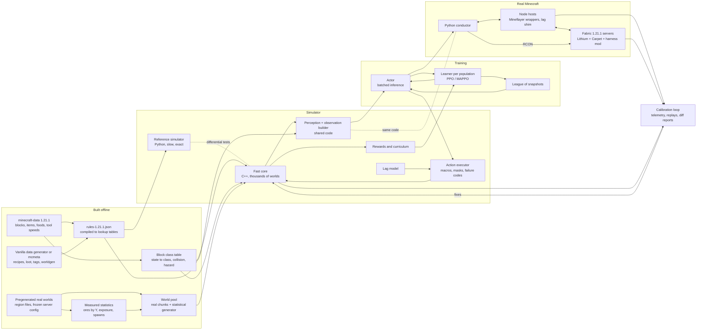

# Minecraft Hivemind

Design document for two teams of 10–20 learning Minecraft agents.

Draft 0.3, 2026-10-13. Status: design only, nothing built. Written to be picked up after the current project (WAI). Draft 0.2 applied an engineering review and an ML review of draft 0.1. Draft 0.3 adds section 9.1, the owner's emergent-language arm.

**Labels.** [n] points to the References. **[mem]** means written from memory and not checked against a source; verify it against the pinned game version before relying on it. **[est]** means an estimate that must be measured. Everything else is a design choice or comes from a cited source.

## 1. Vision and research questions

> "My next project will be a hivemind of 10-20 AI Minecraft agents. I'll pit them in the same world as another team of 10-20 agents to see how they learn and interact. Do they learn to fight for resources or work together? The first big hurdle would be training a single agent to play Minecraft." (the owner, condensed)

The owner's design ideas:
- Simulate Minecraft the way WAI simulates Worms Armageddon (WA), then speed it up.
- Copy mechanics exactly; make randomness statistically right.
- Add variable lag so the agents can cope with online play.
- Use the owner's own high-level actions (craft pickaxe, mine block, chat).
- No LLM.
- Teach item meanings by chatting, and see whether the agent learns to ask for items.

### 1.1 Research questions

| # | Question | Answered by |
|---|---|---|
| RQ1 | Can a small non-LLM network, trained almost entirely in a simulator, survive and progress (wood, stone, iron, nights) in real Minecraft? | The same held-out seeds, run in the simulator and in the real game |
| RQ2 | When two teams share a world, do they fight, avoid each other or cooperate? How does that depend on scarcity and on reward sharing within a team? When they fight, is it a social dilemma or simply the best strategy? | The experiment plan, cross-play and payoff analysis (section 10) |
| RQ3 | Can a fixed-vocabulary chat carry stable, human-readable meaning? Do agents start asking for items without being taught to? Can they pick up a new word from a partner during play? | Request success, a no-imitation arm, nonce-word episodes, drift checks, sessions with the owner (section 9) |
| RQ4 | Does training with lag noise make the agents robust on laggy servers? | Real-game evaluation under three lag profiles |

RQ2 has no yes/no answer. The expected result is a map of which settings lead to conflict, avoidance or cooperation, with error bars over seeds.
- "Scarcity changes nothing" is a valid result, but only if the agents are competent. That is why RQ1 comes first.
- "They fight" is not a finding on its own. If attacking pays more whatever the other team does, there is no dilemma, only a dominant strategy. Section 10.4 measures the payoffs to tell the two cases apart.

### 1.2 What success means at each stage

| Stage | Success |
|---|---|
| Rules | All recipes and smelts match the real game. Break times logged on the server match within ±1 tick |
| One agent, simulator | On 1,000 held-out seeds, with honest perception (6.1): iron pickaxe in ≥80% of episodes; first night survived in ≥80% |
| One agent, real game | Real/sim success ratio ≥0.8 per milestone in each of three evaluation profiles, at the fixed sample size in 11.5 |
| Chat | With scripted helpers, ≥70% of `need X` requests succeed. Nulling the messages lowers team return. Agents use a nonce word correctly within an episode. The owner gets ≥15 of 20 requests answered |
| Teams | Two independently trained populations of 10–20 agents train stably. Metrics have 95% intervals over ≥8 seeds and differ from scripted baselines. There is a payoff matrix per scarcity level |

The thresholds are proposals [est], so that each stage has a finish line.

## 2. Design principles

1. **Mechanics exact, randomness statistically right.** Deterministic rules are generated from game data and copied exactly. Random processes are sampled from the game's own tables, or from statistics measured on real worlds under one frozen server config. Emergent behavior (mob AI, ore exposed in caves) is measured, not derived.
2. **High-level actions.** The policy picks a verb with arguments, such as `mine(iron_ore)` or `give(bread, 3, agent 7)`. Movement is scripted.
   - VPT reports that RL from scratch on raw controls never learned to collect logs reliably [35].
   - DreamerV3 needed a faster block-breaking setting from prior work, and 9 days on an A100 [36].
3. **No LLM in the loop.** LLM agents such as Voyager [45] and Mindcraft [46] are slow (about 9.2 s per GPT-4o response in PillagerBench [48]) and learn no weights. Their social behavior comes from human text; Project Sid states that its institutions do not emerge from scratch [47]. They may serve as baselines, never as the learner.
4. **Simulator plus bridge, as in WAI.** Train in a fast simulator. Play the real game through Mineflayer, which takes the WormKit module's place. Keep checking one against the other, as WAI's dream-vs-WA checks do.
5. **Lag is noise.** Stale observations, round trips, stretched durations and failed actions are randomized, so the policy must check results.
6. **One featurizer, one perception function, one action contract.** The simulator and the bridge share observation code, perception, masks and failure codes. Two copies would drift apart.
7. **The server is the ground truth.** Mineflayer's local view can be wrong; for example, it marks a block as broken before the server agrees [74]. Rule checks are therefore logged on the server.
8. **Everything measurable.** Every stage has a numeric exit test with a fixed sample size. Statistical checks are equivalence tests, not "failed to reject". Social claims rest on metrics, controls and baselines, not on stories from logs.
9. **Throughput first.** One process steps thousands of worlds, with no Python per world. Invalid actions are masked, not penalized.

## 3. Architecture overview



| Component | Proposed location and format |
|---|---|
| Rules build: merge, cross-check, compile | `rules/build_rules.py` → `rules-1.21.1.json` → `rules-1.21.1.bin` |
| Block class table, shared by the featurizer, perception and the nav grid | `rules/block_classes-1.21.1.csv` |
| World pool: pristine worlds, copied on reset | `worlds/seed-<n>.npz` (uint8 voxels plus metadata) |
| Reference simulator: readable Python, the oracle | `sim/ref/` |
| Fast core: batched, multithreaded C++ | `sim/core/`, C ABI called through ctypes or nanobind |
| Perception and observation builder, shared by the simulator and the bridge | `features/` |
| Rewards, curriculum, trainer, league | `train/` |
| Bridge: conductor, Node hosts, server config, harness mod | `bridge/` |
| Calibration: telemetry, replays, diff reports | `calib/` |
| Run records: git hash, rules hash, world-pool hash, config | `runs/<id>/run.json` |

## 4. Simulator specification

### 4.1 Version pin and data sources

**Pin one Java Edition version and never mix versions.** Recommendation: **1.21.1** (D1).
- Mineflayer ("1.8 to 26.1" [5]), minecraft-data [2] and mcmeta branches [3] cover both 1.21.1 and 26.1. The current release is 26.3 [26].
- 1.21.1 wins because it is the long-lived Fabric/NeoForge modding version [mem], prismarine-provider-anvil documents it [10], it predates the 1.21.2 recipe and food-component format changes [mem], and Mineflayer only added 26.1 in 4.38.0 [5]. 26.1 is closer to what public servers run.
- Rules are generated by script, so re-pinning later costs a rebuild and a recalibration, not a rewrite.
- Names change between versions. The 1.21.1 gamerules `playersSleepingPercentage` and `commandModificationBlockLimit` were later renamed (`players_sleeping_percentage`; `max_block_modifications` since 25w44a) [73]. Every script and config is keyed to the pinned version.

| Source | Used for | Known problems |
|---|---|---|
| minecraft-data `pc/1.21.1` [1] | Hardness, `material` (tool tag), `harvestTools`, light, block states; stack sizes, durability; tool speeds (wood 2, stone 4, iron 6, diamond 8, netherite 9, gold 12); recipes; foods | **`blockLoot` and `entityLoot` point to the 1.20 files for every newer version [2] and contain errors.** Coal ore shows 1–2 coal at 0.5; gravel gives flint at 1/3, not 10%. It has no tags, smelting, fuel, mob stats or spawn lists |
| Vanilla data generator [4] (`java -DbundlerMainClass="net.minecraft.data.Main" -jar server.jar --server`), or mcmeta `1.21.1-data` [3] | Recipes, including smelting `cookingtime` and `experience`; loot tables; tags (`mineable/*`, `needs_*_tool`); placed ore features; biome spawners | Hardness, fuel, and mob stats and AI live in Java code |
| minecraft.wiki [13–22][72][73] | Formulas, fuel values, mob stats, gamerules | Written by players; must be verified |
| Real game, via the bridge and the harness mod | Final authority | Slow |

The build script takes loot, recipes, tags and worldgen from the generator, and everything else from minecraft-data. Recipes exist in both, so it cross-checks them and fails on any disagreement.

### 4.2 Exact, approximate, skipped

| Area | v1 | Notes |
|---|---|---|
| Breaking, harvest rules | **Exact** | Formula in 4.3 |
| Drops | **Sampled** from the vanilla loot tables | No Fortune or Silk Touch |
| Crafting 2×2, and 3×3 at a table | **Exact** | |
| Smelting, fuel | **Exact**; each furnace is a scheduled event | 200 ticks per item. Fuel: coal 1600 ticks, coal block 16000, lava 20000, log 300 [20]; planks 300 and stick 100 [mem] |
| Hunger, regeneration, starvation | **Exact** | [14] |
| Clock, beds, night skip | **Exact** | 24,000 ticks per day [15]. The night is skipped only when `playersSleepingPercentage` of the players sleep; the default is 100 [73] |
| Chunk ticking | **Exact rule** | Mobs and dropped items advance only in chunks inside the simulation-distance square of some agent [72]; furnaces probably stop too [mem], which the harness checks in M2 |
| Combat, armor, durability, stacks | **Exact** | [17][18] |
| Mob stats | **Exact** once checked | Zombie: 20 HP, 2 armor [19]; other mobs [mem] |
| Perception | **Exact by definition** | One function in the core and the bridge (6.1) |
| Movement | **Approximate** | Nav grid with pathfinder's movement rules; durations fitted to telemetry (4.5) |
| Light | **Approximate** | Block light by BFS; sky light from the heightmap |
| Hostile spawns | **Measured** | Rate per dark cell under the frozen server config, with the vanilla caps and distances |
| Mob AI | **Measured** | Chase on the nav grid; hits with a measured hit chance; creeper fuse exact |
| Knockback | **Approximate** | Fixed displacement plus a short stun |
| Ores, trees | **Real chunks plus statistics** | No reimplementation of noise worldgen |
| **Skipped** | | Redstone, enchanting, brewing, villagers, Nether and End, fluid flow (water and lava are static), fire, crop growth, exact collisions, vehicles, rain and storms |

### 4.3 Exact formulas (v1 core)

**Breaking** [13]:
```
speed = toolSpeed if the tool's tag matches the block, else 1
if speed > 1 and Efficiency: speed += eff^2 + 1
speed *= (1 + 0.2*haste) * 0.3^min(fatigue, 4)
underwater without Aqua Affinity: *0.2 ; not on the ground: /5
dmg = speed / hardness / (canHarvest ? 30 : 100)
dmg >= 1: instant ; else ticks = ceil(1/dmg), then 6 ticks before the next block
```
Check values: stone with a wooden pickaxe 23 ticks; stone by hand 150 (no drop); log by hand 60, with a wooden axe 30; obsidian with a diamond pickaxe 188. Hardness −1 is unbreakable. The vanilla server accepts a client's "finished" packet once progress reaches 70% [mem], so a server-side test checks both the 100% time and the earliest accepted time.

**Hunger** [14]
- Exhaustion costs: sprinting 0.1/m, swimming 0.01/m, jump 0.05, sprint-jump 0.2, breaking a block 0.005, attacking 0.1, taking damage 0.1.
- At 4 exhaustion: subtract 4, then remove 1 saturation (or 1 hunger if saturation is 0).
- Hunger 20 and saturation > 0: every 10 ticks, heal `min(sat,6)/6` HP for `min(sat,6)` exhaustion.
- Otherwise, if hunger ≥ 18: heal 1 HP every 80 ticks for 6 exhaustion.
- Hunger 0: lose 1 HP every 80 ticks. Damage stops at 10 HP on Easy and 1 HP on Normal; on Hard it does not stop.
- Sprinting needs hunger > 6. A player spawns with hunger 20 and saturation 5.
- Eating adds `n × ratio × 2` saturation, capped at the hunger level, and takes 32 ticks [mem].

**Clock** [15]: day 0–12000, night 13000–23000. Surface hostiles can spawn 13188–22812 in clear weather. Beds work 12542–23460.

**Combat** [18]
- Cooldown `T = 20/attackSpeed` ticks.
- Damage multiplier `0.2 + ((t+0.5)/T)^2 × 0.8`, clamped to [0.2, 1].
- Critical hit: ×1.5 when falling and the attack charge is above 0.9 [mem]. The wiki states this threshold as 84.8%, which is the damage multiplier at 0.9 charge (0.2 + 0.81 × 0.8), not the charge itself.
- Swords: wood 4, stone 5, iron 6, diamond 7, at attack speed 1.6. Fist: 1.
- 10 ticks of invulnerability after a hit. Fall damage = blocks fallen − 3 [mem].

**Armor** [17]: `dmg *= 1 − min(20, max(A/5, A − 4·dmg/(T+8)))/25`, with A armor points and T toughness. Iron gives 2/6/5/2 points. Diamond gives 3/8/6/3, plus toughness 2 per piece.

**Spawning** [16]
- Caps: 70 monsters and 10 creatures, each × loaded chunks/289.
- Hostiles need block light 0 and sky light ≤ a random 0–7.
- No spawns within 24 blocks of a player.
- Despawn: instantly beyond 128 blocks; beyond 32 blocks, a mob idle for 600 ticks despawns with probability 1/800 per tick.
- These rules describe normal play. The wiki reports that at a view distance of 9 or below, spawning is severely reduced [16]. The simulator uses rates measured under the frozen config (11.2), not rates derived from these rules.

### 4.4 World model

- **Voxels:** one byte per cell holding a block class. About 96 classes matter in v1. Y is trimmed to −64..191, i.e. 256 levels (D3). A 128×128 single-agent world is 4 MiB. A two-team world's side is `sqrt(agents × area per agent)`, e.g. 384² (36 MiB) for 40 agents at about 60² each.
- **Block class table:** maps every 1.21.1 block state to a class and its flags. The featurizer, perception and the nav grid all read this one table. Flags:
  - solid, collision height (slab 0.5, fence 1.5);
  - transparent, liquid, climbable (pathfinder can't use climbables [8]);
  - hazard: lava, fire, magma, cactus, cobweb, powder snow, sweet berry bush.
- **Y cap:** the world pool accepts only start areas whose terrain stays at or below Y 191. The real-game evaluation uses the same areas, so nothing is cut off on either side.
- **Side arrays:** block light (4 bits), a heightmap for sky light, and a nav grid that is updated when blocks change.
- **Entities:** fixed slots with in-use flags: agents ≤40, mobs ≤32, dropped items ≤64, furnaces ≤16. Craftax caps entity counts and masks unused slots in the same way [40].
- **World sources:**
  - (a) Real chunks. Pregenerate seeds on a Fabric 1.21.1 server under the frozen config, using Chunky [mem]. Read the `r.x.z.mca` region files [21][22] (a palette plus packed longs per 16³ section) with a NumPy reader. Cross-check the reader against anvil-parser2 [11] or prismarine-provider-anvil 2.13.0 [10]. cubiomes [12] gives biomes, not blocks.
  - (b) A statistical generator that re-places ores and trees from measured per-Y histograms, so density can be scaled.
- **Resets** copy from the pristine pool and never wait for generation, like Craftax's optimistic resets [40].

### 4.5 Tick model and movement

Each world jumps to its next event: a 5-tick frame, an action completion, or a scheduled event (furnace done, dusk, dawn).
- Hunger, regeneration and timers advance every tick.
- Furnaces, mobs and dropped items advance only in ticking chunks (4.2).
- Each frame samples spawns (Poisson, measured rates), moves mobs on the nav grid, resolves attacks with the exact formula, and despawns.

A running action is interrupted by damage, a new hostile within 8 blocks, a message addressed to the agent by a teammate or a human, a vanished target, or a full inventory. Messages from enemies only set an observation flag, so an enemy cannot stall a rival by chatting at it.

An agent whose action ends is *ready*. A step call advances every world until it has a ready agent, then returns all ready agents as one batch. Dig times stay exact while mobs update at 4 Hz, and no world waits for another (unlike WAI's barrier on the slowest worker).

**Movement:**
```
T_goto   = T_search + L/v + k_turn·turns + k_jump·jumps + Σ dig ticks + k_pillar·pillars + ε
T_search = search_ms / tickTimeout      (pathfinder thinks tickTimeout ms per physics tick)
```
- L is the nav-grid path length. v = 4.317 m/s walking, 5.612 sprinting [mem].
- k_turn, k_jump, k_pillar, ε and search_ms (as a function of L) are fitted to Mineflayer telemetry in M2, before the fast core fixes the model. With `tickTimeout` = 10 ms, a 200 ms search costs 20 ticks.
- Reach: 4.5 blocks for blocks, 3.0 for entities [mem].

**Nav grid rules.** These match the bridge's pathfinder config (11.1); the defaults are from the pathfinder README [8].

| Move | Simulator | Pathfinder setting |
|---|---|---|
| Walk, step up 1 | Yes | Default |
| Drop | ≤4 blocks, onto a solid block | `maxDropDown = 4` (default) |
| Dig through | Yes, at the exact break time | `canDig = true` (default) |
| Pillar up 1×1 | Yes, uses one block per step | `allow1by1towers = true` (default) |
| Parkour gaps | No | `allowParkour = false` (default is true) |
| Ladders, vines | No | Pathfinder cannot use climbables |
| Doors, fence gates | Closed means wall | `canOpenDoors = false` (the README calls it unreliable) |
| Breaking next to liquid | No | `dontCreateFlow = true` (default) |
| Search limit | 96 blocks; over 2 s gives PATH_TIMEOUT | `searchRadius = 96` (default −1, unbounded), `thinkTimeout = 2000` (default 5000) |

### 4.6 Performance targets

Environments built on Java Minecraft run at about 72 (MineDojo, one env) to 133 (MineRL, 8 workers) steps/s [39][40], so the real game cannot be the training ground. The simulator also does not need Craftax speed (267k–406k primitive steps/s on an RTX 4090 [40]). One decision here is a macro of about 20–400 ticks [est], and the learner caps training at about 10–15k decisions/s per RTX 3090 (section 13).

**Target:** ≥30k decisions/s on 24 threads, with 60k as a stretch goal. 30k is enough to feed two GPUs with headroom. It means ≤800 µs of CPU per decision, including all world ticks in between [est].

| Option | For | Against | Verdict |
|---|---|---|---|
| Python and NumPy | Readable | About 1k decisions/s [est] | Reference only |
| **Batched C++ core** (OpenMP; one call per step for all worlds) | Runs on Windows; uses all 32 cores; worlds fit in 64 GB of RAM; branchy logic is easy | The rules are written twice | **v1** (D2) |
| PyTorch on GPU | Native on Windows | Branchy macros are awkward; 3D worlds compete with the learner for VRAM | Observation post-processing only |
| JAX, Craftax-style | Proven on 2D worlds [40] | CUDA needs Linux or WSL2 [mem]; thousands of 3D worlds won't fit in 24 GB | Later, on a Linux rig |

Core rules: one process; structure-of-arrays state; pinned observation buffers; typed `argtypes`/`restype` on every ctypes call (a WAI lesson); profile before optimizing.

### 4.7 Determinism, testing, reproducibility

A **counter-based RNG** (Philox or SplitMix style) is keyed by seed, episode, tick, purpose and entity. It lets the reference and the core draw identical numbers.

**Replays** store the seed, the actions, the lag samples and the rules hash, not states. With the counter-based RNG these replay exactly, and they are small.

**Tests:**
1. **Unit tests** against the check values in 4.3.
2. **Real-game rule checks**, logged on the server (11.4).
3. **Differential tests** (the pattern of WAI's `check_fastphysics`): 1M random valid actions through both simulators. Integer state must be identical; floats within 1e-5.
4. **Invariants every step:**
   - items appear only through loot, crafting or smelting;
   - counts stay within [0, stack limit];
   - health stays within [0, 20];
   - no block changes beyond reach.
5. **Equivalence tests** against measured distributions. Fix n in advance and pass only if a bootstrap 95% upper bound on the distance is under the margin; for example, total-variation distance ≤ 0.03 for drops at n = 5,000. A "p > 0.05" test is not used, because smaller samples pass it more easily.
6. **Speed bounds:** a lower time bound per milestone, computed from break and craft times. Any faster episode exposes a bug. Hide-and-seek agents exploited physics errors [57], and these agents will too.

**Run tracking:**
- Every run writes `run.json` with the git hash, rules hash, world-pool hash, config and seeds.
- Unit and differential tests run on every commit.
- A nightly Mineflayer smoke suite runs each verb against a local server.
- Node dependencies are pinned in `package-lock.json`, Python dependencies in a lock file.

## 5. Action set v1

Seventeen verbs. Three things are automatic rather than policy actions:
- picking up items within 1 block;
- choosing the best tool inside `mine`, as the `tool` plugin does;
- respawning.

In the Duration column, RT is one round trip in ticks (RTT/50 ms).

| Action | Parameters | Mask (allowed when) | Duration | Failure codes | Mineflayer counterpart |
|---|---|---|---|---|---|
| goto | remembered resource class, entity, base, teammate, own furnace | target known and reachable | T_goto (4.5) | NO_PATH, PATH_TIMEOUT, STUCK, INTERRUPTED | pathfinder `goto(GoalNear)` [8] |
| explore | direction (8) × {16, 32, 64} blocks | not facing the world edge | T_goto to the frontier | NO_PATH, STUCK | pathfinder `GoalXZ` [8] |
| descend | target Y band {48, 16, 0, −16, −32, −54} | band below the agent; pickaxe held | staircase: per block, break ticks + 6 + one step | NO_PATH, DIG_FAILED, HAZARD, INTERRUPTED | own loop: `dig` + move [6] |
| strip_mine | direction (4) × {16, 32} blocks, 2 high | pickaxe held | per block, break ticks + 6, plus walking | DIG_FAILED, HAZARD, INV_FULL, INTERRUPTED | own loop: `dig` + move [6] |
| mine | block class × count bin | class perceived now or in memory (6.1) | per block: T_goto + break ticks + 6 + RT + pickup | NO_TARGET, NO_PATH, DIG_FAILED, INV_FULL, INTERRUPTED | pathfinder + `dig`, with targets from shared perception, never `findBlocks` [6] |
| craft | item × count bin | recipe satisfiable; 3×3 needs a table within 16 blocks | walk + per item: n_clicks·RT + 2 ticks [est]; a pickaxe is about 8–10 clicks | MISSING_INGREDIENT, NO_STATION, TIMEOUT | `recipesFor`, `craft`, which crafts one item per loop pass [6][75] |
| smelt_start | input × count bin (fuel chosen automatically) | furnace within 16; input and fuel held | walk + about 6 clicks·RT [est]; the agent is then free | NO_STATION, MISSING_INGREDIENT, TIMEOUT | `openFurnace`, `putFuel`, `putInput` [6] |
| collect | own furnace (pointer) | that furnace has output ready | walk + about 3 clicks·RT [est] | NO_TARGET, NO_PATH, TIMEOUT | `openFurnace`, `takeOutput` [6] |
| place | item × pattern {here, front, pillar, enclose, light} | enough items; target cells free | per block: RT + 2 ticks [est] | NO_TARGET, INTERRUPTED, TIMEOUT | `placeBlock` [6] |
| attack | entity pointer | within 16 blocks | walk, then hit every T ticks until done | TARGET_LOST, DIED, INTERRUPTED | own loop on `attack` (mineflayer-pvp gets flagged as killaura [32]) |
| flee | entity pointer | hostile or enemy within 16 | move 16–24 blocks away | STUCK | pathfinder, inverted goal [mem] |
| eat | food item | food held, hunger < 20 | 32 ticks + RT [mem] | INTERRUPTED | `consume` [6] |
| equip | item × slot | item held | 1–2 RT | TIMEOUT | `equip` [6] |
| sleep | — | bed within 16, bed window, no hostile within 8 blocks [mem] | until the night is skipped or the agent wakes | NO_STATION, INTERRUPTED | `sleep` [6] |
| give | item × count × agent pointer | item held; agent within 32 | walk to ≤3 blocks, toss (RT); pickup delay about 40 ticks [mem] | TARGET_LOST, NO_PATH | goto + `toss` [6] |
| chat | intent, item, count, addressee (section 9) | ≤1 message per 40 ticks | 1 tick + RT/2 | — | `chat` [6] |
| wait | {20, 100, 400} ticks | always | as chosen | INTERRUPTED | no-op |

`descend` and `strip_mine` exist because iron is mostly below the surface. Smelting is split in two so the agent is not blocked for 200 ticks per item (80 s for 8 ores); the furnace is a scheduled event that runs only while its chunk ticks.

**Failure codes**, the same in the simulator and the bridge: `NO_TARGET, NO_PATH, PATH_TIMEOUT, STUCK, DIG_FAILED, MISSING_INGREDIENT, NO_STATION, INV_FULL, TARGET_LOST, HAZARD, INTERRUPTED, DIED, TIMEOUT`.
- Every action has a deadline in ticks and in wall-clock time. The failure code appears in the next observation.
- Voyager teleports stuck bots with `/tp` [33]. Here a stuck bot gets `STUCK`, and the policy must recover.

**Wrapper rules** (bridge side):
- **Deadlines with cleanup.** On a deadline or a cancel, the wrapper calls `stopDigging`, stops pathfinder, and closes any window. Some Mineflayer calls can hang: for versions without transaction packets, such as 1.21.1, a window click waits for a slot update with no timeout [75].
- **Digs are verified.** Mineflayer's `dig` waits `bot.digTime` (prismarine-block's formula), sends "finish", and then sets the block to air locally [74]. The promise can therefore resolve even if the server delays or refuses the break. After a dig, the wrapper re-reads the block after RT + 2 ticks, and returns `DIG_FAILED` if the block is still there.
- **Targets come from shared perception**, never from `findBlocks`, which searches every loaded block and amounts to X-ray.

**Action heads.** The action space is factorized into a verb head and argument heads, like the craft/place/equip enums of MineRL and MineDojo [37][38].
- Invalid choices get a logit of −1e9. This keeps the policy gradient valid and scales far better than penalties [65].
- Masks are stored with the rollout, so the PPO ratios use the same masks.

## 6. Observation and network v1

### 6.1 Perception

Perception is defined once and runs in the C++ core. The bridge calls the same function on the blocks that Mineflayer holds.
- **Exposed:** a block is exposed if at least one face touches air or a transparent block.
- **Voxel window** (within 7 blocks): exposed cells show their class. Buried cells show a single `buried` class. This allows a little knowledge through walls at short range, the same on both sides.
- **Resource memory** (within 24 blocks [est]): a block enters memory only when one of its exposed faces is in line of sight. Line of sight is a ray from the eyes that crosses only transparent cells. It is checked every 5 ticks on a fixed set of rays [est].
- **X-ray condition** (ablation only): memory is filled from every block within 24, which is what `findBlocks` does. Results are reported separately and never count toward the exit criteria.

### 6.2 Observation

| Part | Shape | Encoding |
|---|---|---|
| Voxel window | 15 × 15 (x, z) × 7 (y −3..+3) | block class, embedded (`buried` for unexposed cells); light/15 |
| Resource memory | 40 classes × 4 | known?, path distance/128, dy/64, count seen (perceived blocks only) |
| Furnaces | 4 own furnaces × 3 | distance/64, input left, output ready |
| Inventory | ~120 items | log(1+n)/log(65); held item; armor; durability |
| Self | 10 | health, food, saturation, air, XP, y/320, sin/cos of time of day, rain, light |
| Entities | 16 nearest within 32 blocks | type, offset/32, HP, held item, flags (teammate, enemy, hostile, passive, human), slot; padding mask |
| Chat | last 8 messages | 4 slot tokens, speaker relation (self, team, enemy, human), addressed-to-me flag, age |
| Last action | 4 | verb, argument, result code, elapsed ticks |
| Lag | 1 | ping/500 ms (Mineflayer reports ping [6]) |
| Identity | 1–2 | agent slot 0–19; team id only in the shared-network variant |

**Teammates' inventories are hidden**, as in the real game; otherwise asking would be pointless. Nearby players' held items and armor stay visible.

Precedents:
- Craftax's symbolic observations are about 10× faster than pixels [40].
- Neural MMO convolves a 15×15 tile crop and uses attention only for entities [54].

### 6.3 Network (about 4–6M parameters)

| Block | Design | Forward cost [est] |
|---|---|---|
| Voxels | 8-d class embedding plus light, y folded into 63 channels; Conv 3×3 → 64; Conv 3×3 stride 2 → 64; Linear 4096 → 256 | 16 + 5 + 2 MFLOP |
| Entities and chat | 24 tokens (16 entities, 8 messages); 2-layer masked transformer, d = 128, 4 heads; mean- and max-pooled to 256. Entity tokens double as pointer targets | ~19 MFLOP (about 0.39 MFLOP per token per layer) |
| Other inputs | MLP over inventory, self, memory, furnaces, last action, identity → 256 | <1 MFLOP |
| Trunk | 768 → 512 → GRU 512, the GRU size of Craftax's PPO-RNN baseline [40] | ~4 MFLOP |
| Heads | verb (17), then argument heads conditioned on the verb: item class (~160), entity pointer, count, pattern, direction, Y band, or the 4 chat slots in turn | <1 MFLOP |
| **Total** | | **≈ 47 MFLOP** (≈ 66 with 48 tokens) |

- **Log-probability:** summed over the heads used, which gives the exact joint probability.
- **Entropy:** the exact joint entropy, `H(verb) + Σ_v p(v)·H(args | v)`. Summing entropies over the heads used would give chat (4 heads) and give (3) a larger bonus than wait. If computing every verb's argument heads proves too slow, fall back to dividing each head's entropy by the log of its number of valid options.
- **Shared item embeddings** (D9): blocks, inventory slots, arguments and chat item tokens share one table. The chat token `iron_ingot` then starts with the same vector as the ingot in the inventory. Nonce words (9) get their own, initially uninformative, vectors.

## 7. Rewards and curriculum

**Achievements** pay their tier reward on the first unlock in an episode. Tiers are 1/3/5/8, as in Craftax [40].

**Only an agent's own production unlocks an achievement:** an item must be mined, crafted or smelted by that agent, and a kill must be its own. Received or scavenged items still work as crafting inputs, so a gift pays when the receiver crafts something new with it. Passing one ingot along 20 teammates pays nothing (otherwise, at τ = 1, it would pay 20 × 5), and an enemy's death drop unlocks nothing, so killing does not pay through the reward itself.

| Tier | Achievements |
|---|---|
| 1 | log, planks, crafting table, wooden pickaxe, wooden sword, cobblestone, kill an animal, eat |
| 3 | stone pickaxe, stone sword, furnace, coal, torch, raw iron |
| 5 | iron ingot, iron pickaxe, survive the night (no death between ticks 13,000 and 24,000), kill a zombie, bed, shield, bucket |
| 8 | iron armor piece, diamond, diamond pickaxe |

**Shaping (potential-based).**
- Φ(s) = 0.1·HP + 0.1·hunger [est], and the shaping term is F = γ^k·Φ(s′) − Φ(s). This matches Crafter's ±0.1 per health point [41] and Multi-Agent Craftax's 0.1 per food or water point, lost or regained [44]. Potential-based shaping leaves the optimal policy unchanged (Ng, Harada and Russell 1999 [mem]).
- **Death:** Φ(death) = 0. The shaping chain restarts at respawn, and the respawn state's potential is never paid, so respawning at 20 HP cannot refund a death. There is also an explicit death penalty of −3 [est].
- **Episodes end on death in M1–M5**, as in Crafter [41]. Respawn appears only with teams (M9).
- **Night:** +0.1 for every 1,000 night ticks survived without damage [est], on top of the tier-5 achievement. Preparing for the night then pays before dawn.
- If the tiers prove hard to tune, flatten them to +1 per milestone, as DreamerV3 did [36].

**Time-aware discounting (semi-MDP).** An action lasting k ticks, with per-tick rewards r_i (shaping, night ticks), uses:
- `R_t = Σ_{i<k} γ^i·r_{t+i}`
- `δ_t = R_t + γ^k·V(s_{t+1}) − V(s_t)`
- `A_t = δ_t + γ^k·λ·A_{t+1}`, with λ = 0.95 per decision [est]
- per-tick `γ = 0.5^(1/H)`, with a half-life H = 12,000 ticks (10 minutes), so γ = 0.999942

The dawn reward (5) is then worth 5 × 0.5^(11000/12000) ≈ 2.6 at dusk and about 1.25 in the morning. A 2-minute half-life would make it 0.2 and 0.006, too little to plan for. Slow actions still cost through γ^k, so no time penalty is needed. A long half-life raises variance; if the critic struggles, try H = 6,000 with the dense night reward [est].

Macros are interruptible options (Sutton, Precup and Singh 1999 [mem]).

**Score:**
- Per-achievement success rates on held-out seeds.
- The Crafter score `exp(mean(ln(1 + s_i))) − 1`, with s_i in percent [41][42]. On Crafter at 1M steps: PPO 4.6, DreamerV3 14.5, human 50.5 [43].

**Anti-hacking:**
- Each unlock counts once per episode, which kills place-and-remine and ingot ↔ block loops.
- Only own production counts (above).
- Placing blocks is never rewarded. A shelter can't be measured reliably, but surviving the night can.
- Potential-based shaping cannot be farmed: a damage-then-heal loop nets zero before discounting and loses after it.
- Speed bounds (4.7) catch simulator exploits.

**Curriculum:**
- **Episodes:** one in-game day (24,000 ticks) from morning, growing to three days.
- **Start states:** 30% start mid-tree (tools, dusk, near iron). This is WAI's stuck-spot practice in another form.
- **Density:** resources start at 2× and anneal to the measured statistics.
- **Seed replay:** seeds with the fastest learning progress are replayed more (prioritized level replay [mem]).
- **Exploration:** entropy coefficient 0.01, the explore, descend and strip_mine verbs, and a decaying new-chunk bonus [mem]. Curiosity bonuses (ICM, E3B) did not help on Craftax [40].

## 8. Lag and robustness model

Mineflayer's physics runs on a fixed 50 ms wall-clock timer with at most 4 catch-up ticks [7], and `/tick` rate changes do not speed up players [23]. Network lag and server lag therefore act differently, and the simulator needs both. Most Mineflayer actions also wait for the server once per click or block, so their duration grows with the round-trip time.

| Parameter | Sampled | Range | Effect |
|---|---|---|---|
| Ping (RTT) | per episode, lognormal | median 60 ms, p95 400 ms [est] | observations are RTT/2 old; actions start late |
| Jitter | per action | ±30% of ping [est] | |
| Round trips | per action type | craft ≈ 2 clicks per ingredient + 2 per output item; place 1 per block; equip 1–2; furnace 3–6 [est] | adds n_rt·RTT to the duration |
| Spikes | Poisson, about 1 per 2–5 min [est] | 1–3 s | observations freeze; the running action continues; then a burst of updates |
| Server rate | per episode | 20, 15 or 10 TPS | the world runs slower than bot movement |
| Duration scale | per action | U(0.9, 1.3) [est] | stretches each macro |
| Action failure | per action | 1–5% [est] | returns a failure code |
| Position correction | per goto | measured | short rollback, then a re-plan |

**Where the numbers come from.** M2 measures every wrapper's duration and failure rate under the shim's lag settings, so the ranges above are replaced by fitted values before the lag milestone (M6). The owner can also note their real ping to servers they play on, to set the lognormal.

**Evaluation profiles** (three cells, to fit the budget in 11.5):

| Profile | Lag | Server rate |
|---|---|---|
| A | LAN (<5 ms) | 20 TPS |
| B | 120 ± 40 ms | 20 TPS |
| C | 300 ± 120 ms, plus 1 s spikes (2% per action) | 15 TPS |

Training still randomizes over the full ranges above.

A delayed MDP becomes Markov again if the state includes the actions sent since the last observation (Katsikopoulos and Engelbrecht 2003, summarized in [66]). The last-action field and the GRU cover this, and DCAC trained well under random delays [66].

- **Schedule:** no lag until the single-agent exit test passes. Then ramp it in over about 20% of training, and report scores per profile.
- **Scope:** macros hide most lag. It matters for combat, fleeing, crafting at high ping, and races to resources.
- Most public servers ban bots (11.6), so "online" in practice means the owner's own server with simulated lag.

## 9. Chat and grounding

**Vocabulary v1 (about 118 tokens).** A message has 4 slots (intent, item, count, addressee); `none` fills unused slots.

| Slot | Tokens |
|---|---|
| intent (14) | need, have, give, come, follow, help, attack, flee, stop, wait, yes, no, thanks, where |
| item (~68) | minecraft-data names (log, planks, stick, cobblestone, coal, raw_iron, iron_ingot, bread, ...) plus 8 nonce words `word_1`–`word_8` whose meaning is drawn per episode |
| count (10) | 1, 2, 3, 4, 6, 8, 12, 16, 32, 64 |
| addressee (~24) | agent 0–19, all, team, me, you |

- **Rendering:** a message is shown as text, e.g. `need 3 iron_ingot @all`.
- **Limits:** at most 1 message per 40 ticks, each costing −0.001 [est]. This keeps agents below vanilla's spam kick [mem]; 26.2 made the threshold configurable [29].
- **Interrupts:** only messages from teammates and the human interrupt an action (4.5).
- **Structure:** with large vocabularies, emergent-language agents gave each object its own symbol, without structure [59]. The fixed template builds the structure in.

**How meaning is learned:**
1. **Asking pays.** Inventories are hidden, and agents get different starting kits and areas. **Giving pays** through the team share τ > 0 (section 10) and through the receiver's own crafts (section 7).
2. **Scripted helpers** use the human meaning. On `need X n` they come and give X if they have it, and they say `have X` truthfully. They start as 30–50% of teammates and anneal to about 10%, so a learner gets help only by using the human meaning.
3. **Shared item embeddings** (section 6). An ablation with separate, random chat embeddings tests the owner's idea of teaching meaning through chat alone.
4. **Auxiliary losses (weight about 0.1):**
   - a speaker loss toward what a scripted speaker would say;
   - a listener head predicting the speaker's need or have;
   - positive-signalling and positive-listening losses [64].
5. **Supervised first, then self-play**, with the supervised loss kept in the mix. Lowe et al. found this order works best [63]. Lewis et al. used a frozen human-like partner and 1 supervised update per 4 RL updates [58]. Lazaridou et al. also grounded emergent symbols in natural language [60].
6. **Nonce-word episodes: the owner's "teach it by chatting".** Weights do not change during play, so a word learned mid-game must live in the GRU's memory. In 20% of episodes [est], each `word_k` stands for an item drawn for that episode, and helpers use it consistently (`have word_3`, then hand over bread). The agent must learn the word from its partner. Score: request success with nonce words, by how often the word was shown before.
7. **No-imitation arm.** No speaker loss and no supervised pretraining; helpers still answer `need X`. A random `need X` comes up about once in 14 × 60 = 840 chat actions [est], so this arm tests whether asking is discovered rather than imitated. It answers RQ3's "do they learn to ask?"; the main arm shows how well taught asking works.

**Precedent.** Craftax-Coop added REQUEST_RESOURCE and GIVE actions to Craftax. Trading appeared most under MAPPO, less under IPPO, and not at all under PQN [44].

**How meaning is kept:**
- Helpers never update.
- A **drift check** pairs learners with scripted listeners only. Falling request success means drift. Pragmatic drift between co-adapted pairs is the hardest kind to see [61].
- Evaluation uses partners the agents never trained with [56].

**A human in the chat:**
- A tokenizer lowercases text, maps item names and synonyms to tokens, maps "me"/"I" to the speaker and numbers to the nearest bin, and drops unknown words.
- The human appears as an entity with relation "human". Logged human chats become supervised data.
- **What to expect:** the agent learns what to *do* with a message (come, give, look for X). It does not understand language.
- The owner teaches meanings by being a consistent helper: say `have 3 bread`, then hand over bread. Nonce words let the owner name things the agent has never heard of.

| Metric | Definition |
|---|---|
| Ask rate | `need X` sent when X is missing for a reachable craft |
| Request success and latency | X received within 600 ticks; median delay |
| Causal influence | change in listener actions and team return when messages are replaced by a null message [62] |
| Truthfulness | `have X` sent while actually holding X |
| Helper agreement | learner messages a scripted speaker would also send |
| Nonce-word success | request success with `word_k`, by number of prior exposures in the episode |
| Human success | the owner's requests answered correctly, out of 20 per session |

Messages can be informative yet ignored [62], so causal influence, not message count, is the main metric.

### 9.1 The owner's emergent-language arm (added in draft 0.3)

> "What if we just let them create their own language if they wanted to? ... Imagine you have a hive of 20 of them, and you sneak up and kill one of them. Would that one communicate to the rest of them what happened?" (the owner, 2026-10-13)

This is a separate experiment from the grounded chat above. The grounded chat is for talking with humans. This arm asks whether agents invent a language of their own, and what they use it for.

**The free channel.**
- K abstract symbols with no meaning given: 32 symbols [est], messages of 1–3 symbols, rendered as `#07 #19` in logs.
- No helpers, no speaker loss and no supervised data on this channel. Meaning can only come from what works.
- Variants: team-only channel (main) and global channel (the other team can listen in). Both channels can coexist (grounded + free) or the free channel can run alone.
- Same rate limit and small cost as chat (one message per 40 ticks, −0.001).

**The ambush test (alarm calls).** Do agents warn each other when one is attacked? Warnings only emerge if they pay off:
1. **Hidden threat:** teammates must not see the attacker themselves (line of sight, distance), otherwise a warning carries no news.
2. **Warnings must change outcomes:** a warned teammate can flee, regroup or arm up, and losses hurt the team reward (τ > 0, section 10).
3. **A chance to speak:** while taking damage, and once on the death tick ("last words"); witnesses can also call.
4. **Practice:** scripted raiders (or the owner) ambush lone agents at random times, often enough to learn from.
5. **The owner's version:** the owner sneaks up and kills one agent out of the others' sight. That run is logged and compared against muted runs.

**Getting it started.** Emergent communication with RL often never gets going, because speaker and listener must discover each other at the same time [62][64][78]. Helps that give no meaning of their own:
- positive-signalling and positive-listening losses [64];
- a social-influence bonus: a small reward for messages that change what listeners do [78];
- a small vocabulary and message noise or dropout, which push towards robust, reusable symbols;
- a curriculum: frequent, simple threats first, then rarer and more varied ones.

**Reading their language** (the way field researchers decoded vervet monkeys' alarm calls [77]):
- Log every message with its context: attacked, enemy seen, low health, ore found, night, item needed.
- For each symbol, measure which situations come before it and what listeners do after it (mutual information). Build an automatic **dictionary page**: symbol, most likely meaning, confidence.
- **Playback test:** inject a suspected "danger" symbol when nothing is wrong and see whether teammates react. This is how the vervet alarm calls were shown to carry meaning [77].
- **Mute control:** replace messages with a null message; the drop in reaction speed and team return is the causal effect [62].
- **Dialects:** independent populations and seeds will invent different languages. Compare their dictionaries, and check whether two populations can understand each other (cross-play).
- **Eavesdropping (global channel):** do teams start using codes, keep quiet near enemies, or send fake alarms?

| Metric | Definition |
|---|---|
| Alarm rate and latency | messages sent by a victim or witness within N ticks of an attack, and the delay |
| Listener response | teammates' flee/regroup/arm actions after an alarm, against muted runs |
| Symbol meaning (MI) | mutual information between each symbol and the logged situations |
| Playback response | reaction to an injected symbol with no threat present |
| False-alarm rate | alarms with no attack within the window |
| Dialect overlap | similarity of two populations' dictionaries; cross-play request and alarm success |

Expect the first languages to be small and practical: a few symbols for "danger", "come here" and "I have X", not sentences. Whether they add structure (who, what, where) is part of the question.

## 10. Multi-agent and teams

### 10.1 Training setup

- **Two independent populations (main setting).** Each team has its own network, learner and league. Neural MMO's niches formed between separately trained populations [53]. Within a team, agents share parameters and get an agent-slot input.
- **Shared-network variant.** One network for both teams, with a team-id input (plain self-play). Cooperation between copies of one policy can be a convention between twins, so this variant is reported separately. A **cross-play matrix** (every trained population, shared ones included, against every other) shows whether behavior holds against strangers.
- **Critic:** MAPPO's centralized critic. In the MAPPO study, the agent-specific (AS) and feature-pruned (FP) global-state inputs both did well; FP was used in most results and beat AS on several maps [67]. Start with FP. Hide-and-seek found an omniscient critic critical [57]. IPPO is the baseline; in Craftax-Coop all three algorithms reached comparable final returns, with MAPPO lowest [44].
- **Batch:** at least 32k agent-decisions per update. Hide-and-seek used 64k; 32k cost little, and 8k and 16k never converged [57].
- **Epochs:** 4 [est]. MAPPO suggests at most 10 epochs on hard tasks and 15 on easy ones [67]; 10 would cut throughput about 2.4× (section 13).
- **Team spirit:** `r_i′ = (1 − τ)·r_i + τ·mean_team(r)` [mem], with τ as a knob. OpenAI Five annealed τ from 0.3 to 1.0, and its Rerun from 0.3 to 0.8 [68]. Teams earn their own rewards (general-sum), so cross-team cooperation is possible but never forced.
- **League, per population:**
  - a snapshot every ~10M agent-decisions;
  - opponents are 80% the other population's current policy and 20% its past snapshots, chosen by prioritized fictitious self-play [69];
  - exploiters reset above a 70% win rate [mem], where a win means a higher per-capita return.
- **Team sizes** vary (5, 10, 20) in training, because unseen agent counts do not generalize [49].
- **World rules** (D4–D6, D14):
  - death drops the inventory, and the agent respawns at base after a delay;
  - cross-team damage on, friendly fire off (a scoreboard team option [mem]);
  - global chat, with team-only as a variant;
  - the night-skip gamerule set explicitly. At the default of 100%, one awake enemy blocks the skip [73], and the simulator models the same rule.

### 10.2 Scarcity and controls

**Scarcity is the main knob.**
- In Gathering, policies trained with low abundance were highly aggressive [50][52].
- Common-pool resource work links exclusion to sustainability and inequality [51].
- Neural MMO saw niches form between populations [53], but little specialization within teams [55].

Knobs: ore density ×{0.25, 0.5, 1, 2}, area per agent (about 60² or 120² blocks), and animal respawn rate. Trees are renewable; ores are not.

**Controls,** each at scarcity 0.25 and 2:
- **PvP off** (no cross-team damage). Comparing gathering and avoidance against the main runs shows what fighting changes.
- **keepInventory on** (death drops nothing). Killing then gains no items, which separates "fight to take" from "fight to deny".

### 10.3 Metrics

| Metric | Definition | Unit |
|---|---|---|
| Contact | time with an enemy within 16 blocks | minutes per agent-hour |
| Aggression | cross-team damage, kills, share of fights started | per minute of enemy contact |
| Avoidance | contact time vs a random-placement baseline at the same density and area | ratio |
| Gifts | `give` calls and items moved, within and across teams | per agent-hour |
| Scavenging | other team's dropped items picked up, including death drops | per agent-hour |
| Territory | chunks holding a team's placed blocks; overlap between teams | share |
| Inequality | Gini of inventory value (crafting depth), within and across teams | 0–1 |
| Specialization | entropy of each agent's verb distribution; mutual information between slot and verb | bits |
| Communication | section 9 metrics, within team and across teams | |
| Outcome | per-capita return, deaths, time to milestones | |

Aggression is counted per minute of contact because scarcity and area change how often agents meet. Counting it per agent-hour would mix "meet more" with "fight more".

All metrics are compared against scripted baselines (peaceful gatherers, raiders, random) and against a team trained alone. Agents are also scored per capita against held-out background populations, as in Melting Pot [56].

### 10.4 Payoff analysis

This follows Leibo et al. [50] and is what makes RQ2 answerable. For each scarcity level:
1. Sort trained snapshots into an aggressive set and a peaceful set by attack rate per contact minute (top and bottom thirds [est]).
2. Play pairs drawn from the two sets against each other, ≥200 episodes per cell [est].
3. Estimate per-capita returns:
   - R: peaceful vs peaceful;
   - P: aggressive vs aggressive;
   - S: peaceful vs aggressive;
   - T: aggressive vs peaceful.
4. The game is a social dilemma when R > P, R > S, 2R > T + S, and either greed (T > R) or fear (P > S) holds [50] (exact list [mem]).

In Gathering and Wolfpack, most of the dilemmas found were Prisoner's Dilemmas [50]. Independent populations make this analysis natural, because the cross-play matrix supplies the raw data.

### 10.5 Experiment plan and statistics

Chat is off in the core plan. It belongs to M8, and enters the team stage only as a one-factor variant. Per-run budgets and throughput are stated once, in section 13.

| Phase | Cells | Seeds | Per run | Runs | Machine time [est] |
|---|---|---|---|---|---|
| Pilot and convergence check | scarcity {0.25, 2} × τ {0, 1} | 2 | 1.5B, with checkpoints at 0.5B and 1.0B | 8 | ~6 days |
| Main grid | scarcity {0.25, 0.5, 1, 2} × τ {0, 1} | 8 | 0.5B | 64 | ~16 days |
| Controls | {PvP off, keepInventory} × scarcity {0.25, 2}, τ = 0 | 8 | 0.5B | 32 | ~8 days |
| Variants | τ = 0.5; shared network; team size 5 and 20; area; chat global vs team | 4, at scarcity 0.25 and 2 | 0.5B | ~48 | ~12 days |

**Statistics:**
- With 8 seeds, t(0.975, 7) = 2.36, so a 95% interval is ±0.83 SD of the seed spread. With 3 seeds it would be ±2.5 SD (t = 4.30).
- Multi-agent runs are often bimodal. Report every seed's value and the share of seeds in each mode, not only means.
- Report metric curves over training, not only end values. A metric counts as settled when its mean over the last 10% of a run differs from the previous 10% by less than half the seed SD [est].
- The pilot decides whether 0.5B is enough. If metrics at 0.5B and 1.5B differ by more than that, raise the per-run budget and cut cells, not seeds.
- Hide-and-seek needed 132.3M episodes (31.7B frames, 34 hours) to reach its fourth stage [57]. Social behavior may need far more than 0.5B decisions.

## 11. Bridge and calibration

```
Python conductor (asyncio) ── TCP, u32 length + msgpack ── Node hosts ×10 (4 bots each: wrappers, lag shim, telemetry)
   │ same featurizer, perception and masks as the simulator
   └─ RCON :25575 (/tick, setup, resets, /tick query) ── Fabric 1.21.1 servers (Lithium + Carpet + harness mod)
```

### 11.1 Bridge

**Packages** (npm latest on 2026-10-13 [9]; recheck against the pinned version and pin each):

| Package | Version | Note |
|---|---|---|
| Mineflayer | 4.39.0 | needs Node ≥22 |
| mineflayer-pathfinder | 2.4.5 | |
| mineflayer-collectblock | 1.6.0 | |
| mineflayer-tool | 1.2.0 | |
| mineflayer-armor-manager | 2.0.1 | off for learners: equipping is a policy action |
| mineflayer-auto-eat | 5.0.3 | off for learners: eating is a policy action |
| `@msgpack/msgpack` | 3.1.3 | |

- **Pathfinder:**
  - movement settings as in the 4.5 table;
  - `tickTimeout` = 10 ms (the README's default is 40 ms per tick) [8];
  - at most 4–5 bots per Node process, so A* cannot starve physics;
  - no path beyond loaded chunks [8].
- **Messages:**
  - The conductor sends `act{agent, req, action, params, deadline_ticks, deadline_ms}` or `cancel`.
  - Node replies `result{agent, req, code, tick0, tick1, wall_ms, n_roundtrips, inv_delta, raw_state}`.
  - Node pushes `event{chat|hurt|death|kick|correction}`.
  - Python builds features from the raw state with the simulator's featurizer and perception.
- **Timing:** each agent is its own semi-MDP. Agents that become ready within 5–10 ms of each other are batched, as in WAI's async actor.
- **Wrappers:** deadlines with cleanup, verified digs and perception-based targets (section 5).

### 11.2 Server config (frozen at M0, before any measurement)

Every statistic (spawns, ore exposure, furnace timing, despawns) is measured under this exact config. Any change means measuring again.

| Setting | Value | Why |
|---|---|---|
| Server | Fabric 1.21.1 + Lithium + Carpet + harness mod | Lithium tests its patches for vanilla parity [25]. Carpet gives spawn tracking, mob caps, TPS logging, `/profile` and `/player` fake players [27] (keep `antiCheatDisabled=false`). Paper deliberately changes vanilla behavior, so it is only a second evaluation server |
| `view-distance` | 10 | At 9 or below, mob spawning is severely reduced [16] |
| `simulation-distance` | 10 | The Java multiplayer default [72]; the core models the same ticking square |
| `difficulty` | normal | Starvation stops at 1 HP (4.3) |
| `online-mode` | false | Bots without accounts; firewalled (11.6) |
| `spawn-protection` | 0 | |
| RCON | on, port 25575, localhost only | [24] |
| `enforce-secure-profile` | false | [mem] |
| `playersSleepingPercentage` | 100 (vanilla), set explicitly | Default 100 [73]; simulated (10.1) |
| `commandModificationBlockLimit` | ≥ 4,194,304 on evaluation servers | Default 32,768 [73]; needed for `/clone` resets of a 128 × 128 × 256 area |
| `keepInventory` | false (true in the control) | 10.2 |

**`/tick`** [23][70] (`rate`, `freeze`, `step`, `sprint`, `query`; 1.20.3+, permission level 3):
- Sprinting does not speed up bots. Worldgen, furnace and spawn statistics are therefore measured while sprinting, with Carpet fake players.
- Every bot measurement runs at 20 TPS.
- `/tick rate 10–15` imitates an overloaded server.

**Lag:** a per-bot shim delays outgoing `client.write` calls and incoming packets; the profile and seed are logged. Toxiproxy (`latency`, `jitter`, `bandwidth`, `timeout`; API on port 8474) is the cross-check [28].

### 11.3 Harness, resets and evaluation areas

- **Harness mod.** A small Fabric mod, with Carpet scarpet as a fallback, does three jobs:
  - It logs block-break ticks on the server, so dig tests measure the server rather than prismarine-block.
  - It restores player state for snapshot replays. Vanilla commands cannot set hunger [mem]; scarpet can set hunger, saturation and exhaustion with `modify(player, 'hunger' | 'saturation' | 'exhaustion', value)` [76].
  - It reports chunk-ticking state.
- **Snapshot replay:**
  - terrain from structure templates, or `/clone` from a pristine copy;
  - inventory via `/give` and `/item`;
  - health, hunger and time via the harness and `/time set`;
  - `/kill` on leftover entities in the area.
- **Evaluation areas:**
  - Single-agent evaluation uses separate pregenerated 128² areas whose centres are ≥512 blocks apart. At simulation distance 10, each bot ticks a square of ±160 blocks, and 128 + 2 × 160 = 448.
  - Each area is walled with barrier blocks, matching the simulator's world edge. `/worldborder` is one square per world, so it is used only in team worlds, where it matches the 384² (or larger) simulator world.
  - Spawn rates are measured inside such walled areas. The measured rates then include the effect of mobs outside the wall on the mob cap.
- **Resets:**
  - Per area, with `/clone` from a pristine copy kept elsewhere in the same world, followed by `/kill` on non-player entities.
  - Full restores (stop the instance, copy back the region files, restart) between evaluation batches.
- **Instances:** 40 areas at simulation distance 10 would tick about 40 × 441 chunks on one server. Use 4 instances × 10 bots instead [est], and verify with the M7 ramp test.

### 11.4 Telemetry and thresholds

Telemetry is compressed JSONL per bot per session:
- `session.json`: versions, jar hash, seed, lag profile, shim seed.
- Per action: parameters, start snapshot (voxels, inventory, entities, health, food), result, `tick0`/`tick1`, wall ms, round trips, path length, replans, search ms, items gained, damage, corrections and ping.
- Every 5 ticks: position, velocity, health, food, held item.
- Every 10 s: server MSPT and Node event-loop delay.
- The harness log of server-side break ticks.

Simulator replays are cheap, so the simulator side of each comparison uses ≥10,000 replays, and the confidence interval comes from the real side. All passes are equivalence tests at a fixed n: the 90% interval of (real − sim) must lie inside the margin.

| Level | Test | n (real) | Pass [est] |
|---|---|---|---|
| Rules | craft and smelt every recipe after `/give` of the ingredients | all recipes | 100% |
| Rules | server-logged break ticks per block × tool, LAN, 20 TPS | 20 per pair | every one within ±1 tick |
| Rules | drops per block (`/loot` or a fake player [mem]) | 5,000 per block | TV distance, 95% upper bound ≤ 0.03 |
| Action | success per verb, real vs sim replay from the same snapshot | 250 per verb | 90% interval of the difference within ±8 points |
| Action | duration ratio sim/real | 250 per verb | median within 0.9–1.1 and p90 within 0.8–1.25, bootstrap 90% intervals inside |
| Action | goto fit (4.5) | 500 held-out paths | log-RMSE ≤ 0.2 |
| Action | inventory changes from craft, smelt, equip | all | exact |
| Action | top 3 real failure codes | 250 per verb | sim frequency 0.5–2× real |
| World | per-Y ore and exposure histograms, sim generator vs real chunks | 50 seeds | TV distance, 95% upper bound ≤ 0.05 |
| Episode | real/sim success ratio per milestone, per profile | 250 episodes | ≥ 0.8, 90% lower bound ≥ 0.7 |
| Episode | return ratio | 250 episodes | ≥ 0.85 |
| Episode | time to wood, stone pickaxe, iron, first dawn | 250 episodes | KS D, 95% upper bound ≤ 0.2 |

For scale: at a true rate of 0.8, n = 100 gives a 95% interval of ±7.8 points; n = 250 gives about ±5.

When a test fails, rank actions by time share × error, then fix the simulator or the wrapper. Rerun the rule and action levels on every version bump, like WAI's turn checks.

### 11.5 Real-game evaluation budget

- One episode is one in-game day: 20 minutes at 20 TPS, and about 27 at 15 TPS.
- **Full check per checkpoint:** 3 profiles × 250 episodes × ~20 min ≈ 250 bot-hours, or about 6–7 hours on 40 bots across 4 instances [est].
- **Quick check:** 50 episodes per profile (±11 points at 95%) ≈ 50 bot-hours, about 1.5 hours.
- Run full checks only at milestone exits and on final checkpoints. Twelve profile cells (4 latencies × 3 TPS) would cost about 1,000 bot-hours per checkpoint.
- An hour of real play gives a bot 72,000 ticks, about 700 decisions [est], so the real game is for evaluation only.

### 11.6 Own-server rules

- Agents run only on the owner's firewalled server in offline mode; online mode needs a paid account per bot. Block port 25565 from outside: in offline mode anyone can join under any name.
- The EULA and usage guidelines govern servers [30]. Their wording on bots and offline mode is **unverified** (the fetch timed out). Read it before sharing anything publicly.
- Public servers only with written permission. Hypixel bans automated play [31], as do most servers [mem].

## 12. Milestones

Effort is in focused weeks at about WAI's pace [est].

| # | Milestone | Exit criteria | Effort |
|---|---|---|---|
| M0 | Pin version, build rules, freeze server config | Rules JSON built (loot from the generator only); cross-check and break-time checks pass; block class table; `server.properties` and gamerules frozen | 1–2 wk |
| M1 | Reference simulator | 4.3 formulas unit-tested; 17 verbs; perception; chunk ticking; furnace events; text and top-down viewer | 4–6 wk |
| M2 | Minimal bridge, rule check, duration and lag fits | Harness mod; server-logged digs within ±1 tick; recipes 100%; goto, mine and craft durations fitted (log-RMSE ≤ 0.2); wrapper durations and failures measured under profiles A–C | 2–3 wk |
| M3 | Worlds | 50 seeds imported (Y ≤ 191 areas); per-Y ore and exposure histograms; spawn rates in walled areas under the frozen config; density knob; pool | 2–3 wk |
| M4 | Fast core | ≥30k decisions/s on 24 threads; differential test clean over 1M actions; exact replays | 6–10 wk |
| M5 | Single-agent PPO | Held-out, no X-ray: iron pickaxe ≥80%, first night ≥80%; Crafter score; learner throughput measured | 3–6 wk |
| M6 | Lag randomization, using the M2 fits | ≤10% score drop in profile C | 1–2 wk |
| M7 | Full bridge, calibration, evaluation orchestration | 11.4 thresholds pass in profiles A–C; areas, resets and instances automated; 40-bot ramp test (MSPT p95 < 40 ms, Node loop delay p99 < 20 ms) | 6–10 wk |
| M8 | Chat with helpers | Request success ≥70%; causal influence with a 95% interval excluding 0; drift stable; nonce words learned within episodes; owner ≥15 of 20; no-imitation arm reported | 3–5 wk |
| M9 | Small teams (2v2 → 5v5) | Independent populations train stably; metrics, cross-play and a first payoff matrix produced | 4–6 wk |
| M10 | Two teams of 10–20 | Pilot, main grid and controls done with ≥8 seeds; payoff analysis per scarcity level; real-game spot checks | 4–8 wk |

Total: about 36–61 focused weeks [est]. M0–M5 (about 18–30 weeks) clear the owner's "first big hurdle", and are worth doing even if the team stage never happens.

## 13. Hardware and compute budget

The machine: Threadripper 3970X (32 cores, 64 threads), 64 GB DDR4, 2× RTX 3090 (48 GB VRAM in total), Windows 11.

| Resource | Simulator training | Real-game evaluation, 40 bots [est] |
|---|---|---|
| CPU | core 24–28 threads; actors and learners 2–4 | core 8–12; 4 server instances 12–16; Node hosts ~6; conductor 1–2 |
| GPU 0 | run 1, or population A | inference |
| GPU 1 | run 2, or population B | learner or idle |
| RAM | worlds 8–16 GB (2,048 single-agent worlds = 8 GiB); rollouts 2–6 GB | + 4 servers at `-Xmx5G`; Node 4–10 GB |
| Disk | world pool, tens of GB [est]; checkpoints (below) | telemetry ~0.4 GB/h uncompressed |

MineLand measured 6.3 GB for 64 agents and 9.0 GB for 128, without vision [34].

**Learner cost [est].**
- One decision costs one forward pass to act, plus, in each of E PPO epochs, a forward and a backward pass (about 3 forward-equivalents).
- With the network in 6.3 (≈47 MFLOP) and E = 4, that is 13 × 47 ≈ 0.6 GFLOP per decision.
- The 3090's dense FP32/TF32 peak is about 35.6 TFLOPS [mem]. Small-batch RL with a GRU sustains perhaps a quarter of that.
- Result: **about 10–15k decisions/s per 3090**. At MAPPO's 10 epochs [67] it would be about 5–7k.
- The learner sets the rate. Acting is 1/13 of the work, so the actor shares its run's GPU, as in WAI. M5 measures the real number.

**Using two GPUs:**
1. **One run per GPU**: two seeds or two experiments in parallel. This is the default for single-agent work and for grid seeds.
2. **One population per GPU**: in team runs, population A learns on GPU 0 and B on GPU 1. Total work is the same as one shared network, because each team's decisions train only its own network.
3. **One run over both GPUs**: data parallel over gloo. Windows supports every PyTorch collective backend except NCCL, and gloo all-reduce works on CUDA tensors; Windows support is labeled prototype [71]. All-reducing about 20 MB of gradients per update is cheap next to the update [est]. Use this for a long single-population run.

Never put two runs on one GPU; WAI saw illegal-memory-access crashes. If WAI is still training, give this project a whole GPU.

**Per-run budgets** (the only place they are stated; section 10.5 uses them):

| Run | Agent-decisions | Throughput [est] | Wall time [est] |
|---|---|---|---|
| Single agent, wood → stone pickaxe | 1–10M | ~12k/s on one GPU | minutes |
| Single agent, iron pickaxe and the night (M5) | 50–300M | ~12k/s | 1–7 h |
| Single agent, diamond and armor | 0.3–1B | ~12k/s | 7–23 h |
| Team grid run, 10v10, two populations | 0.5B | ~24k/s on both GPUs | ~6 h |
| Pilot and convergence run | 1.5B | ~24k/s | ~17 h |
| Showcase, 20v20 | 3B | ~24k/s | ~1.5 days |

The team-stage plan in 10.5 then needs about **6 weeks of machine time** [est]: 6 + 16 + 8 + 12 days. If the pilot shows that 0.5B is not enough, the grid shrinks in cells, not seeds.

For comparison:
- PPO on Craftax-Classic ran 1B steps in under an hour on one GPU, reaching about 90% of the optimal reward [40].
- Multi-Agent Craftax ran 250M steps in 52–57 minutes on an L40S [44].
- DreamerV3 needed 9 days on an A100 for 100M steps in the real game [36].
- A 3090 is roughly 50–70% of a 4090 [mem].

**Checkpoints [est]:**
- A snapshot is about 20 MB of weights, plus about 40 MB of Adam state.
- Keep weights for every snapshot, since the league needs them. Keep Adam state only for the last 3.
- A 0.5B grid run with a snapshot every 10M decisions keeps 50 snapshots across its two populations, about 1 GB. A 1.5B pilot run keeps about 3 GB. The whole plan in 10.5 needs about 170 GB.
- A 10B run would need 20–60 GB.

**A bigger rig** would:
- run the grid in days instead of weeks, or with more seeds and longer runs;
- allow larger batches and leagues;
- bring NCCL and JAX on Linux;
- run more Minecraft servers for parallel evaluation.

## 14. Risks, open questions, decisions

| Risk | Mitigation |
|---|---|
| Sim-to-real gap (movement, combat, mobs) | Calibration from M2 on; pathfinder rules ported into the nav grid; models fitted to telemetry; lag and failure noise |
| Mineflayer hangs or reports success early (dig resolves locally; window waits have no timeout) [74][75] | Deadlines with cleanup; re-read after RT + 2 ticks; server-side logs |
| Agents exploit simulator bugs [57] | Invariants, speed bounds, real-game checks of surprising strategies |
| Hidden X-ray (`findBlocks`) inflates competence | One perception function on both sides; X-ray only as a labelled ablation |
| Statistics measured under the wrong server config | Config frozen at M0; all statistics re-measured on any change |
| Stale plugins (pathfinder 2023, pvp 2022) [9] | Own wrappers; nightly smoke suite; time set aside for patches |
| Macros hide too much: the agent learns the tech tree, not Minecraft | Acceptable for the social questions; finer verbs later |
| Weak multi-agent learning (MAPPO under 15% of the maximum in Craftax-MA [44]) | Strong single agent first; potential-based survival shaping; large batches; IPPO baseline |
| Not enough compute for social behavior (hide-and-seek: 31.7B frames [57]) | Pilot and convergence check first; cut cells, not seeds; a bigger rig later |
| Results are artifacts of the reward design | Own-production unlocks; PvP-off and keepInventory controls; payoff analysis; metrics fixed before the grid runs; every cell reported |
| Cooperation is a convention between copies of one network | Independent populations as the main setting; cross-play matrix |
| Chat unused, drifting, or only imitated | Helpers, auxiliary losses, causal-influence and drift checks; the no-imitation arm |
| Scope: this is several projects | Each milestone stands alone; stopping after M5 or M8 still gives results |
| Version churn | Rules regenerate by script; gamerule names keyed to the version; recalibrate on version bumps |

**Decisions for the owner:**

| # | Decision | Recommendation |
|---|---|---|
| D1 | Game version | 1.21.1 (alternative: 26.1) |
| D2 | Fast-core language | C++ with a C ABI (Rust also works) |
| D3 | World size and Y range | 128² single agent; team worlds sized by area per agent (384² for 40 agents at ~60²); Y −64..191 with areas capped at 191 |
| D4 | Death | Vanilla item drop, delayed respawn at base |
| D5 | PvP | On between teams; friendly fire off |
| D6 | Chat scope | Global; team-only as a variant |
| D7 | Team reward mix | τ ∈ {0, 1} in the grid, 0.5 as a variant |
| D8 | Helpers in final experiments | Training only; report final results without them |
| D9 | Chat shares item embeddings | Yes, plus a separate-embedding ablation; nonce words have their own |
| D10 | Linux training box | Not needed for v1 |
| D11 | Human sessions | The owner plays a helper; sessions logged |
| D12 | Team networks | Two independent populations; a shared network as a variant |
| D13 | Server config | View and simulation distance 10, frozen at M0 |
| D14 | Night skip | `playersSleepingPercentage` 100 (vanilla), simulated |
| D15 | Perception | Exposed face in line of sight within 24 blocks; X-ray only as an ablation |
| D16 | Evaluation | Profiles A–C; 250 episodes per profile for full checks |
| D17 | Emergent language (9.1) | Run it as its own arm next to the grounded chat; team-only channel first, global as a variant |

**Open questions:**
- Will agents build shelters without a shelter reward?
- What will they fight over? Ores are finite; trees and animals regrow; death drops make killing pay in materials, though not in unlocks.
- Can teams trade with only `give` and chat, or is a trade verb needed?
- Do roles depend on the slot input, and do they survive slot shuffling?
- Is 0.5B agent-decisions per run enough for the social metrics to settle?

## 15. Lessons carried over from WAI

1. **Dream-vs-real checks** caught errors that training never would. Here they are the calibration loop, from M2 on.
2. **Slow reference, fast version, checker** (`fastphysics`, `check_fastphysics`) is the simulator template.
3. **The CPU barrier** (28 Python workers waiting on the slowest) → one process steps all worlds and batches ready agents.
4. **Held-out maps** → held-out seeds.
5. **Stuck-spot practice and heat maps** → curriculum start states and seed replay.
6. **Action masks** (parachute only when allowed) → a rule-based mask per verb.
7. **Real-game timing surprises** (WA's turn clock) → measure Mineflayer's wall-clock physics, round trips and `/tick` before modelling, and measure on the server, not the client.
8. **Typed ctypes signatures** on every native call. **One run per GPU.** **Keep every checkpoint's weights** (the league needs them).
9. **Don't penalize harmless habits**, only what costs results.
10. **Frame gaps are pauses, not game over:** lag spikes and kicks are events, not episode ends.

## 16. Glossary

- **Tick:** 1/20 s. **TPS:** ticks per second. **MSPT:** milliseconds per tick. **RT/RTT:** round-trip time.
- **Macro, option:** an interruptible high-level action lasting many ticks.
- **Semi-MDP:** decisions with variable-length actions, discounted by γ^k.
- **PPO, MAPPO, IPPO:** proximal policy optimization; multi-agent PPO with a centralized critic; independent PPO per agent.
- **Population:** a team's own network, learner and league.
- **Potential-based shaping:** shaping reward F = γΦ(s′) − Φ(s), which does not change the best policy.
- **Domain randomization:** training under varied conditions so the policy transfers to the real system.
- **League, PFSP:** a pool of frozen past policies as opponents, harder ones sampled more often.
- **Cross-play:** each population plays against another's snapshots.
- **Payoff analysis (EGTA):** estimating a game's payoff matrix by playing sets of learned policies against each other.
- **τ:** the share of reward pooled across a team.
- **Crafter score:** the geometric mean of achievement success rates.
- **Perception, X-ray:** what an agent may know about blocks; X-ray means seeing blocks with no exposed face in view.
- **Nonce word:** a chat token whose meaning is drawn fresh each episode.
- **Drift:** learned messages losing their human meaning. **Causal influence:** how much a message changes the listener's behavior.
- **Equivalence test:** a pass only if the confidence interval of a difference lies inside a margin. **TV distance:** half the sum of absolute differences between two distributions. **KS D:** the largest gap between two cumulative distributions.
- **Simulation distance:** the square of chunks around a player in which entities are ticked [72].
- **Mineflayer:** a Node.js library for Minecraft bots. **RCON:** the remote server-command protocol.
- **Region file, palette:** world storage. A region file holds 32×32 chunks, and each 16³ section stores a palette plus packed indices.

## References

**Game data and tools**

1. PrismarineJS minecraft-data — https://github.com/PrismarineJS/minecraft-data
2. minecraft-data `dataPaths.json` (checked 2026-10-13) — https://github.com/PrismarineJS/minecraft-data/blob/master/data/dataPaths.json
3. misode/mcmeta (branches `1.21.1-data`, `26.1-data`) — https://github.com/misode/mcmeta
4. Running the data generator — https://minecraft.wiki/w/Tutorials/Running_the_data_generator
5. Mineflayer README and history — https://github.com/PrismarineJS/mineflayer
6. Mineflayer API — https://raw.githubusercontent.com/PrismarineJS/mineflayer/master/docs/api.md
7. Mineflayer physics plugin — https://raw.githubusercontent.com/PrismarineJS/mineflayer/master/lib/plugins/physics.js
8. mineflayer-pathfinder README (movement and pathfinder defaults) — https://github.com/PrismarineJS/mineflayer-pathfinder ; issues — https://issuehunt.io/r/PrismarineJS/mineflayer-pathfinder?tab=idle
9. npm registry (mineflayer, plugins, @msgpack/msgpack) — https://registry.npmjs.org/
10. prismarine-provider-anvil 2.13.0 — https://unpkg.com/prismarine-provider-anvil@2.13.0/README.md
11. anvil-parser2 — https://pypi.org/project/anvil-parser2
12. cubiomes — https://github.com/Cubitect/cubiomes

**Game mechanics (minecraft.wiki)**

13. Breaking — https://minecraft.wiki/w/Breaking
14. Hunger — https://minecraft.wiki/w/Hunger
15. Daylight cycle — https://minecraft.wiki/w/Daylight_cycle
16. Mob spawning (including the view-distance warning) — https://minecraft.wiki/w/Mob_spawning
17. Armor — https://minecraft.wiki/w/Armor
18. Damage — https://minecraft.wiki/w/Damage
19. Zombie — https://minecraft.wiki/w/Zombie
20. Smelting — https://minecraft.wiki/w/Smelting
21. Region file format — https://minecraft.wiki/w/Region_file_format
22. Chunk format — https://minecraft.wiki/w/Chunk_format
23. Commands/tick — https://minecraft.wiki/w/Commands/tick
24. server.properties — https://minecraft.wiki/w/Server.properties

**Server and network**

25. Lithium — https://modrinth.com/mod/lithium
26. Carpet versions (Modrinth API) — https://api.modrinth.com/v2/project/carpet/version
27. Carpet settings — https://github.com/gnembon/fabric-carpet/wiki/Current-Available-Settings
28. Toxiproxy — https://github.com/Shopify/toxiproxy
29. Minecraft Java Edition 26.2 — https://minecraft.net/en-us/article/minecraft-java-edition-26-2
30. EULA and commercial usage guidelines — https://www.minecraft.net/en-us/article/minecraft-eula-and-commercial-usage-guidelines-updates
31. Hypixel Watchdog — https://support.hypixel.net/hc/en-us/articles/360019613300-About-the-Hypixel-Watchdog-System
32. mineflayer-pvp anti-cheat issue — https://oss.issuehunt.io/r/PrismarineJS/mineflayer-pvp/issues/29
33. Voyager code — https://github.com/MineDojo/Voyager
34. MineLand — https://arxiv.org/html/2403.19267v2

**Agents and simulators**

35. VPT (Baker et al. 2022) — https://ar5iv.labs.arxiv.org/html/2206.11795
36. DreamerV3 (Hafner et al.) — https://arxiv.org/html/2301.04104
37. MineRL environment — https://www.aicrowd.com/showcase/testing-minerl-environment
38. MineDojo action space — https://docs.minedojo.org/sections/core_api/action_space.html
39. Craftium — https://arxiv.org/html/2407.03969
40. Craftax (Matthews et al. 2024) — https://arxiv.org/html/2402.16801v1 ; abstract — https://arxiv.org/abs/2402.16801
41. Crafter (Hafner 2021) — https://arxiv.org/html/2109.06780v2
42. Crafter code — https://github.com/danijar/crafter
43. Crafter results summary — https://www.emergentmind.com/topics/crafter
44. Multi-Agent Craftax: Craftax-MA and Craftax-Coop (2025) — https://arxiv.org/html/2511.04904v1
45. Voyager (Wang et al. 2023) — https://arxiv.org/html/2305.16291v2
46. Mindcraft / MineCollab (2025) — https://arxiv.org/abs/2504.17950
47. Project Sid (2024) — https://arxiv.org/html/2411.00114v1
48. PillagerBench (2025) — https://arxiv.org/html/2509.06235v1
49. TeamCraft (2024) — https://arxiv.org/html/2412.05255v1

**Multi-agent learning and communication**

50. Sequential social dilemmas (Leibo et al. 2017) — https://ar5iv.labs.arxiv.org/html/1702.03037 ; abstract — https://arxiv.org/abs/1702.03037v1
51. Common-pool resource appropriation (Perolat et al. 2017) — https://ar5iv.arxiv.org/html/1707.06600
52. DeepMind, Understanding agent cooperation — https://deepmind.google/discover/blog/understanding-agent-cooperation/
53. Neural MMO v1 — https://arxiv.org/pdf/1903.00784
54. Neural MMO (2020) — https://arxiv.org/pdf/2001.12004
55. Neural MMO 2.0 — https://arxiv.org/html/2311.03736v1
56. Melting Pot 2.0 — https://ar5iv.labs.arxiv.org/html/2211.13746
57. Emergent tool use, hide-and-seek (Baker et al. 2019) — https://ar5iv.labs.arxiv.org/html/1909.07528
58. Deal or no deal (Lewis et al. 2017) — https://ar5iv.arxiv.org/html/1706.05125
59. Natural language does not emerge naturally (Kottur et al. 2017) — https://arxiv.org/abs/1706.08502
60. Emergence of natural language (Lazaridou et al. 2017) — https://arxiv.org/abs/1612.07182
61. Communication meets natural language (Lazaridou et al. 2020) — https://arxiv.org/abs/2005.07064
62. Pitfalls of measuring emergent communication (Lowe et al. 2019) — https://arxiv.org/abs/1903.05168
63. Supervision and self-play (Lowe et al. 2020) — https://arxiv.org/abs/2002.01093
64. Biases for emergent communication (Eccles et al. 2019) — https://arxiv.org/pdf/1912.05676
65. Invalid action masking (Huang and Ontañón 2020) — https://arxiv.org/abs/2006.14171
66. RL with random delays, DCAC (Bouteiller et al.) — https://arxiv.org/pdf/2010.02966
67. MAPPO (Yu et al.) — https://ar5iv.labs.arxiv.org/html/2103.01955 ; PDF — https://arxiv.org/pdf/2103.01955
68. OpenAI Five (team-spirit schedules in Table 2) — https://ar5iv.labs.arxiv.org/html/1912.06680
69. AlphaStar league — https://deepmind.google/discover/blog/alphastar-grandmaster-level-in-starcraft-ii-using-multi-agent-reinforcement-learning/
70. Denizen `tick` command notes — https://meta.denizenscript.com/Docs/Commands/tick

**Added in draft 0.2**

71. PyTorch distributed: backends and Windows support (gloo on Windows; no NCCL) — https://docs.pytorch.org/docs/2.14/distributed.html
72. Simulation distance — https://minecraft.wiki/w/Simulation_distance
73. Game rule (`playersSleepingPercentage` default 100; `commandModificationBlockLimit` default 32,768, renamed `max_block_modifications` in 25w44a) — https://minecraft.wiki/w/Game_rule
74. Mineflayer digging plugin (`dig`, local air update) — https://raw.githubusercontent.com/PrismarineJS/mineflayer/master/lib/plugins/digging.js
75. Mineflayer craft and inventory plugins (one craft per loop; window waits) — https://raw.githubusercontent.com/PrismarineJS/mineflayer/master/lib/plugins/craft.js ; https://raw.githubusercontent.com/PrismarineJS/mineflayer/master/lib/plugins/inventory.js
76. Carpet scarpet entity API (`modify` hunger, saturation, exhaustion) — https://raw.githubusercontent.com/gnembon/fabric-carpet/master/docs/scarpet/api/Entities.md

**Added in draft 0.3** (from memory, not checked yet [mem])

77. Seyfarth, Cheney & Marler (1980), "Monkey responses to three different alarm calls", Science 210 — vervet alarm calls and the playback method [mem]
78. Jaques et al. (2019), "Social influence as intrinsic motivation for multi-agent deep reinforcement learning", ICML — https://arxiv.org/abs/1810.08647 [mem]
79. Foerster et al. (2016), "Learning to communicate with deep multi-agent reinforcement learning", NeurIPS — https://arxiv.org/abs/1605.06676 [mem]
80. Mordatch & Abbeel (2018), "Emergence of grounded compositional language in multi-agent populations", AAAI — https://arxiv.org/abs/1703.04908 [mem]
